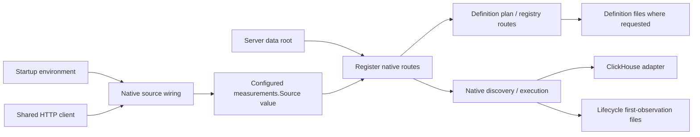

# HTTP effects and dependency boundaries — C2 first cut

This inventory describes the current Go server routes, not a new API. Browser
`/api` proxy mapping remains in Python. `serve-http` loads binding/inventory and
operation packages at startup, expands plans, builds one 15-second HTTP client,
registers route families and wraps the mux in `newQueryBudget(..., 4)`. Server
header timeout is five seconds; write timeout is 90 seconds. Pure planning, source
execution, filesystem publication and XTDB transactions retain different owners.

## Endpoint effects

Limits below are request JSON byte ceilings, not result or measurement limits.
Validation may reject smaller requests. Route-specific codes/messages and source
family limits remain authoritative in code/tests; this table groups related routes.

| Routes / owner | Effect | Request ceiling / execution lifetime |
| --- | --- | --- |
| GET `/http-package`, `/operations`, `/counter-rates`, `/histograms` in `serve_http.go` | Execute ClickHouse reads; operation views can issue multiple reads | Query parameters; shared client 15s per HTTP request, incoming context |
| GET `/operation-packages` | Return startup declarations; no telemetry | Query validation, no body |
| GET `/measurement-packages`, `/investigation-workflows` | Read definition/workflow files; no telemetry | Catalog/file bounds, no body |
| POST `/measurement-packages/plan` | Validate/compile native definition; no source or publication | 64 KiB |
| POST `/measurement-packages` | Publish canonical YAML; preserve existing duplicate policy | 64 KiB; filesystem |
| POST `/metric-discovery` | Query native instrument inventory | 64 KiB; 15s context |
| POST `/measurements` | Execute native measurement; lifecycle may create first-observation custody files | 64 KiB; 15s context |
| POST `/inventory`, `/discovery`, `/explore` | Query ClickHouse; Explore also freezes a bounded process-local result-page capability when possible | 16 KiB; 15s / 30s / 55s contexts |
| POST `/compare` | Compare supplied summaries; no telemetry query | 1 MiB |
| POST `/tail` | SSE polling reads; own four-slot budget, bounded stream lifetime and write deadlines | 16 KiB; 60s context, 2s polling, 5s per-write deadline |
| GET `/investigations/{id}` | Reopen immutable operation capture; no telemetry | File bounds |
| POST `/investigations` | Read operation/rate/histogram evidence and publish a capture; refresh checks parent question/package revision | 16 KiB; incoming context and shared HTTP client |
| GET `/captures`, `/captures/{id}` and suffixes `followups`, `compare`, `windows`, `receipt` | Read/page/recompute from saved evidence; no telemetry reread | File/catalog/cursor bounds |
| POST `/captures` | Execute source family and publish immutable evidence; refresh retains original question | 16 KiB; 55s context |
| POST `/captures/live` | Read fresh evidence against a saved baseline and hold expiring drafts, or freeze a held draft into immutable capture files without a reread | 16 KiB; read branch 55s context; draft budget separate |
| GET `/recipes`, POST `/recipes` | Return templates / plan supplied question; no telemetry | POST 16 KiB |
| POST `/dashboards/plan` | Plan from supplied inventory/declarations; no telemetry | 256 KiB |
| POST `/telemetry-packages/draft`, `/numeric-plan`, `/plan` | Build/validate/compile reusable definitions; no telemetry | 64 KiB |
| POST `/telemetry-packages`; GET collection or `/{revision}` | Publish or read reusable definition files | POST 64 KiB; store bounds |
| POST `/population/plan` | Plan typed population transformation; no telemetry | 128 KiB workbench decoder |
| GET/POST `/annotations`, `/exploration-views`, `/deployments`, `/documents`, plus GET `/{id}` | Read/publish authored context; document creation checks references and can verify pinned XTDB review citations | POST 128 KiB; citation checks 30s each |
| POST `/captures/comparisons`; GET `/captures/comparisons/{id}/receipt` | Recompute/save comparison context from saved captures; no telemetry reread | POST 128 KiB |
| GET `/retained-evidence/status` | Report optional XTDB configuration; no database probe | No body |
| GET retained collection, manifest, annotations/history or pinned revision | Read XTDB metadata/custody; await-token lower bounds remain separate | 30s contexts |
| POST `/retained-evidence` and `/{id}/annotations` | Freeze selected saved/server-held rows or correct review metadata in XTDB; request recovery may precede publication; no ClickHouse reread | 16 KiB; 30s contexts |
| POST `/queries/{id}/cancel` in budget wrapper | Cancel/mark a query capability; no source publication | Wrapper validates UUID and capability budgets |

The global query budget currently controls only POST metric discovery, native
measurements, inventory, discovery, Explore, captures and live comparisons. It
adds a 60-second outer context and handles optional query IDs. GET executions,
operation investigations, tailing and retention are not all covered by that
wrapper; tailing retains its own slots. This extraction does not broaden budgets.
A GET method therefore does not establish source-free behavior, and a source read
does not establish absence of filesystem custody effects.

## Decoder, response and stream policies

Most JSON route families disallow unknown fields, cap the body and refuse a second
JSON value. Trailing-value messages differ (`one JSON object required`, `expected
one JSON object`, `require one JSON object`); helpers must retain these choices.
Malformed/body-limit errors normally return 400 rather than universally using 413.
Live snapshot size limits can return 413; capacity can return 429. Saved-reference,
refresh, backend and optional-store failures retain per-route 404/409/410/502/503
policies. The current native success/failure and YAML duplicate response fixtures
are in `testdata/storage` and the native route tests.

JSON/no-store is common, not universal: early tail errors currently set JSON but
not no-store; successful SSE sets `text/event-stream`, no-store and
`X-Accel-Buffering: no`. Some inline GET handlers use `http.Error`, whose content
type/body differ from JSON encoder failures. Default mux 404/405 responses retain
Go's behavior. SSE emits reset/stream events and must preserve flush, cancellation,
continuity caveats and disconnect handling. Do not route streaming through a
buffered JSON responder or silently standardize these policies in a refactor.

## Startup dependencies: delivered native slice

`nativeMeasurementSourceFromEnvironment` resolves native ClickHouse endpoint,
credentials and the HTTP client at startup. Empty endpoint retains
`http://localhost:8123`. `registerMeasurements` receives an existing
`measurements.Source` value; handlers no longer read ClickHouse environment
variables. Its custody directory remains derived from the supplied server data
root. Registration copies source strings; the HTTP client remains a shared pointer.
Process environment mutation is not a native configuration reload mechanism.

This is one adopted family. Inline operation GET handlers, exploration/captures/
investigations/tail still resolve ClickHouse environment at request time. Retention
snapshots `GOO_XTDB_URL` on registration, while document citation checks currently
read it at request time. Definitions/workflow paths still depend on working
directory; result snapshots remain process-global and live comparison drafts remain
registration-local. These are explicit remaining boundaries, not unified services.

## Checks and next cuts

Existing native registry/preview/YAML fixtures pass before and after injection.
Two injected backends return different gauge values with distinct credentials;
an ambient trap source receives zero requests. Tests prove injected client use,
source-free planning, native/discovery routing, invalid-input rejection before reads,
request cancellation and absence of gauge/discovery lifecycle files. Startup tests
pin default endpoint and configuration snapshot behavior. The full HTTP race suite
retains budget, SSE, capture and optional-store tests.

C2 remains active. Next, freeze decoder/response cases for two pure planning routes
and share only matching mechanics with explicit byte/message policies. Then migrate
additional source families to injected startup dependencies. Bounded ClickHouse
transport extraction follows one family at a time, preserving parameter escaping,
read limits, basis/identity and non-2xx/oversize/cancellation behavior. Python proxy
removal, changing custody/duplicate policy and universal endpoint budgets are not
part of this cut.
