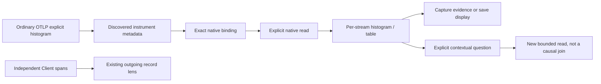

# Native HTTP-client duration observations

Implemented and accepted in milestone 392; final acceptance is recorded in
[validation](../VALIDATION.md).

Services recognizes the stable OpenTelemetry `http.client.request.duration`
explicit histogram in seconds. It uses the existing per-stream histogram
evaluator, native instrument picker, retained Histogram/Table display and
measurement capture/reuse workflows. No manifest, new query executor or
metric-to-span join is required.

## Source contract

The instrument capability profile is `http-client-request-duration`, pinned to
[OTel semantic conventions v1.45.0](reviews/HTTP_CLIENT_METRIC_REVIEW_392.md).
Shape recognition requires the exact metric name, explicit histogram kind and
literal unit `s`. Execution separately requires a valid supported definition and
delta (`1`) or cumulative (`2`) temporality. Generic histogram support for other
units is independent; a millisecond instrument does not acquire this profile or
undergo unit conversion. Exponential histograms remain unsupported.

Scope/version/schema, resource schema, service, instance, namespace, environment
and all attributes retain their original identities. Reported schema URLs,
including omitted and custom URLs, are metadata rather than verified convention
conformance; no schema migration is inferred. Required method/address/port keys
and optional context are inspected through the existing presence matrix. Missing
or empty dimensions stay visible instead of dropping otherwise usable streams.
Presence does not validate attribute values or numerical coverage.

Advisory OTel bucket boundaries are not an admission requirement. Actual bounds
and counts drive evaluation. Delta exports, cumulative anchors, epoch changes,
gaps and flagged unavailable values keep their existing meanings. No precise
percentile is interpolated from a bucket range, and independent stream
percentiles are never averaged into a fleet percentile.

## Independent signals

| Available evidence | Services behavior |
| --- | --- |
| Qualified native metric only | Native duration option/card is available; outgoing Client-span observations are not enabled. |
| Client spans only | Existing explicit outgoing record lens is available when its own evidence requirements hold; no native histogram is invented. |
| Both | Each choice retains its own question, observations and read clock. |
| Other unit or unsupported representation | Generic supported binding or an explicit unsupported state; no client-profile qualification. |

Instrument observations are separate from exported rows, matching Client-span
records, unique requests and physical attempts. Method, destination, port and
status labels remain literal. No default port, retry count, callee identity,
remote topology or remote health is inferred.

Native defaults stay bounded by the existing dashboard limit and priorities;
explicit instrument selection remains authoritative. The outgoing record profile
can prioritize its compatible native histogram, but its selection never grants
native source authority. Conversely, recognizing the metric does not promote the
record lens or populate its required span fields.

Local disclosures, display changes and configuration reuse do not read telemetry.
Run explicitly executes the full destination question. Captures retain immutable
evidence and separate custody/source clocks; contextual Back retains supplied
evidence under its existing owner rules. Existing exemplar authority is unchanged.
