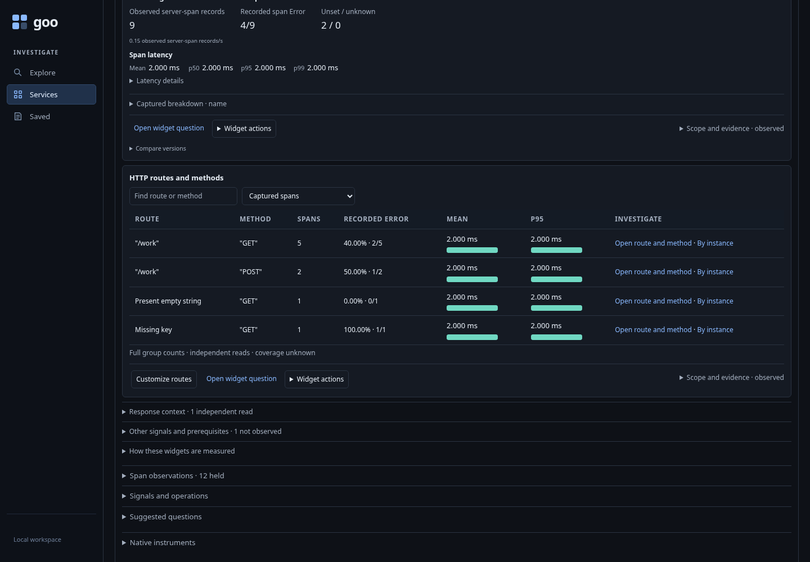

# Consolidating HTTP inspection

Status: the shared HTTP service view now groups routes and methods together.
The separate prepared HTTP panel and endpoint are **still present**. This is the
first replacement slice, not a claim that retirement is complete.

## What an operator can do now

Open a discovered service and select **Incoming HTTP**. Its existing route table
shows one row per reported route **and method**, including span counts, recorded
span Error, mean duration and p95. `GET /work` and `POST /work` no longer share a
row. Local Find searches either value. **Open route and method** stages both
constraints; **By instance** keeps both constraints while regrouping by instance.
Returning to Services uses the held dashboard without rereading.

Existing chart-template presets support one grouping field. **Customize routes**
therefore explicitly retains the route-only reusable view, with the same population
selectors and window; it does not claim to save the joint table as a chart template.
The joint widget question itself remains available through ordinary questions,
package authoring, notes and captures.

Missing and empty routes remain distinct. The view's existing HTTP admission
requires a reported nonempty current `http.request.method` on a Server span.
Response codes remain available in the existing response-context disclosure,
separate from recorded span status. Nothing infers business success from either.

The existing route widget and source-read budget are retained. The ordinary
query model already supports joint groupings; this change extends the shared
service diagnosis renderer to display and narrow all grouping fields. No new
endpoint, evaluator, source adapter, data format or chart is introduced.

[390 px layout](journeys/screenshots/http-route-method-390.png) ·
[320 px layout](journeys/screenshots/http-route-method-320.png)

## Replacement map

| Prepared HTTP behavior | Shared path / remaining difference |
| --- | --- |
| Scope by service, environment, resource attributes and library/version | Ordinary typed questions support these selectors. A replacement must carry each declared selector, not silently broaden to all service spans. |
| Group route and method together | Delivered in the existing HTTP service widget; ordinary questions and saved definitions retain both fields. |
| Request counts | Shared views count observed span records. The prepared evaluator deduplicates trace/span identities and rejects conflicting copies. These are different denominators. |
| Successful, failed and unknown requests | Prepared evaluation uses explicit configured status ranges, final-status eligibility and method presence. Shared response groups expose literal codes; recorded span Error is independent. The policy output has not been ported. |
| Success ratio | Prepared evaluation withholds a ratio when unknown outcomes exist. Do not substitute a recorded-Error percentage or independent-query arithmetic. |
| Missing route and method | Shared groups retain missing and empty route values separately. Prepared evaluation uses reserved unknown buckets and includes method-unknown requests; its population is broader than the current HTTP service admission. |
| Completeness and duplicate checks | Prepared evaluation rejects over 1,000 raw rows and conflicting identities; generic grouped queries have their own bounds and read-consistency checks. Neither establishes ingestion completeness or unsampled traffic. |
| Inspect/save/reuse a query | Ordinary widget questions, shared definitions, notes and captures already support these flows. Stored definitions and captures are retained. |
| Latency | Already provided by the ordinary service view; the prepared HTTP aggregate did not implement duration distributions. |

## Before removing the special path

1. Preserve explicit outcome-policy evaluation through the shared measurement
   path, with its selected resource/library binding and one admitted population.
2. Prove duplicates, conflicts, missing method/status, invalid/non-final status,
   custom failure ranges and unknown-ratio behavior against the prepared kernel.
   A span-record count is not an equivalent substitute for the deduplicated count.
3. Move the surviving inspection/authoring journey, then delete the special
   runtime panel, `/api/http-package`, capability flag and startup binding inputs
   together with their obsolete callers. Existing stored user work must remain.

This list describes actual semantic gaps. It does not authorize a new span
capture family, generic executor or parallel service-view framework.

## Executable walkthrough

[`http-route-method.spec.js`](../journeys/http-route-method.spec.js) emits ordinary
OTLP spans, reads the actual ClickHouse records, opens a saved inventory, and
inspects its normal HTTP service dashboard. It checks independent tuple counts,
exact rows for POST/missing/empty route drilldowns, source-free staging/return,
three viewport sizes and a Bombadil joint-group journey. The existing HTTP
response journey exercises the same renderer's single-field path.
