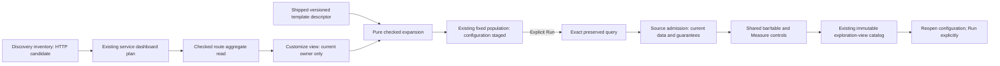

# Customize HTTP service views — 278

The **HTTP server routes** widget offers **Customize view** after a checked record
aggregate result. It expands a shipped template into the existing fixed-population
editor. This is the same query/display/save workflow as manually authored views;
there is no separate dashboard designer or second view catalog.

279 expands this template as an explicit records-plus-aggregate composition.
The first default is a compact count bar with population share. Its checked query
retains duration summaries, so **Measure** can select duration statistics locally
after Run. Counts describe captured server-span records, not unique requests,
verified HTTP outcomes, or complete upstream telemetry.



## Template and expansion boundary

The shipped descriptor is `otel.http-server-routes`, version `1`. It describes a
bounded record profile and default `goo.view/1` display, using JSON rather than
an expression evaluator. It is not arbitrary uploaded code or a general template
language. The configuration-only API is:

```text
POST /api/view-templates/expand
{ "template": "otel.http-server-routes", "version": 1, "widget": <DashboardWidget> }
→ { "template": { "id": "otel.http-server-routes", "version": 1, "title": ... },
    "view": <ExplorationView configuration> }
```

Expansion validates the query and widget profile, then retains the entire query.
It does not reconstruct a wider query from a service name. Family/state labels
alone are insufficient: the checked predicate must require an exact nonempty `column:service` equality, exact
reported Server kind and a nonempty current `http.request.method` value.
Requirements hidden inside a weakening OR are refused. Additional predicates,
namespace, environment policy, fixed window, grouping and aggregate bindings stay
intact. The response contains detached configuration, never source rows, captures,
read clocks, runtime completeness witnesses or execution authority.

The source must be a supported HTTP-server record widget with one grouping:
`attribute:http.route`. Missing and empty routes remain captured groups. Custom
nonempty method strings remain reported values; method presence does not verify
semantic-convention conformance. Client spans, missing/empty current methods,
legacy-only HTTP method keys, native metrics and other widget families do not
qualify. Recorded span Error is not silently converted into an HTTP failure policy.

## Interaction and ownership

Customize is available on current observed or no-data results; changed-between-read
results cannot enter this handoff. A delayed expansion response cannot navigate
after the service, profile, window or owner changes. The configuration is validated
before the existing investigation/population owner is changed. Returning to the
service uses the existing trail rather than an independent editor stack.

The staged editor has no imported telemetry. Customize, expansion and Save operate
on configuration; **Run population view** explicitly reads the preserved question.
Existing source/property editing, compatibility checks, immutable save/reopen and
current-scope display reuse continue to apply. No-data results remain usable intent,
without implying service health or upstream completeness.

## Scope and next step

This proves one OTel service record template. Other HTTP widgets, RPC/database/
messaging/native families, team template upload, WYSIWYG layout and whole-screen
composition are not added. Existing prepared-table prebuilts remain separate;
this descriptor does not claim to replace their measurement/policy bindings.
Saved views materialize the expansion; they do not subscribe to later template revisions.

279 delivers [records-plus-aggregate composition](RECORD_AGGREGATE_COMPOSITION.md)
under one query/read owner. Extend templates only when the profile's scope, units,
quality and action rules are explicit; another renderer migration is not a gate.
