# Customize service record views

The **HTTP server routes** widget offers **Customize view** after a checked record
aggregate result. It expands a shipped template into the existing fixed-population
editor. This is the same query/display/save workflow as manually authored views;
there is no separate dashboard designer or second view catalog.

279 expands this template as an explicit records-plus-aggregate composition.
311 adds an HTTP-method facet to eligible ordinary route views through that same
Customize path; numeric views retain their existing measure and composition.
The first default is a compact count bar with population share. Its checked query
retains duration summaries, so **Measure** can select duration statistics locally
after Run. Counts describe captured server-span records, not unique requests,
verified HTTP outcomes, or complete upstream telemetry.

```mermaid
flowchart LR
  I[Discovery inventory: HTTP candidate] --> P[Existing service dashboard plan]
  P --> R[Checked route aggregate read]
  R --> C[Customize view: current owner only]
  D[Shipped versioned template descriptor] --> E[Pure checked expansion]
  C --> E
  E --> S[Existing fixed population: configuration staged]
  S -->|Explicit Run| Q[Configured fixed question]
  Q --> A[Source admission: current data and guarantees]
  A --> V[Shared bar/table and Measure controls]
  A -->|Explicit Read values| F[Method counts in the applied scope]
  F -->|Include or Exclude: no read| T[Existing selection tray]
  T -->|Apply or Open then Run| Q
  V --> Save[Existing immutable exploration-view catalog]
  Save --> Reopen[Reopen configuration; Run explicitly]
```



## Template and expansion boundary

The HTTP descriptor is `otel.http-server-routes`, version `1`. It describes a
bounded record profile and default `goo.view/1` display, using JSON rather than
an expression evaluator. It is not arbitrary uploaded code or a general template
language. The configuration-only API is:

```text
POST /api/view-templates/expand
{ "template": "otel.http-server-routes", "version": 1, "widget": <DashboardWidget> }
→ { "template": { "id": "otel.http-server-routes", "version": 1, "title": ... },
    "view": <ExplorationView configuration> }
```

Expansion validates the query and widget profile, then retains the entire query.
It does not reconstruct a wider query from a service name. Family/state labels
alone are insufficient: the checked predicate must require an exact nonempty `column:service` equality, exact
reported Server kind and a nonempty current `http.request.method` value.
Requirements hidden inside a weakening OR are refused. Additional predicates,
namespace, environment policy, fixed window, grouping and aggregate bindings stay
intact. The response contains detached configuration, never source rows, captures,
read clocks, runtime completeness witnesses or execution authority.

The source must be a supported HTTP-server record widget with one grouping:
`attribute:http.route`. Missing and empty routes remain captured groups. Custom
nonempty method strings remain reported values; method presence does not verify
semantic-convention conformance. Client spans, missing/empty current methods,
legacy-only HTTP method keys, native metrics and other widget families do not
qualify. Recorded span Error is not silently converted into an HTTP failure policy.

## Interaction and ownership

Customize is available on current observed or no-data results; changed-between-read
results cannot enter this handoff. A delayed expansion response cannot navigate
after the service, profile, window or owner changes. The configuration is validated
before the existing investigation/population owner is changed. Returning to the
service uses the existing trail rather than an independent editor stack.

The staged editor has no imported telemetry. Customize, expansion and Save operate
on configuration; **Run population view** explicitly reads the preserved question.
Existing source/property editing, compatibility checks, immutable save/reopen and
current-scope display reuse continue to apply. No-data results remain usable intent,
without implying service health or upstream completeness.

## Scope and next step

296 adds [authorable view templates](AUTHORABLE_VIEW_TEMPLATES.md) in the existing
view catalog and a Database client activity preset. The DB preset requires Client
kind and nonempty current `db.system.name`, grouped by `db.operation.name`. Other
RPC/messaging/native families, WYSIWYG layout and whole-screen composition remain
separate work. Existing prepared-table prebuilts remain separate;
this descriptor does not claim to replace their measurement/policy bindings.
Saved views materialize the expansion; they do not subscribe to later template revisions.
Eligible ordinary HTTP/DB expansions can retain the explicit reusable-template
binding; numeric HTTP expansions preserve their query without that binding.

279 delivers [records-plus-aggregate composition](RECORD_AGGREGATE_COMPOSITION.md)
under one query/read owner. Extend templates only when the profile's scope, units,
quality and action rules are explicit; another renderer migration is not a gate.


## Method facet and reusable binding — 311

> Delivered in 311. See [validation](../VALIDATION.md) and the
> [current executable storyboard](journeys/311-http-method-facet.md).

For an eligible ordinary HTTP-server route widget, **Customize HTTP route view**
stages a composition with an **HTTP methods** facet before the route chart and
records. The field is exactly `attribute:http.request.method`; it complements the
route grouping rather than repeating it. Customize is configuration-only. Run
reads the configured population; **Read values** separately reads method counts
in that applied scope. Neither opening the view nor Run silently loads values.
Include/Exclude uses the existing pending tray and explicit Apply/Open/Run flow.

The original supported widget question remains intact: exact service, environment
policy, fixed bounds, required Server kind, nonempty current method and all extra
conditions/grouping/measures survive expansion. Missing/empty current methods,
client spans and legacy-only method attributes do not become server requests.
Counts still describe captured span records, with independent reads and unknown
upstream coverage. This is not a unique-request or HTTP-success inference.

The facet uses the existing ordinary-record profile. If the checked HTTP widget
has an authored numeric projection incompatible with facets, Customize retains
that question and its existing data-only composition without the new default
facet. It never strips the measurement to manufacture an ordinary count view.
Authored facet definitions remain strict: they cannot use that default omission
rule to hide an invalid declared control.

Ordinary category templates can now retain a validated facet beside aggregate and
records, including an otherwise valid hidden facet. The category remains the
explicit `group: destination` input. The facet field, title, applied-scope basis
and visibility remain literal presentation/control intent; they are checked
against the destination and never rewritten to its grouping field. No source
question, loaded counts or pending selections are copied. Same-signal/profile
requirements still apply, and facet-plus-comparison remains refused.

Presentation edits preserve the valid template binding. Save/export/reopen use the
existing immutable catalog and portable definition path; reopening stages intent
for Run, and destination reuse starts with unloaded facet values. A records-plus-
facet view without an aggregate is still an ordinary saved view, not a category
template. This extends the 310 control contract without adding a new acquisition
owner, template registry or query language.

The checked [HTTP service YAML](../config/views/http-server-routes.yaml) carries
the reusable HTTP profile, route chart, literal method facet and records through
the existing portable/CLI validator.

See [declarative facets](DECLARATIVE_FACETS.md),
[architecture review](reviews/HTTP_FACET_ARCHITECTURE_311.md), and
[design review](reviews/HTTP_FACET_DESIGN_311.md).
