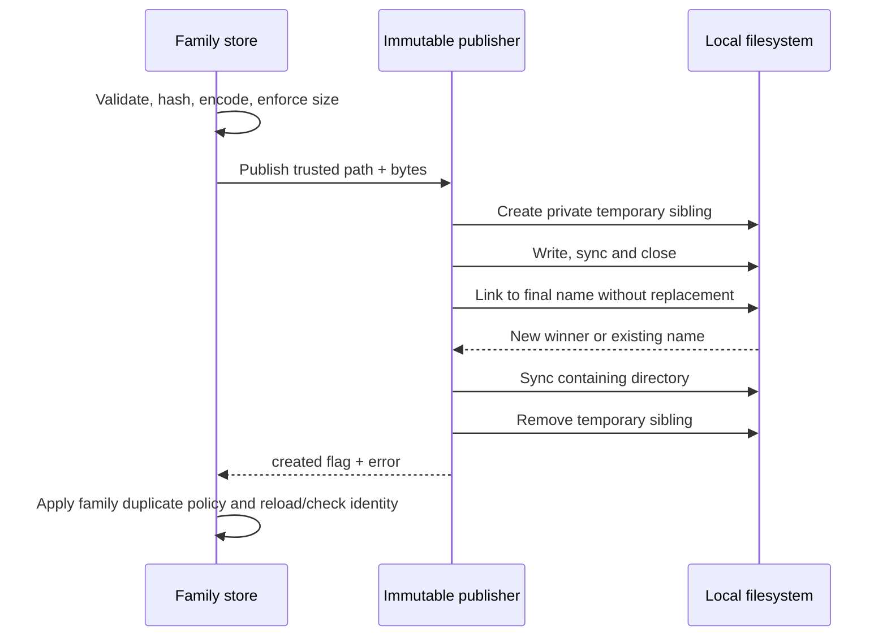

# Immutable file publication — C1 first adoption

Reusable telemetry packages (`exploration.PackageStore`) and workbench artifacts
(`workbench.Store`) now share `internal/immutablefile.Publish`. This is filesystem
mechanics only. Callers provide trusted directory/name/prefix and already encoded
bytes; they retain validation, size limits, identity, canonicalization, lineage,
catalog rules and authoritative reloads. No stored schema or HTTP response changes.

Before extraction, `testdata/storage` froze one reusable OTel span package and one
deployment marker. Package revision hashes cover the definition bytes; deployment
identity hashes the typed envelope with an empty ID, including its independent
recorded and event times. The fixture tests passed against the old implementations
before the helper was introduced. The same tests run afterward and check exact
stored bytes/IDs, reopen, duplicate publication, refusal of truncated/foreign-field/
digest-mismatched objects, preservation of a corrupt winner and scratch cleanup.

`created=false, err=nil` means a name already existed, not that it contained valid
or matching bytes. Both current consumers retain their previous duplicate policy:
keep the winner and let the family loader check it. Workbench's private publisher
alone does not validate the winner; its public create methods subsequently load it.
No repair or overwrite is implied. An error after a successful link can coexist
with a published file. Existing directory/file modes remain 0700/0600 for newly
created objects; existing permissions are not changed. Deferred temporary cleanup
and its ignored removal errors retain the previous behavior. Sync calls do not
establish power-loss durability; no crash/power-loss experiment is claimed.

## Store inventory and remaining C1 work

| Owner | Current contract | Adoption |
| --- | --- | --- |
| Workbench artifacts | Typed JSON, family hash/validation, 128 KiB limit, subdirectory catalogs, reload after create | Shared publication mechanics; deployment golden fixture |
| Reusable telemetry packages | Typed definition hash, 32 KiB limit, idempotent duplicate then verified reload | Shared publication mechanics; package golden fixture |
| Exploration captures | Embedded exact evidence, family digest/plan/parent checks, 24 MiB limit, duplicate then reload | Existing writer retained; freeze capture-specific fixtures next |
| Investigation captures | Number-preserving embedded JSON digest, 24 MiB limit, parent question compatibility, duplicate link is an error | Existing writer retained; preserve collision policy when adopting |
| Lifecycle first-observation custody | Identity excludes received time; first winner supplies custody time; no directory sync today | Existing writer retained; pin clock and race behavior before adoption |
| Native measurement YAML route | Validated typed definition identity, YAML bytes; existing winner accepted; no directory sync/reload today | Existing writer retained; pin route response and corruption behavior before adoption |

Existing store tests cover branching/parent mismatch and exact large embedded
integers; the two new golden fixtures are not exhaustive identity coverage for all
workbench families or evidence stores. C1 remains active until those boundaries are
pinned and matching mechanics replace the remaining copies without moving semantics.

## Verification

The real filesystem race test launches 24 competing distinct complete payloads and
requires one complete winner, no replacement, private file mode and no temporary
leaks. Failure tests cover a non-directory storage path and a link failure after a
successful temporary write. A separate Hegel campaign generates 100 sequences of
2–12 writes with zero-to-4096-byte initial payloads, preserving the first bytes
through every duplicate and fresh read. These are filesystem checks rather than
new UI/model protocols; existing browser storyboards and Quint transition models
are unchanged. There is no new UI screenshot for this backend-only extraction.
