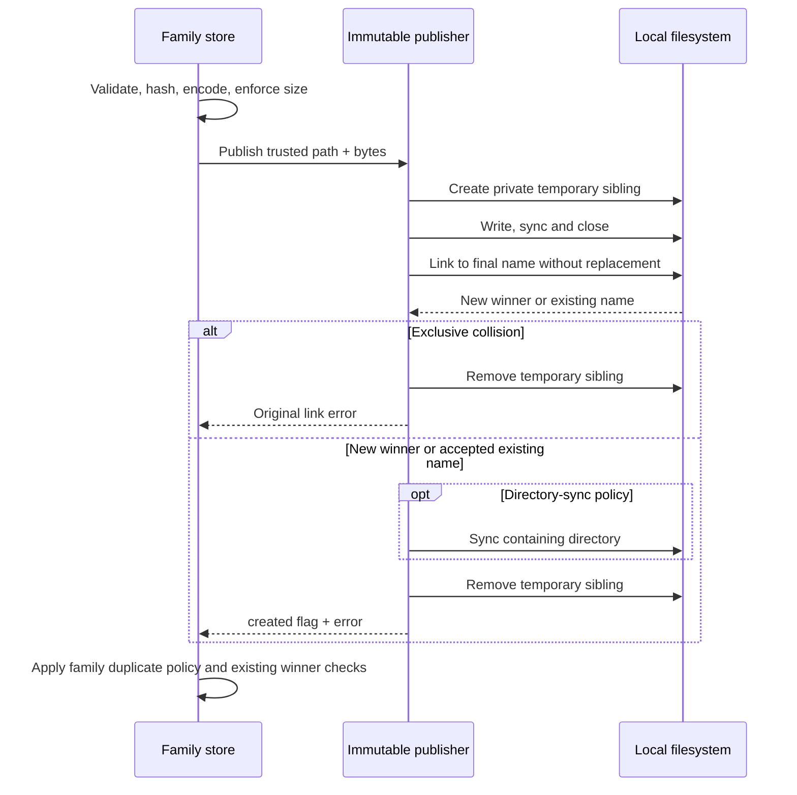

# Immutable file publication — bounded C1 delivered

Reusable telemetry packages (`exploration.PackageStore`) and workbench artifacts
(`workbench.Store`) share `internal/immutablefile.Publish`. Exploration captures
use that path too; investigation captures use its exclusive `PublishNew` entry.
Lifecycle custody and native YAML publication use `PublishFileOnly`, which syncs
the file and links without adding a directory sync.
This is filesystem mechanics only. Callers provide trusted directory/name/prefix and already encoded
bytes; they retain validation, size limits, identity, canonicalization, lineage,
catalog rules and existing winner verification. The original C1 extraction preserved
native YAML POST's lack of winner reload. M2 now validates that existing winner before
reporting success; the shared helper and stored schema remain unchanged.

Before extraction, `testdata/storage` froze one reusable OTel span package and one
deployment marker. Package revision hashes cover the definition bytes; deployment
identity hashes the typed envelope with an empty ID, including its independent
recorded and event times. The fixture tests passed against the old implementations
before the helper was introduced. The same tests run afterward and check exact
stored bytes/IDs, reopen, duplicate publication, refusal of truncated/foreign-field/
digest-mismatched objects, preservation of a corrupt winner and scratch cleanup.

`created=false, err=nil` means a name already existed, not that it contained valid
or matching bytes. Idempotent consumers keep the winner. Package, workbench and exploration
consumers retain verified reloads. Custody reloads the event; native YAML POST
validates the existing regular file with a bounded 32 KiB read, package validation
and expected revision check before returning the submitted-definition response. Workbench's private publisher
alone does not validate the winner; its public create methods subsequently load it.
Investigation captures instead retain their original exclusive link error through
`PublishNew`; a collision returns the actual `*os.LinkError` without a directory
sync, as before. No repair or overwrite is implied. An error after a successful
link can coexist with a published file. Existing directory/file modes remain 0700/0600 for newly
created objects; existing permissions are not changed. Deferred temporary cleanup
and its ignored removal errors retain the previous behavior. Sync calls do not
establish power-loss durability; no crash/power-loss experiment is claimed.

## Store inventory and compatibility policies

| Owner | Current contract | Adoption |
| --- | --- | --- |
| Workbench artifacts | Typed JSON, family hash/validation, 128 KiB limit, subdirectory catalogs, reload after create | Shared publication mechanics; deployment golden fixture |
| Reusable telemetry packages | Typed definition hash, 32 KiB limit, idempotent duplicate then verified reload | Shared publication mechanics; package golden fixture |
| Exploration captures | Embedded exact evidence, family digest/plan/parent checks, 24 MiB limit, duplicate then reload | Shared idempotent publication; exact capture/page fixtures |
| Investigation captures | Number-preserving embedded JSON digest, 24 MiB limit, parent question compatibility, duplicate link is an error | Shared exclusive publication; number-preserving capture fixture |
| Lifecycle first-observation custody | Identity excludes received time; first winner supplies custody time; no directory sync today | Shared file-only publication; exact event/clock fixture and distinct-clock race |
| Native measurement YAML route | Validated typed definition identity, YAML bytes; existing winner accepted; no directory sync/reload today | Shared file-only publication; canonical YAML/revision/HTTP response fixtures |

Existing tests retain branching/parent mismatch, exact large embedded integers and
family-specific validation. Golden fixtures cover selected examples, not every
artifact subtype. All six Go temporary-write/link paths now use this helper;
C1's bounded mechanics consolidation is delivered. No reader, hash, schema,
catalog, HTTP response or trust policy was unified. C2 endpoint-policy/startup
inventory is next in the active plan.

## Verification

The real filesystem race test launches 24 competing distinct complete payloads and
requires one complete winner, no replacement, private file mode and no temporary
leaks. Failure tests cover a non-directory storage path and a link failure after a
successful temporary write. A separate Hegel campaign generates 100 sequences of
2–12 writes with zero-to-4096-byte initial payloads, preserving the first bytes
through every duplicate and fresh read. These are filesystem checks rather than
new UI/model protocols; existing browser storyboards and Quint transition models
are unchanged. There is no new UI screenshot for this backend-only extraction.

## Capture continuation fixtures

The exploration fixture pins typed-envelope identity, exact raw evidence integers,
independent source-read/receipt timestamps and the complete first-page JSON
response. Duplicate publication reloads and rejects a corrupt existing winner
without replacing it. Its strict envelope decoder still refuses unknown fields,
truncation, digest mismatch and trailing JSON. Foreign receipt cursors and changed
refresh questions remain refused. Existing tests retain native, inventory,
comparison, source-plan and concurrent capture behavior.

The investigation fixture pins its distinct Number-preserving embedded JSON
normalization: changing key order preserves identity; changing a large integer
does not. Reopen preserves original evidence bytes, a valid refresh retains its
parent, and changed parent questions remain refused. This loader historically
ignores unknown fields; the fixture makes that policy explicit rather than changing
it during a filesystem refactor. Truncation, digest mismatch and trailing JSON
remain refused. The exclusive publisher test pins link-error type/existence
classification and preserves original bytes on collision.

Both fixture tests passed on the old writers before migration. They now accompany
the same affected race suite and generated duplicate-write sequences; Hegel also
requires exclusive duplicate attempts to return an existence error on every step.
No new UI or execution-state protocol is introduced.

## Custody and native YAML continuation fixtures

The lifecycle fixture pins an exact business timestamp and the first Goo observation
clock as decimal nanosecond strings. Identity excludes received time; caller-supplied
received time is ignored. Reobserve with an earlier proposed clock preserves the
existing winner. Changing the business payload creates independent custody. Sixteen
concurrent distinct observation times must all return one winning event/clock.
Truncated payloads, changed business identity and non-integer received clocks are
refused without repair. This is trusted local custody: a syntactically valid integer
edit to received time is not detected by the event hash. The fixture records that
existing boundary rather than implying tamper-evident custody.

The native fixture uses an ordinary `api` gauge definition with an OTel-style
metric name. It pins canonical YAML bytes, typed revision, exact POST JSON, 201
status and JSON/no-store headers. A fresh registry reopens the package. Invalid
YAML, unknown request fields and trailing JSON remain 400. Duplicate publication
keeps valid existing bytes and returns the same submitted-definition response.
M2 deliberately revises the historical corrupt-winner success policy: an invalid,
unavailable, oversized or wrong-revision winner returns 400 without repair or
overwrite. A valid noncanonical representation and an exactly 32 KiB package remain
accepted. Concurrent valid duplicates reopen successfully and leave no scratch files.
This is caller-side winner verification, not a crash-durability guarantee.

Both fixture sets passed before replacing their writers. `PublishFileOnly` retains
file sync and intentionally omits directory sync for these callers. The generated
publication campaign now chooses either syncing policy for the initial winner and
checks idempotent, file-only and exclusive duplicates throughout each sequence.
These checks do not inject sync failures or simulate power loss.

| Bounded C1 acceptance | Evidence / scope |
| --- | --- |
| Identity and response parity before extraction | Selected golden fixtures across all six publication families; exact capture-page and native POST response bytes |
| Exact integers and clocks | Raw uint64 evidence, native nanosecond question checks, custody event/observation strings |
| Duplicate/no-overwrite and reopen | Idempotent/exclusive/file-only policies, fresh loaders/registry and retained corrupt winners |
| Family validation and lineage | Existing parent/plan/branch tests; strict versus permissive decoders and native duplicate limitations remain explicit |
| Proven shared mechanics | One temporary-write/file-sync/link implementation, caller-specific directory-sync and collision policy; old copies removed |
| Concurrency and generated sequences | Race-enabled affected suites, complete-winner competition, distinct custody clock race and 100 Hegel sequences |

Power-loss durability, tamper-evident custody and native duplicate repair remain
outside this mechanical extraction. Any policy change needs its own explicit
contract and validation.
