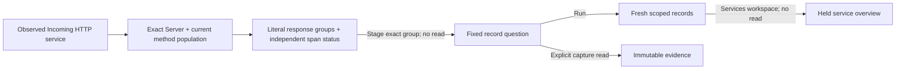

# Incoming HTTP response context

Open an observed service's **Incoming HTTP** overview, then expand **Response
context**. **Reported HTTP response status** groups the full matching Server-span
population by the qualified current `http.response.status_code` attribute. Opening
the disclosure itself reads no telemetry; its widgets retain independent reads
and expose pending/unavailable/changed states while closed.

The population is the existing exact service, namespace, environment policy and
fixed window, restricted to Server spans with a nonempty current
`http.request.method`. Response-code presence is not an admission condition.
Missing, empty and unexpected literal codes remain distinct. Legacy
`http.status_code` is not an alias; a span reporting only that key remains in the
missing-current-code group. A native HTTP instrument without observed spans does
not establish this span population.

Recorded span Error is shown separately. A reported response code does not define
request identity, success, availability, an SLI denominator or backend failure.
Record pages and ranked group limits do not define full population counts.

A response group stages an ordinary typed record question, preserving its exact
literal, missing or empty predicate and the parent scope. **Run** reads explicitly.
Save the question or capture its fixed scope using the existing controls; capture
is a separate source read. Returning to **Services & resources** restores the held
overview without rerunning its profile. Pending, hidden, inert and retired context
actions cannot leave the accepted owner.

See [service dashboards](SERVICE_DASHBOARDS.md),
[outgoing HTTP](OUTGOING_HTTP.md) and [validation](../VALIDATION.md).
