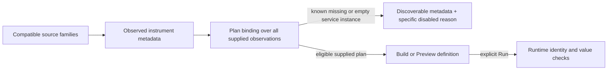

# Discover an instrument, then preview a usable binding

Measurements and Services use the same supplied capability plan to enable Build
or Preview. The action requires a supported instrument kind, a generated
definition and an eligible metadata plan. The renderer and the action callback
check that same rule; changing or withdrawing the current view retires the action.

Automatic Services overview candidates use the same readiness check before the
existing compact planning projection. Ineligible instruments remain in the observed
metadata cards with their reasons; they do not trigger automatic widget reads.
This is browser scheduling policy, not API authorization. The public planner
remains metadata-only and runtime validation remains authoritative.

A disabled action shows its specific reason. Metadata, convention hints and source
coverage qualifications remain in native disclosures. Exported-point and
instrument counts stay visible without opening details.

## Service instance identity

Current **service measurement evaluation** requires a reported, nonempty
`service.instance.id`. Discovery checks every supplied resource observation for
known missing or empty instance IDs, including observations beyond the 25 streams
shown in the metadata preview. One known incompatible observation makes the broad
service binding ineligible. Missing and present-empty values remain distinct.

This is Goo's current service evaluator policy, not a universal OTLP requirement.
Host, pod and container resource bindings retain their own identity rules. No
instance identifier is synthesized, and metadata/source discovery still succeeds
when a service instrument cannot be evaluated by this policy.

Absent observations and unavailable resource maps are unknown. They do not become
invented missing instances. A structurally usable preview without observed identity
coverage is still not proof that values, intervals, temporality or future source
rows satisfy the evaluator.

## Preview and evaluation remain separate

A metadata plan has not run the measurement. Preview validates a definition;
explicit Run reads and evaluates source observations. Existing runtime guards
continue to check the actual data. Newly arriving incompatible streams, invalid
values or interval/reset problems can still refuse evaluation after a prior
eligible preview.

[Metric scope discovery](METRIC_SCOPE_DISCOVERY.md) keeps valid scope selection
available for metadata exploration. [Roadmap](ROADMAP_2026_11_14_CHECKPOINT_430.md)
tracks the separate design question of generic resource/scope/instrument/attribute
stream evaluation.

[Executable storyboard](journeys/instrument-preflight.md) · [Validation](../VALIDATION.md).
