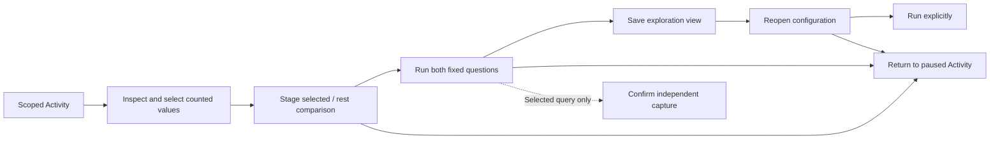

# Preserve an investigation and return

Status: implemented consolidation; final source/frame UX and accessibility
follow-up is accepted.
Actual browser, exploratory and native verification execution belongs in
[validation](../VALIDATION.md).

An operator should be able to narrow ordinary telemetry, compare selected values
with the rest of that fixed scope, preserve the comparison's configuration, reopen
it, and return to the held Activity without rebuilding the investigation.
This consolidates the existing owners and artifact types; it adds no source engine
or preservation format.

## Choose what to preserve

| Choice | What it retains | Source effect |
| --- | --- | --- |
| Selected question | One signal's selected query and fixed UTC window | Sharing/staging reads nothing |
| Exploration view | Both comparison questions and their presentation | Saving/reopening configuration reads no telemetry |
| Selected-query capture | A new immutable receipt for the selected query | Confirmation independently rereads that query |
| Held Activity | This tab's existing observations and controls | Return reads nothing |

This contextual Capture action does not capture the pair. The application already
supports immutable comparison receipts through other existing surfaces; adopting
that path here is the next depth item. The selected and rest operands have
independent source clocks. Capturing the selected query must not imply that the
rest operand or the currently displayed records were frozen. Saving a view
stores the questions and presentation, not those observations.

In a comparison's existing **Preserve** menu, selected-only actions identify that
scope in their names. **Save exploration view** preserves both sides. Opening the
saved view stages its fixed configuration; only **Run** reads the two populations.
The existing **Use fresh** action remains an explicit window change.

## Metadata tools before the first read

The existing **Saved exploration views** disclosure is available in the fixed
question builder's advanced options before a telemetry read. It exposes the same
saved-view and portable-YAML import controls used in an active population's
**View settings**. One DOM owner moves between those existing hosts; there is no
second import form, hidden-control bypass or requirement to run an arbitrary
question merely to import configuration. Preview/import/store operations remain
separate from telemetry acquisition. Main-entry Recent/Pinned recall of exact
saved-view references is still the next breadth item.

## Retained state and authority

Held data, local selections and the actual opener may survive a child view.
Retaining the same question is not permission to load data, publish late responses
or invoke hidden controls. Current ownership, native control readiness and request
generation remain fresh checks. Replacing a scope retires old handlers even if
identical query values return later.

An already-issued explicit save may finish storing its definition after its
panel closes; closure is not an undo of publication. Save and metadata-load
responses must obey the same adoption rule: only the current
context may adopt the receipt, update saved identity or restore focus. A saved
configuration may be reopened after its originating source result has departed,
but the earlier held observations must not be relabeled as its new result.

[Executable storyboard](journeys/investigation-reuse.md) distinguishes
source/store budgets, actual documentation frames and executed checks. The current
426 executable exercises saved configuration only, not pair capture.
