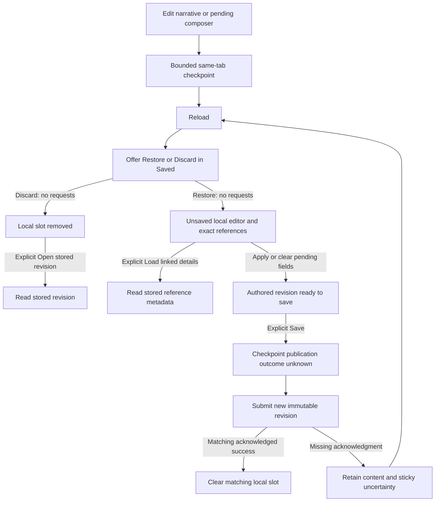
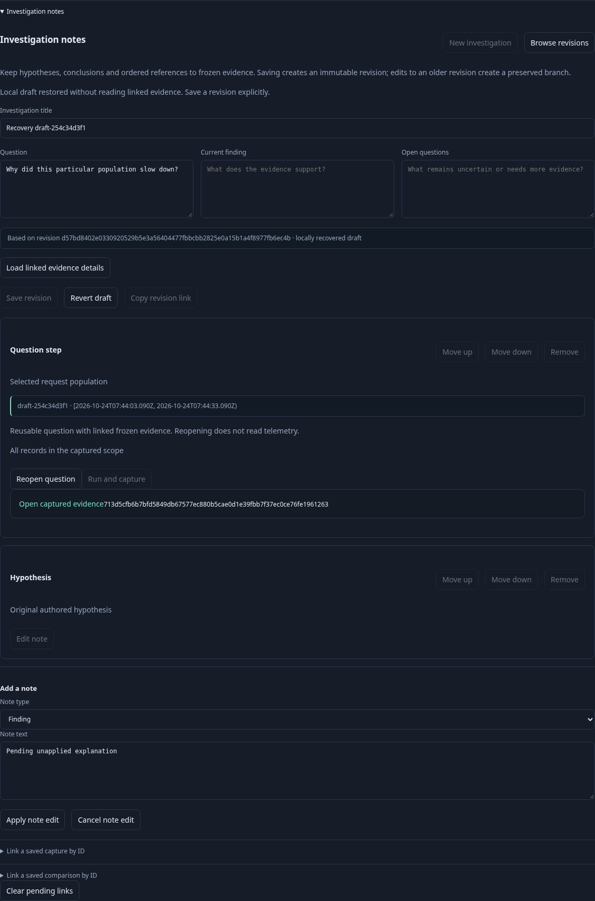
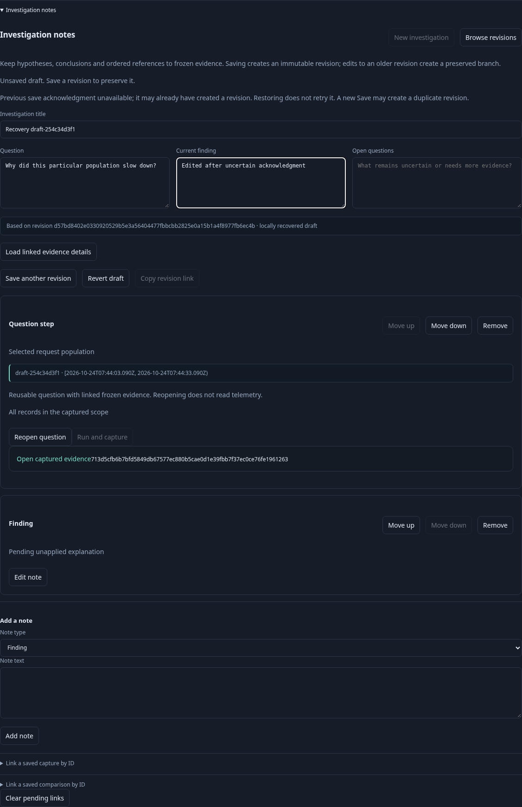
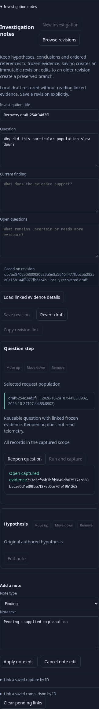

# Ordinary investigation draft recovery

Status: implemented bounded M4 behavior; independent acceptance evidence is recorded below and in VALIDATION.md. Native evidence retry journals keep their independent protocol.

## Scope and storage

Recover the ordinary investigation editor after an accidental reload in the same browser tab. Use one versioned `sessionStorage` slot scoped by application pathname; the browser already partitions by origin. This is not cross-device or cross-tab persistence. Closing a tab usually removes its session storage; a browser may restore a session. An opener-created tab can inherit a copy, but subsequent changes are independent. No tab can overwrite or clear another tab's slot, so a shared cross-tab compare-and-set protocol is unnecessary. If implementation chooses shared `localStorage` instead, this design must be revised: read/compare/write alone is not atomic and does not satisfy the overwrite requirement.

Expire the slot seven days after its last successful checkpoint. Bound the serialized UTF-8 payload to 256 KiB. Validate a draft shape, not publication readiness: incomplete title/brief and blank composer are legitimate drafts. Enforce existing UTF-8 text bounds, at most 32 cards, exact supported card shapes, unique question keys and at most 16 unique evidence references per question. Allow only enumerated schema keys so unknown telemetry payloads cannot hitchhike in the journal. Use strict recursive transport-shape allowlists for record/native steps, including native definition, binding, lifecycle and stream subtrees; the current shallow validateStep alone is insufficient. Reject unsupported fields visibly rather than silently stripping them and changing intent. Browser shape checks do not replace Go semantic validation at publication. Do not silently truncate. Oversized, corrupt, expired, unsupported-version or wrong-path data is unavailable for restoration, with explicit discard and current in-memory work left intact. Storage denial/quota failure gets a concise visible warning; do not claim recovery is confirmed.

The slot contains only authored content and exact immutable references:

- Version, app path, checkpoint identity, saved-at time and publication state.
- Original parent revision ID and recorded-at display value, or no parent for a new investigation.
- Title, question, finding, open questions and ordered validated cards, including typed question steps and exact evidence/review IDs.
- Pending note role/text and editing-card index; capture ID/caption/destination question key; comparison ID/finding; opened question key.

Never include full capture pages, reference metadata responses, telemetry payloads, credentials, transient result tokens/tail occurrence proofs, detached DOM or unrelated trail history. An existing saved retained-card read-basis lower bound is allowed where that card schema already supports it; it is not a transient source capability. Typed authored question definitions may contain selector values, so this convenience stores the user's authored investigation content in the browser, not a privacy boundary.

## Checkpoint lifecycle

Checkpoint on authored field input, card addition/removal/reorder, staging incoming evidence, pending note edits/cancellation and destination selection. Pending composer changes must be recoverable without pretending they are already applied to ordered cards. A synchronous bounded write is reasonable for this small slot; if debouncing, flush on pagehide and document the possible loss interval. Do not rely solely on beforeunload.

Use a checkpoint identity to ensure save completion only clears the exact checkpoint it submitted. Revert/discard clears only the relevant slot. A restored draft gets a new in-memory context/generation so obsolete captures or save completions cannot attach to it.

A checkpoint contains the base parent, not a claim that the parent exists or is the latest revision. Restoration must not fetch or replace it with a newer head. Missing parents are discovered only when the user explicitly opens the parent or attempts publication, according to existing server validation. Since recovery stores no original parent document, Revert must not call show() on a minimal parent stub: offer explicit Discard local draft and Open stored parent as separate actions, or fetch the parent only on an explicitly labeled action. Discard itself remains source-free.

## Explicit recovery interaction

On mount, validate the local slot and offer a compact notice in Saved/investigation notes: **Unsaved investigation available in this tab** with Restore and Discard. Show title and UTC checkpoint time when valid. Opening Activity must not acquire another global toolbar. A local pending indicator may lead to this notice, but must not initiate restoration.

Do not automatically restore, save, run, capture, retry or open the parent. If the URL targets the same parent revision, the initial shared-link handler must hold that automatic GET while recovery is pending; offer explicit Open stored revision without overwriting local recovery. An unrelated deep link may open its requested stored revision, but recovery remains pending and Restore cannot replace active dirty work. Normal show/cleanup for that unrelated stored revision must not overwrite or clear the pending recovery slot. Restore must check busy/dirty/pending state again at click time; disable it with a concise explanation until the active draft is saved/reverted. Do not silently replace a different recoverable draft when beginning new authored work; require explicit discard or return to recovery first.

Restore stages the saved authored content and composer destination exactly, marks the editor as unsaved, and changes only local UI/route state. It performs **zero network requests**, including receipt metadata. Existing document rendering currently loads reference summaries, retained reviews and comparisons; restored rendering must defer these enrichments behind an explicit **Load linked evidence details** action. Exact reference links and local question/note summaries can render immediately. The user may separately Reopen question, Run, Capture, Open evidence or Save revision using existing explicit actions.

A pending note edit restores the original card plus the unapplied composer buffer, not two applied notes. The editing index must be an in-range integer identifying a note card; legacy destination indexes must resolve an actual question. A capture destination must still identify an existing question in the restored card set; malformed indexes/keys invalidate restoration instead of falling back silently to another destination.

## Publication uncertainty

Before an ordinary Save revision POST, checkpoint the exact submitted authored draft with publication state **outcome unknown**. A confirmed successful response clears only the matching checkpoint. An interrupted/failed response retains the content and displays: **Previous save acknowledgment unavailable; it may already have created a revision. Restoring does not retry it.** The uncertainty warning stays sticky through later local edits/checkpoints; changing checkpoint identity does not erase it. Clear that marker only on matching submitted-snapshot acknowledgment or deliberate local discard. A later user Save is a new explicit publication attempt that may create a duplicate revision, not a guaranteed idempotent retry. Do not invent a successful revision ID or native retry key.

If checkpoint persistence fails, the current editor remains usable and any explicit save retains ordinary server behavior; warn that reload recovery is unavailable. Reload while a save was in flight must not automatically GET a presumed new revision or replay the POST. Existing run-and-capture and attach-to-other-revision workflows are outside automatic retry recovery: preserve authored work where available without claiming to recover a lost capture acknowledgment.

## Implementation and validation map

Keep storage/validation/expiry/checkpoint operations in a small pure/testable helper. `ui/documents.js` owns snapshot assembly, current parent, context invalidation, Restore/Discard, composer fields and save transitions. Its initial shared-link handler and remote enrichment calls need explicit recovery guards. Saved workspace composition only exposes the recovery notice; it must not own publication or source reads. Do not modify native `pending-saves` journal semantics.

Test version/path/expiry/UTF-8 bounds, existing card/step validation, invalid composer destinations, denied/full storage, checkpoint-matched cleanup, independent tab storage and unknown-save transitions. State/property checks should reject automatic effects, overwritten dirty work and stale completion cleanup. A real browser journey edits notes and pending composer/destination, reloads, explicitly restores, verifies exact parent/references and zero restore requests, then explicitly saves and reopens. Exercise corrupt data, discard, failed/uncertain save, unrelated deep link, active dirty conflict and explicit detail loading. Update the storyboard and actual affected screenshot; add bounded Bombadil restore/discard actions and no-automatic-publication invariants where those surfaces are exercised.

## Recovery and publication flow

The diagram describes the bounded policy. Completion and executed browser/model evidence are recorded in the active backlog and validation log, not inferred from this diagram.

## Executable storyboard 169–170

[169](../journeys/investigation-draft.spec.js) sends ordinary OTLP through the real
collector/ClickHouse, captures its question and creates a parent revision. The user
edits the brief and a note, plus pending link captions/destinations, then reloads.
Saved offers Restore/Discard before any automatic parent read. Restore stages the
exact local content with zero API requests, including receipt metadata. The normal
full-page application boot still loads its unrelated definition/status catalogs.
Explicit Load linked evidence details reads the actual receipt while preserving
unapplied text. Clear pending links and Apply note precede an explicit Save.

The server then commits that save but the test drops its actual response. Reload
and Restore retain uncertainty and exact references, send no retry, and leave the
next Save as a visibly separate publication. Confirmed publication clears only its
matching checkpoint. The journey also removes an obsolete question destination,
discards recovery, rejects corrupt local JSON and checks mobile containment.
[170](../journeys/investigation-draft-races.spec.js) holds a real successful response
while a newer checkpoint appears, verifies acknowledged-save/local-cleanup failure
classification and exercises quota denial without losing in-memory authored work.

The pure helper has strict structural allowlists and byte bounds; these are not
secret-content scanning. Authored selector strings can contain sensitive text.
The helper is an application recovery owner, not a display component, server
publication validator or durable/shared draft service.

