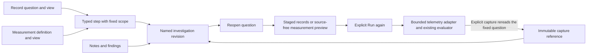
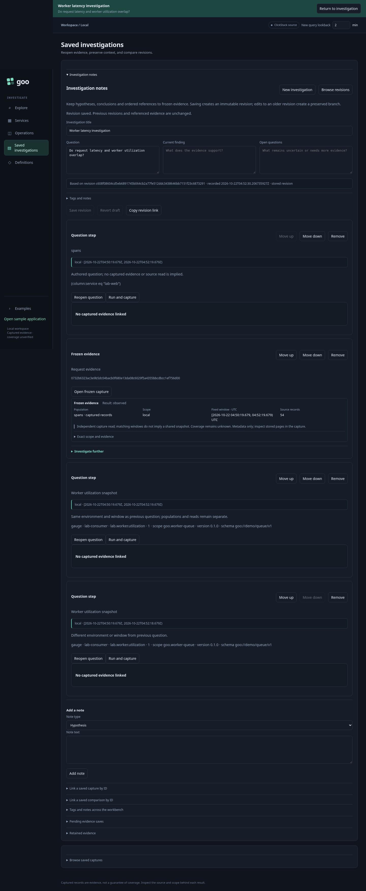
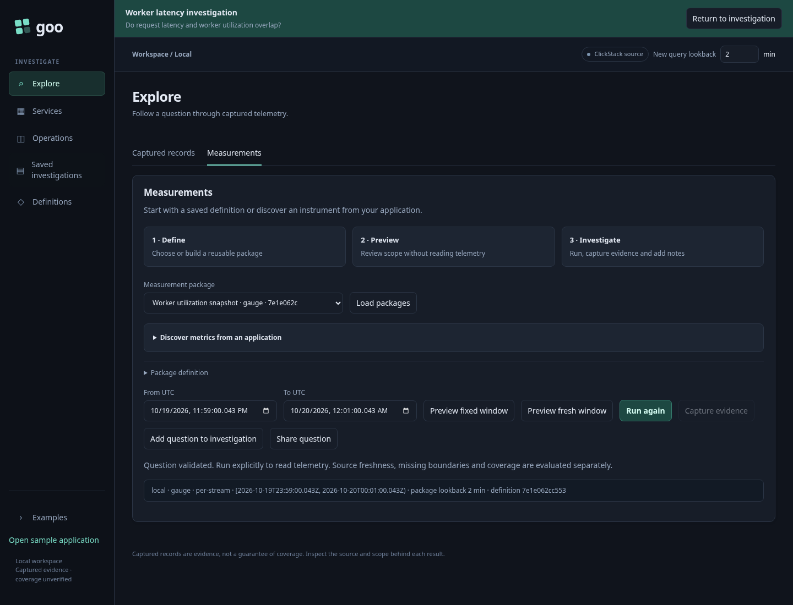
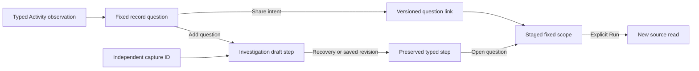

# Questions and evidence in one investigation

An investigation is a named, immutable document revision with ordered notes,
question steps and frozen evidence references. Add a span/log question from Explore
or a validated measurement from Measurements with **Add question to investigation**.
The active investigation receives a draft card; **Save revision** persists it.
Saving a question does not execute it or freeze a result.

Each question uses a versioned envelope with its kind, environment, fixed half-open
window, typed definition and selected view. Record steps retain the selector AST,
grouping and numeric binding; measurement steps retain the complete package
including service selectors, instrumentation scope/version/schema, unit and grain.
Go validates the union and rejects mismatches between envelope and definition scope.
It uses the existing bounded record and measurement validators, without weakening
native stream, temporality, reset or histogram rules.

| Card | Persists | Reopening |
| --- | --- | --- |
| Question step | Fixed scope, typed intent and view | Stages a question; requires Run again |
| Frozen evidence | Exact capture ID | Retrieves stored evidence without telemetry reads |
| Note | Hypothesis, finding, conclusion or next step | Displays authored context |

**Reopen question** stages records or validates a measurement through the existing
source-free package planner. It clears live results; **Run again** is the explicit
telemetry read. A planner request may occur during native reopening, but neither
instrument discovery nor measurement execution happens automatically. Editing a
reopened question changes its local draft; adding it again and saving creates a
new revision, preserving the earlier question and evidence.

Question cards show whether their environment and window match the previous
question card. Matching bounds do not establish identical populations, coverage or
a common read. A span record and a native metric point keep different grains.
Capture cards state that they were read independently and display the original
receipt custody timestamp; measurement results separately show their source read
time. No transactional snapshot or causal relationship is inferred.



Both question types can be shared through versioned `#step=…` URLs. Legacy
`#question=…` record links remain readable. Native URLs include the full definition;
record links keep their 16,000-character budget, and general step links have a
48,000-character budget. Definitions and literal selectors are visible in the URL.
The link conveys intent, not authorization or stored evidence. Named investigation
links continue to identify exact `#document=…` revisions. Existing documents retain
their IDs and load without conversion.

Cards remain bounded to 32 and the existing 128 KiB document limit. Native view
state currently means Overview; record views are Records or Distribution. Service
catalog search, inspector selection, baselines, unsaved keystrokes and simultaneous
collaborative editing are not serialized. Question cards now support explicit [Run and capture and linked evidence histories](LINKED_QUESTION_EVIDENCE.md).
They do not automatically refresh or adopt a mutable latest revision.

Storyboard 50 (`journeys/investigation-steps.spec.js`) uses real requests and worker
metrics, captures through the UI, saves a mixed investigation, reopens it and shares
a native step with a second browser. It checks matched/different windows, explicit
rerunning and mobile layout. Hegel exercises actual JavaScript envelope functions and extends the investigation
state/swarm model with typed-card creation and detached edits across saved forks;
Quint validates the observed save → reopen → explicit-read sequence with seven
rejecting mutations. Bombadil explores the saved question cards without running them.





Question cards may include optional `key` and ordered `evidence` capture IDs.
See the linked-history contract for publication, scope differences and recovery.


## Typed record question handoffs — 284

Record question links and investigation question cards preserve checked environment
scope. Current-only named and effective named, empty-label and unreported selectors
remain distinct. The question and step envelope must agree on checked policy and
exact fixed bounds; matching name text alone is insufficient.

Use **Share question** or **Add question to investigation** after a typed Activity
observation becomes a fixed question. In Activity analysis, open **Edit analysis**
to reveal these controls. Sharing produces a versioned question link.
Adding stages a card in the existing investigation editor; Save revision publishes
it. Same-tab draft recovery preserves the step and its selector. Neither operation
captures records or reads telemetry. Opening a question link or card stages its
fixed scope for explicit Run.

```json
{"version":1,"kind":"record","view":"Records",
 "scope":{"environment":"","environmentSelector":{
   "version":"goo/environment-selector/v1","policy":"effective",
   "scope":{"mode":"unreported"}},"fromMs":1000,"toMs":2000},
 "record":{"signal":"logs","environment":"","environmentSelector":{
   "version":"goo/environment-selector/v1","policy":"effective",
   "scope":{"mode":"unreported"}},"fromMs":1000,"toMs":2000}}
```

Question comparisons use checked environment identity. Current-only named wires
with equivalent representations can match; effective scope with the same literal
name cannot. Displayed scope labels expose policy, empty and unreported cases.
Evidence-difference checks compare scope separately from definition details.



The same envelope does not enable typed environments for measurement definitions
or reusable measurement packages. Those paths continue to refuse unsupported
scope before execution. Recent-population entry is a separate remaining handoff.
