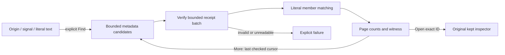

# Find kept observations by content

Status: implemented; final validation is recorded in [VALIDATION.md](../VALIDATION.md).

In **Investigations → Kept observations**, enter optional **Record text** and
choose **Find kept observations**. Goo searches already preserved records on this
server. It does not query telemetry, refresh observations or change custody.
Origin and signal filters still narrow the catalog candidates. Leaving Record text
empty performs the existing metadata discovery.

Text is a case-sensitive literal, including spaces and punctuation. It is valid
UTF-8, at most 256 bytes; there is no regex, SQL wildcard or Unicode normalization.
For each original kept member, search Body for logs or SpanName for spans, then
ServiceName, TraceId and SpanId. Other attributes, annotations and metadata are not
searched. Missing or nonstring fields do not match. A record matching several
fields counts once.

Each request verifies at most 64 candidate receipts and reads at most 32 MiB of
receipt bytes, stopping at 20 matching selections. Catalog metadata is bounded
separately to 1,000 selections. A selection contains at most 20 original records.
Counts of matching selections and records, checked selections and read bytes apply
only to the displayed search page. Eligible selections count the catalog entries
passing origin/signal filters; total counts all catalog entries. Neither is a
source-population count.

**More kept observations** continues after the last checked candidate, including
when a page has no matches. **Previous** rechecks its previous bounded page. A
zero-match page is not proof of absence in unchecked candidates or source data.
There is no accumulated search total. Ordering is newest custody time first with
ID as deterministic tie-breaker. Cursors bind the exact query and catalog basis;
new or changed keeps require restarting Find rather than silently changing a scan.

The full immutable receipt is validated before matching, and its summary must
agree with catalog metadata. An unreadable, corrupt or inconsistent candidate
fails the request; it is never counted as a nonmatch. Repair remains a separate
explicit action. Search does not write an index of record content.

Each result shows the matching-record count and one deterministic witness: the
first matching kept member and first matching field in the order above. The
snippet preserves the entire literal plus up to 32 Unicode code points on each
side (at most 320 total). It is rendered as text. **Open kept observations** uses
the original exact receipt ID and independently verifies the original records;
the snippet is not a replacement receipt or a new observation basis.
**[Open matching record](KEPT_MATCH_NAVIGATION.md)** directly inspects the verified
original member in this tab. The ordinary Open link still opens the selection;
its copied URL does not carry the ephemeral member hint.

Editing filters retires old results and pending requests without a new read.
Leaving discovery also retires pending work. Existing catalog and inspector
navigation remain the owners; no search executor, source query or new custody
format is introduced.

See the [journey](journeys/330-kept-content-search.md),
[architecture](reviews/KEPT_CONTENT_SEARCH_ARCHITECTURE_330.md) and
[design review](reviews/KEPT_CONTENT_SEARCH_DESIGN_330.md).
