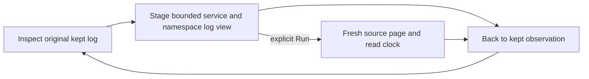

# Surrounding logs from a kept observation

Status: implemented and validated with real OTLP namespace cases, generated
properties and a bounded actor campaign.

Inspect a kept log and choose **Surrounding logs**, including when no trace ID was
reported. Goo stages a records-only log view for the same checked environment,
reported service and resource namespace. **Run** makes a fresh source read.
The trace action remains independently available when a valid trace ID exists.

The default radius is 30 seconds around the log's event time, clipped to its
original observation window. Planning includes the anchor's whole millisecond
and uses an exclusive upper bound. Tail keeps use each member's original poll
window; result-page and saved-capture keeps use their stored fixed question.
The return bar shows that original window, not the smaller context interval.
Neither Kept at nor the present clock supplies replacement bounds.

Namespace selection distinguishes a reported value, a present-empty string and a
known missing key. A supplied resource map without the key means missing; an
absent/invalid map means reporting is unknown and the action is unavailable.
Nonstrings and missing/empty service names are refused. No namespace wildcard or
service fallback is inferred. Other instances of the same qualified service can
appear; this does not identify a physical instance.

Original message, severity, trace and other record predicates are omitted so nearby
logs can appear. The question-scopes disclosure explains the expansion and exact
window. **Time proximity is context, not causality or trace correlation.** New
results carry a fresh read clock and ordinary page/coverage uncertainty; the
anchor may have disappeared from the source while its kept record remains intact.

The existing [kept continuation owner](KEPT_TRACE_CONTINUATION.md) serves both
trace and log views. Staging reads no telemetry or kept/capture content or catalog;
existing GET recipe definitions and retention configuration are counted separately.
Completed-read Back restores the same inspector, action focus and observed scroll
positions without requests. Pending-read Back may send its original query-cancel
control request; it must not reread evidence or adopt late results.

Kept bytes, digest, custody time and observation basis remain unchanged. Saving or
sharing the new view preserves the query, not its in-tab return path. No new source
executor, endpoint, product module or preservation format is needed.

See the [journey](journeys/328-kept-log-context.md),
[architecture review](reviews/KEPT_LOG_CONTEXT_ARCHITECTURE_328.md),
[design review](reviews/KEPT_LOG_CONTEXT_DESIGN_328.md) and
[validation](../VALIDATION.md).
