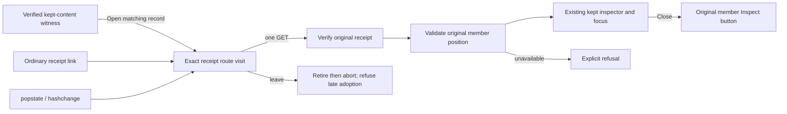

# Open a matching kept record

Status: implemented; actual checks are recorded in [validation](../VALIDATION.md).

A [kept content search](KEPT_CONTENT_SEARCH.md) result offers **Open matching
record** beside its witness. This opens the exact kept receipt, verifies its
original contents and inspects the witness's original member. **Open kept
observations** remains available for the whole selection.

The member position addresses the receipt's members array. It is not the original
result-page row index, a trace/span identity or an excerpt match. The displayed
witness does not supply replacement record contents. A missing, invalid or
unavailable member is refused explicitly; Goo does not substitute the first
record. The original receipt remains available for ordinary inspection.

The direct action is an in-tab button. Its member hint is ephemeral and scoped to
the exact receipt ID; copied receipt links still open the selection. Once loaded,
it uses the existing inspector and focuses its heading. The original record
summary appears before kept provenance, so Body/SpanName remains visible at initial
opening beneath the existing context actions. Observation basis and full details
remain available below. Close returns focus to
that member's **Inspect kept record** button in the original table.

One active kept route visit owns receipt acquisition. Browser popstate and
hashchange notifications share one pending read or reuse the already verified
rendered receipt. They do not rebuild an open inspector. Explicit matching-member
activation can select another member in the same active receipt without another
read. Ordinary Open clears a pending member hint but does not discard an already
open inspector in that visit. It remains ordinary receipt navigation.

Leaving the route retires its visit before aborting the read. A late response
cannot overwrite newer evidence, even if cancellation arrives after the server
read completed. Re-entering an earlier ID after leaving verifies it afresh.
A failed visit does not retry on passive duplicate events; an explicit Open
activation can retry. There is no cross-visit receipt cache.

The existing kept-to-trace/context continuation retains its original receipt and
inspector. **Back to kept observation** restores that retained view without a
receipt or source reread. New context queries still require their existing
explicit Run. Navigation changes neither receipt bytes nor custody time.

See the [journey](journeys/331-kept-matching-record.md),
[architecture](reviews/KEPT_MATCH_NAVIGATION_ARCHITECTURE_331.md) and
[design](reviews/KEPT_MATCH_NAVIGATION_DESIGN_331.md).
