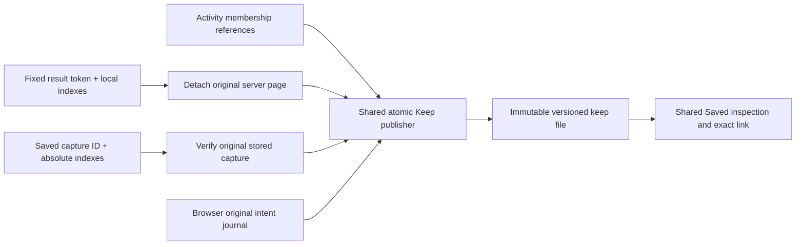

# Keep exact observations

258 supports Activity, fixed Explore results and Saved record selections. The
[fixed/Saved extension](#fixed-results-and-saved-records--258) below specifies the
current index and provenance contracts; the initial Activity slice is recorded first.

Select one or more Activity rows, then **Keep selected**. Selection pauses the
stream. Keeping requires neither a title, tags, an interpretation nor XTDB.
**Open saved** opens the selected records and their observation provenance.
Inspection, reopening and retrying do not query telemetry.

This first slice supports 1–20 server-attested log or span occurrences from one
Activity connection and selector, including checked environment scopes. Duplicate
records retain distinct occurrence keys. These are the server's canonical observed
records, **not original OTLP bytes**, proof of unique physical events, a complete
population, or reviewed classifier labels. Record time, original read window,
observation time and immutable keep time remain distinct; the UI displays UTC.
Fresh **Capture evidence** still executes a fixed question and has different semantics.

```mermaid
sequenceDiagram
    participant U as Activity UI
    participant B as Go membership bank
    participant F as Immutable local file
    U->>B: Tail poll (explicit Start)
    B-->>U: Observed records + short-lived membership references
    U->>U: Select occurrences; pause stream
    U->>B: Keep selected (request ID + references only)
    B->>B: Verify connection, selector, occurrence membership
    B->>F: Copy trusted records; atomically publish one envelope
    F-->>U: Keep receipt + exact ID
    U->>F: Retry same intent or Open saved
    F-->>U: Original receipt and records (no source query)
```

## API and storage

`POST /api/kept-observations/tail` accepts `goo/keep-tail/v1`, a 64-hex
`requestID`, connection, selector and 1–20 token/key references. It rejects record
contents, tags and unknown fields. `GET /api/kept-observations/{id}` returns the
immutable `goo/kept-observations/v1` resource. The OpenAPI specification includes
both routes. The resource lives under `kept-observations/` in the configured
investigations directory, separate from existing captures and XTDB revisions.
No old identity or catalog format changes.

Each request ID has one intent-bound winner. The server checks that winner before
resolving short-lived references, allowing an identical retry after expiry or
process restart. A changed intent returns 409; unavailable original membership
returns 410 rather than rereading or silently substituting records. Resolve copies
release the membership lock before disk IO. Four admissions bound simultaneous
new publication; each durable envelope is limited to 3 MiB. A fully written and
synced temporary file is linked atomically without overwriting a winner, then the
directory is synced. Live proof tokens are omitted from durable/public records;
only their intent digest remains. Digests detect accidental changes, not malicious
filesystem rewriting. The lab has no authentication or authorization boundary.

The browser journals the exact reference-only intent before POST. An uncertain
acknowledgement freezes the submitted selection; **Retry unchanged keep** reuses
that intent. Changing screens does not let a late result replace another view.
Saved captures' **Kept observations and pending keeps** disclosure exposes recent
keeps (16) and pending requests (16) for this browser. **Forget pending request**
removes only local retry state, never a committed server file; preserve the exact
link before forgetting an uncertain request. Storage failure refuses publication.

## Limits of the initial Activity slice (257; extended below)

There is no server-side keep catalog, store quota/GC, cross-browser discovery,
annotation attachment, fixed-result/Saved-record selection, or full trace graph
keep in this slice. Durable exact-ID links work across browsers using the same
server storage; browser recent history is only a convenience. An expired, never
committed observation cannot be kept later without a separately identified fresh
read. Optional XTDB retention remains separate and retains its selector gates.
Future origins must reuse this honest selection/provenance contract rather than
pretend a newly executed question was the earlier observation.

See the [executable storyboard](../journeys/257-kept-observations-storyboard.md)
and [validation](../VALIDATION.md).

## Fixed results and Saved records — 258

The same **Keep selected → Open saved** action now works in the existing record
selection panel for fixed Explore results and Saved record captures. Checked
environment selectors and ordinary named environments use the same path. No label
or XTDB is required. Changing pages or screens invalidates the old selection owner;
a late acknowledgement can update browser recovery but cannot replace the active
view. Clear selection leaves an uncertain request in explicit recovery.

`POST /api/kept-observations/records` accepts `goo/keep-records/v1`, a request ID,
exactly one `resultToken` or `captureID`, and 1–20 distinct indexes. Result indexes
are **local to the original held page**, preserving its nonzero question offset.
Saved indexes are **absolute in the retained capture row bank**; the UI adds its
Saved page offset. Duplicate identical rows retain distinct indexes, even though
their content digests match. This is occurrence identity, not unique physical events.

The optional `expected` question/basis is a precondition, never browser authority
for record contents. The UI persists it in the same retry intent; both Go and the
browser validate it before publication/acknowledgement. A different source scope
returns 409, and a mismatched reply remains pending without being added to Recent.
Browser retry recovery uses the identical precondition after reload.

The new immutable `goo/kept-records/v1` receipt retains origin, exact original
question, basis, read clock, original result state, retained-page/bank size and
limitation flag, selected indexes and record hashes. Saved origin also retains
capture ID and its separate custody clock. Counts/groups are not promoted to a
population claim. The synthetic live snapshot receipt contains the capability
itself and is deliberately not copied; live result tokens never appear in the
public/durable receipt. `GET /api/kept-observations/{id}` strictly dispatches either
receipt version; existing Activity v1 bytes and IDs are unchanged.

Both origins share the existing four-admission, 3 MiB atomic file publisher and
winner-before-resolution retry behavior. The result bank detaches bytes while
locked, then releases its lock before decoding, validation and filesystem work.
Saved origin resolves immutable storage without telemetry. An existing winner
still reopens after process restart, proof expiry or original capture deletion.
Cross-origin reuse of a request ID conflicts. Only record results are eligible;
explanation, measurement and inventory tokens/captures are refused.



The [258 executable storyboard](../journeys/258-keep-records-storyboard.md) covers
both origins. The earlier first-slice limits above are historical: fixed/Saved
origins are now implemented. Server-wide discovery, quotas/GC, optional later
annotation attachment and whole-trace keeps remain separate work.
