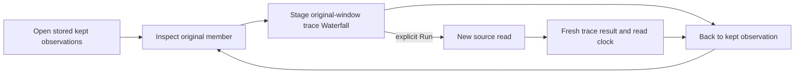

# Continue from a kept observation

Status: implemented and validated with real OTLP logs/spans, generated properties
and a bounded actor campaign.

Reopen a kept log or span, inspect it, then choose **Open trace as view**. Goo
stages a span Waterfall for the reported trace ID in that observation's original
read window and checked environment. Existing **Run** performs a new source read.
Opening the view does not read telemetry or write evidence. Existing view setup
may read retention configuration and recipe definitions; those metadata GETs
are counted separately.

The trace question retains only the environment, original window and trace ID.
Original record predicates, service filters, span restrictions and measures are
omitted so the trace can expand across services. Scope details explain this
expansion. Missing or invalid trace identity has an explicit unavailable reason;
Goo does not guess another window, environment or identity.

For a kept Activity occurrence, use that member's own poll window, including when
other members were observed in different windows. For a kept result page or saved
capture, use its stored fixed question window. Neither event time nor Kept at is
a substitute for these bounds. Typed environment policy remains unchanged,
including current/legacy precedence and empty/unreported scopes.

**Back to kept observation** restores the same retained inspector and focus,
without a source or stored-evidence reread. Returning after a completed read makes
no requests. Returning during a read can send its query-cancellation control
request and abort the browser read; late results cannot replace the restored view. Retired or hidden actions cannot stage
or return a different visit. Normal catalog opens continue to read stored
receipts; this in-tab return is not a durable citation or reload guarantee.

Kept bytes, digest, custody time and original observation basis remain immutable.
The trace result has a new read clock and may include late arrivals, omit data no
longer retained, be unavailable or have unknown completeness. Kept rows are not a
complete frozen trace. Saving or sharing the new view saves its question, not the
retained local return path.

See the [executable journey](journeys/327-kept-trace-continuation.md),
[design review](reviews/KEPT_CONTINUATION_DESIGN_327.md),
[architecture review](reviews/KEPT_CONTINUATION_ARCHITECTURE_327.md) and
[validation](../VALIDATION.md).
