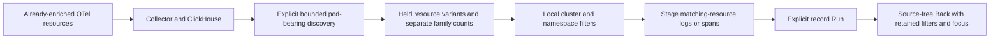

# Kubernetes resources observed in telemetry

Implemented and accepted in [journey 201](../journeys/201-kubernetes-storyboard.md).
This first C2d slice discovers pod resource variants and stages contextual
logs/spans. [Compact receipt](evidence/kubernetes-resources-201.json).
Kubernetes API inventory, ownership graphs and operational metric dashboards
remain separate deliveries.

## Source and identity

The source is already-enriched OTel resource attributes in ClickHouse logs,
traces and gauge/sum/histogram tables. Goo does not contact a Kubernetes API or
require cluster credentials. The supported keys follow the published
[OTel v1.37 Kubernetes resource conventions](https://github.com/open-telemetry/semantic-conventions/blob/v1.37.0/docs/resource/k8s.md).
Collector-side enrichment, such as the
[k8sattributes processor](https://github.com/open-telemetry/opentelemetry-collector-contrib/tree/v0.137.0/processor/k8sattributesprocessor),
has its own API access, RBAC and extraction configuration.

Discovery keeps complete reported resource variants. A variant's key includes
its resource map and retained resource-schema value. Map key order is not
identity. Missing attributes differ from present empty strings; extra resource
labels remain disambiguators. Logs and metric tables retain a schema string,
including an explicitly empty string. The trace table does not retain this
column, so its schema is explicitly unknown rather than a fabricated empty
value. Those variants are distinct.

Pod names are labels, not UIDs. Equal reported pod UIDs with different cluster
qualifiers or other resource attributes do not merge into a verified physical
pod. `k8s.cluster.uid` is a reported cluster qualifier; a cluster name is not
globally unique. Default collector enrichment may omit cluster UID, so these
resources remain visible with unverified cluster context. Missing and empty
cluster/namespace qualifiers remain distinct. Node and workload attributes are
reported associations, not verified owner edges.

Pod-bearing resources without a nonempty `k8s.pod.uid` remain visible as metadata
diagnostics; a name does not manufacture an actionable pod identity. No service
name or instance is required for discovery, and the resource path does not
synthesize either label.

## Discovery and exploration

Use **Services & resources → Kubernetes** with an explicit environment and fixed
window of at most 120 minutes. **Find pods** makes one source operation over five
source families. Grouped full-window counts remain separate for log records,
span records, gauge points, sum points and histogram points. Counts describe
telemetry records, not physical pods, containers, requests or metric values.

The source admits at most 1,000 source-family groups; a sentinel beyond that
refuses the whole lookup. This is not a promise of 1,000 unique resources.
Presentation retains at most 100 resource variants with explicit omissions.
Raw resource identities are bounded to 64 labels and 16 KiB, and the response
has an 8 MiB refusal budget. These limits do not establish source completeness
or a cheap scan. The source searches only pod-bearing telemetry; diagnostics
cannot count Kubernetes resources that never reported pod keys.

Cluster, namespace and text filters operate on held inventory without source
reads. The heading and counts describe resources observed during the fixed
window, not resources running now. Zero matching observations is not healthy
cluster state or proof that a pod does not exist.

For an observation with a reported pod UID, **Matching resource logs/spans**
stages the existing record question. It retains the fixed environment/window,
all reported resource attributes and missing cluster/namespace qualifiers where
needed. It adds no missing-service predicate. Application records may have
additional attributes, including their real service identity.

This is matching-attribute context, not exact map/schema equality, a Kubernetes
API lookup, a causal association or a claim to retrieve all telemetry for a
physical pod. Predicate budgets refuse oversized context rather than dropping
identity attributes. Only explicit **Run** reads records. **Back to Kubernetes**
restores held filters, rows and focus without reading again. Scope changes,
cancellation and departure withdraw pending inventory work.

Shared resource-tab navigation also withdraws pending service discovery,
supporting reads and dashboard work before a hidden view can start later reads.
Completed service views retain their DOM and working Apply callbacks. Returning
to a canceled, incomplete service view requires explicit discovery or Open;
changing a tab does not silently resume a request.

The host and Kubernetes adapters share a small request-generation owner and
bounded matching-resource authoring helper. Host compatibility exports remain;
the helper canonicalizes newly authored predicate ordering without rewriting
stored questions. Display elements, local filtering and tab navigation own no
source requests.

## Validation and later slices

Source/property/API checks and ordinary OTLP/browser acceptance pass. The main
fixture emits 15 metric points and 11 log/span records; two metric controls fall
outside the selected environment/window. The observed 24 source records form 22
source-family groups and 18 full resource/schema variants: six logs, five spans,
eleven gauge points, one sum point and one histogram point. A histogram point's
internal count does not become the inventory's point count.

The selected metric resource has neither service identity nor reported cluster
UID/namespace. Its matching-resource questions return four logs and three spans,
including real-service application records. Missing cluster/namespace predicates
exclude present-empty controls. Local facets, staging and retained Back preserve
held data and focus without reads: discovery is one logical source operation;
explicit log and span Runs bring the main total to three. Readiness probes are
separate from this journal, and one union query still scans five source families.

Real held-response checks cover Kubernetes scope edit/tab departure, Services
supporting/widget departure and completed-view Apply, plus the prior host owner
regression. Independent raw/journal validation rejects sixteen altered controls.
A separate fresh display replay checks full-width resource details, nested
attribute readability, family labels, UTC/ns and local disclosure/Back behavior
with one inventory read. These receipts do not claim a live Kubernetes cluster,
collector enrichment/RBAC acceptance, arbitrary schedules or a new inventory
capture/store.

The adjacent **Observe metrics** action follows the separate
[pod memory contract](POD_METRICS.md): a reported UID and known resource-schema
string admit explicit metric discovery and at most two native defaults. Its
source cost and gauge authority are independent of this inventory and its
record-context actions. Unknown trace schema does not silently become empty.

Phase/readiness, restarts, requests/limits, CPU, node pressure, ownership facts,
resource changes and workload rollups still need explicit receiver, identity,
temporality, calculation and coverage contracts. Discovery alone grants no
native authority and does not infer health from client spans.
