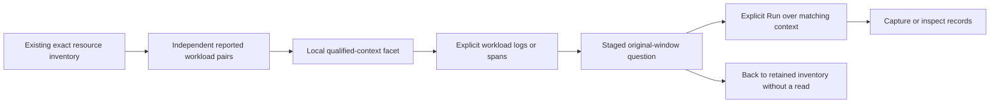

# Reported Kubernetes workload context

Implemented in source; ordinary OTLP/browser acceptance pending for journey 205.
This extends [Kubernetes resource observations](KUBERNETES_RESOURCES.md) using
already reported resource attributes. It does not contact Kubernetes or infer
controller edges, workload health, physical entity counts or complete ownership.

## Pinned attribute catalog

The [OTel v1.37 Kubernetes resource conventions](https://github.com/open-telemetry/semantic-conventions/blob/v1.37.0/docs/resource/k8s.md)
define string `name` and `uid` attributes for Deployment, ReplicaSet,
StatefulSet, DaemonSet, Job and CronJob. These attributes are marked Development
in that version. The public source was read for this implementation; its SHA256
is `d5e34c5e85c1eee5537ea80e9f20c6e45ede71dd8c053376342ad67ce90383f6`.
Goo reads literal values without stripping, guessing or migrating versions.

| Kind | Resource attribute prefix |
| --- | --- |
| Deployment | `k8s.deployment` |
| ReplicaSet | `k8s.replicaset` |
| StatefulSet | `k8s.statefulset` |
| DaemonSet | `k8s.daemonset` |
| Job | `k8s.job` |
| CronJob | `k8s.cronjob` |

Each reported pair is independent. Reporting Deployment and ReplicaSet does not
prove their relationship; Job and CronJob are not synthesized from each other.
Names are labels; UID-bearing telemetry is still reported context, not a verified
Kubernetes entity. A name-only context is explicitly unverified. Missing and
present-empty values differ. Neither reported attribute creates no workload
entry; explicitly empty attributes remain diagnostic entries without an action
unless another selected-pair value is nonempty.

## Local exploration and explicit record expansion

The inventory adds one workload facet over the existing bounded retained page.
Its key includes kind and the missing/empty/present states of cluster UID,
cluster name, namespace, and the selected workload's UID and name. These states
remain distinct even when visible names match. Not reported selects variants
without any supported reported pair; empty pairs are separate diagnostics.
The shown count remains retained resource variants, not workloads, pods or a
full-source count. Existing source/100-variant/omission bounds remain unchanged.
Filtering performs no source reads and cannot inspect omitted variants.

A compact summary opens per-kind **Matching workload logs/spans** actions. They
stage a fixed record question using the original environment/window and exact
states of those five context fields. UID-bearing context also retains its
reported name or absence; this is not a UID-only rename search. Name-only scope
preserves a missing UID predicate rather than including UID-bearing records.
All supplied cluster qualifiers remain, including missing cluster name.

This is an intentional expansion from the selected pod/container: pod UID,
container ID, service/SDK metadata and other workload kinds are not predicates.
Records from sibling pods can match; unrelated UIDs/namespaces/cluster contexts
cannot. A reported workload is actionable even if pod UID is missing. Context
queries are matching attribute predicates, not full resource-map/schema joins,
verified owner edges, or atomic snapshots of the inventory and records. Standard
predicate and record limits apply. The existing explicit Run, capture and
retained Back owners perform their existing jobs; staging/disclosure/filtering
never execute or publish. No API endpoint, result DTO or capture format changes.

## Compact container cue

The shared readiness app renderer now shows the literal reported container name
and ID above its category. Full text remains visible, wrappable and available
in its title; exact-stream inspection retains all raw identity. The same renderer
covers resource defaults, native execution and frozen captures. Identity does not
change the decoder, zero handling, freshness, source query or stored bytes.

The pure catalog/scope adapter lives in `ui/kubernetes-context.js`; application
request/navigation ownership stays in the existing Kubernetes and record owners.
No generic passive component owns Kubernetes semantics. See
[journey 205](../journeys/205-workload-context-storyboard.md) for implementation
and actual acceptance status. Verified controller facts, workload rollups,
requests/limits, replicas, lifecycle history and Kubernetes API/RBAC enrichment
remain separate contracts.
