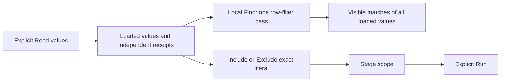

# Finding values in large facets

Find searches the full loaded value, including a suffix beyond its visible
preview. Long values show both their prefix and terminal identifier within a
160-codepoint preview. The full title, accessible name and exact Include/Exclude
value are preserved. Missing keys and present empty strings remain separate.

The shared `goo-facet-list.filter(query)` method reflects the query and filters
current child rows once, returning `{visible, total}` synchronously. It works on
connected or detached elements and recomputes after child insertion, removal or
text changes, even when the query text is unchanged. It retains row and action
nodes. The `query` attribute/property supports server-rendered HTML; `refresh()`
explicitly applies that query to current children.

Local Find changes neither the source question nor measurement totals. It makes
no requests and does not rescale paired counts to the visible subset. Ready
partition absence, unavailable-side counts and upstream coverage retain their
existing meanings. Each source side still admits at most 1,000 values, with up
to 2,000 distinct values in a paired union.

The live journey uses ordinary OTel logs, an aggregate grouped by service, and
an independent cohort facet with 384-byte values. This isolates facet rendering
from aggregate chart size. Separate supplied-component cases exercise 384- and
2,048-byte labels; those are measured fixtures, not maximum string guarantees.
The comparison endpoint's independent 1 MiB request limit concerns its cohort
payload, so a large facet does not necessarily imply a large comparison request.

The paired fixture still creates roughly 32,000 elements. This cut removes
duplicate filtering and improves visible identity; it does not claim to solve
initial mount cost. A follow-up should measure full renders per logical source
publication, stage and Back operation before choosing batching or bounded row
rendering. See [validation](../VALIDATION.md), the
[architecture review](reviews/LARGE_FACETS_ARCHITECTURE_343.md), and the
[interaction review](reviews/LARGE_FACETS_DESIGN_343.md).
