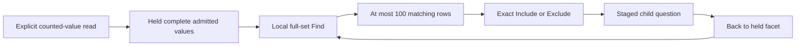

# Large-facet interaction budget

Milestone 369 measures and delivers bounded local rendering. Genuine native
interaction acceptance and repeated timing checks pass; see
[validation](../VALIDATION.md) for complete execution status.

The task uses real OTLP logs, explicit counted-value reads, an ordinary
1,000-value facet and a disjoint paired 2,000-value facet. Desktop and narrow
layouts use the same long Unicode labels, missing keys and present-empty values.
Supplied-component diagnostics and historical DOM counts are supporting research;
they do not establish current user-task latency.

Only the initial explicit read acquires facet values. Local Find, staged
selection and Back must preserve exact counts, identities and independent read
receipts without source reads. Measure source wait separately from render CPU,
event handling, two-frame paint opportunity and whole task wall time. A
requestAnimationFrame observation is not a compositor presentation timestamp.

The adopted task goals for this session are local search p95 at most 200 ms,
no repeated stalls above 500 ms, Include/Exclude at most 200 ms, and usable
mount/Return around one second. Repeatable local presentation above two seconds
is material. Architecture's stricter diagnostic goals remain visible in its
review; these are bounded pilot criteria, not universal device service levels.

If measurement warrants bounded presentation, full admitted values must still
define matching, counts and common scales. Preserve exact missing/empty/literal
identity, keyboard reachability, focus and read receipts. A presentation limit
must not become a query limit. If current tasks meet the budget, close this
measurement without adding paging or a virtualizer.

See [architecture criteria](reviews/LARGE_FACET_ARCHITECTURE_369.md) and
[usability criteria](reviews/LARGE_FACET_DESIGN_369.md).

## Clean baseline and selected remedy

The trace-disabled genuine baseline passes semantic and no-local-API assertions
at all four sizes, but misses the adopted interaction goals. Times below are
milliseconds to the second animation-frame opportunity, not compositor timestamps.

| Case | Search p95 | Selection max | Ready mount | Return max | Mounted rows / elements |
| --- | ---: | ---: | ---: | ---: | --- |
| Desktop ordinary | 367.0 | 255.3 | 438.5 | 182.2 | 1,000 / 6,015 |
| Desktop paired | 1,087.8 | 461.6 | 1,112.8 | 548.2 | 2,000 / 32,025 |
| Narrow ordinary | 216.8 | 195.3 | 345.5 | 165.3 | 1,000 / 6,015 |
| Narrow paired | 896.6 | 489.5 | 1,196.1 | 479.2 | 2,000 / 32,025 |

Repeated clear-to-full-set searches dominate: paired desktop 620.6/1,087.8 ms,
narrow 883.9/896.6 ms. A nonterminal caret at position 3 becomes position 22 after
staging and Return. This is recorded separately from the successful ability to
edit in the middle before publication.

The selected remedy is a component-local page of at most 100 matching values,
with explicit shown/matching/loaded ranges. Full-model matching, counts and pair
scales stay authoritative. Keep the Find input stable while changing rows,
retain same-read query/page/selection, and retire old row action generations.
There is no new source pagination or query authority.

Earlier traced exploratory attempts are excluded from this decision. Default
Playwright DOM tracing could delay observations around the 32,000-element tree;
the benchmark explicitly disables it and marks its report `traceDisabled: true`.
Manual screenshots and actual input/render reports remain available.

## Bounded rendering result

The current trace-disabled repeat passes all adopted budgets, exact child scopes,
independent receipts and zero local API activity. Every one of the 60 ordinary/
paired pages is checked against independent complete literal identities; Find
covers all admitted values, including missing, empty and off-page long suffixes.

| Case | Search p95 | Selection max | Ready mount | Return max | Mounted rows / elements |
| --- | ---: | ---: | ---: | ---: | --- |
| Desktop ordinary | 72.9 | 69.1 | 67.9 | 54.6 | 100 / 619 |
| Desktop paired | 65.4 | 135.4 | 176.9 | 166.9 | 100 / 1,629 |
| Narrow ordinary | 35.1 | 37.2 | 42.0 | 56.7 | 100 / 619 |
| Narrow paired | 64.0 | 107.9 | 132.2 | 102.0 | 100 / 1,629 |

The earlier final run also passed all budgets (paired search p95 111.6/65.2 ms).
Variation is retained rather than selecting a fastest sample. These small,
shared-host pilots establish this task's improvement, not a device-independent
latency guarantee. Source waiting and driver wall time are reported separately.

Include/Exclude and Back retain the nonterminal caret at 3, exact whole original
predicates and both operands where paired. Old row callbacks remain inert after
page/Find even when reattached; inactive or detached pager callbacks cannot alter
the held view. New read identity resets local state. Focus falls back to the
existing current control if a former row no longer exists; a new read does not
promise the old row remains available.

The native workload performs 18 explicit source acquisitions and two comparison
requests across both viewport setups. Local Find/page/staging/Back perform zero
API calls, including metadata and capture-store GETs. No source semantics,
endpoint, model format, global virtualizer or Go API is added. See the
[executable storyboard and frames](journeys/369-facet-interactions.md).
