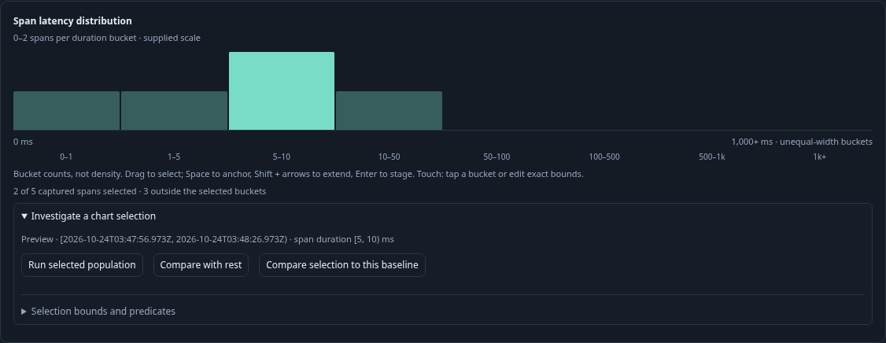
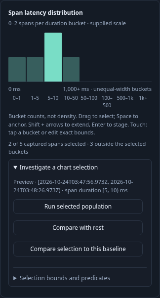

# Latency histogram selection

Raw-span questions grouped by `column:duration_bucket` now show a compact latency
histogram in Distribution. It uses the full supplied breakdown, independently of
the record-page limit. Eight ordered, unequal-width duration buckets share a
count scale; bar height is count, not probability density. Exact counts remain
strings. A missing group is zero only after validating the complete grouped sum
against the supplied total. Inconsistent, unknown, numeric-transform and native
metric populations do not offer this raw-span operation.

Drag across whole buckets, including right-to-left, or select a bucket by click
or tap. Keyboard: Space anchors, Shift + left/right extends, Enter commits.
Escape cancels an unfinished gesture and restores the previous visual range.
Touch dragging retains normal scrolling. Counts beside the selection show its
size and the outside population from the supplied aggregates; gestures do not
read telemetry. The complete histogram scale stays fixed during selection and
local facet search. The detailed facet rows remain available below it.

The compact action tray previews the exact UTC window and duration range. Its
bounds/predicate disclosure permits precise edits. Editing bounds withdraws the
old bucket highlight/count preview; Run measures the edited population. Run selected population explicitly reads a child question for record inspection.
Compare selection to this baseline likewise reads the selected child and compares
it with supplied parent aggregates. Compare with rest stages the disjoint pair
first; explicit Run in that child reads both populations. The
parent's complete predicates, environment, reported-edge scope and time window
remain intact, and paging resets. `[5,10)` ms compiles to integer nanoseconds
`>= 5000000` and `<= 9999999`; the last bucket has no upper bound. Parent return
restores the paused display without a source read. Existing saved views and
captures own reuse and evidence; the visual brush itself is ephemeral.

```mermaid
sequenceDiagram
    participant User
    participant Bars as Passive goo-time-bars
    participant Adapter as Latency histogram adapter
    participant Owner as Population selection / trail
    participant Source as Go / ClickHouse
    Source-->>Adapter: Explicit query result: full duration groups
    Adapter->>Bars: Supplied count bars and labels
    User->>Bars: Drag or keyboard range
    Bars-->>Adapter: Supplied fromKey / toKey intent
    Adapter->>Owner: Half-open duration range, original UTC window
    Owner-->>User: Preview counts and stage actions
    User->>Owner: Inspect or compare
    Owner-->>User: Compare with rest stages child; no source read
    User->>Owner: Run population view
    Owner->>Source: Explicit selected / remainder queries
    Source-->>User: Independently read results
```

This is a fixed-scope raw-span capability, also reachable through an explicit
Activity continuation. It does not add automatic live histogram subscriptions,
request latency inference, native histogram-to-span membership, equal-width
rebucketing, completeness claims or atomic comparisons across source reads.
A later read may differ from the preview. Native OTel histograms retain their
own interval/temporality contracts.

Journey 153 ingests ordinary OTLP spans, independently checks ClickHouse, uses a
one-row page over five matching spans, reverse-drags, cancels, commits a keyboard
selection, compares exact boundaries and the disjoint remainder, returns without
reads, and runs an explicit single-bucket inspection. It captures desktop/mobile frames
and runs Bombadil's local-stage/read-count invariants. Journey 154 is a labeled
synthetic passive-component contract, including pre-definition property upgrade,
SSR attributes, captured pointer release outside the plot, cancellation and
removing range behavior. Hegel checks bucket partitions against the Go compiler
and predicate matcher. The actual browser ledger replays through the existing
Quint drilldown model with controls rejecting hidden reads and scope/partition
mutations.




[Optional Activity latency](ACTIVITY_LATENCY.md) now supplies explicit or opt-in scheduled raw-span distributions on the live entry surface. Brushing pauses and stages before Apply; the original fixed-scope histogram behavior remains available.
