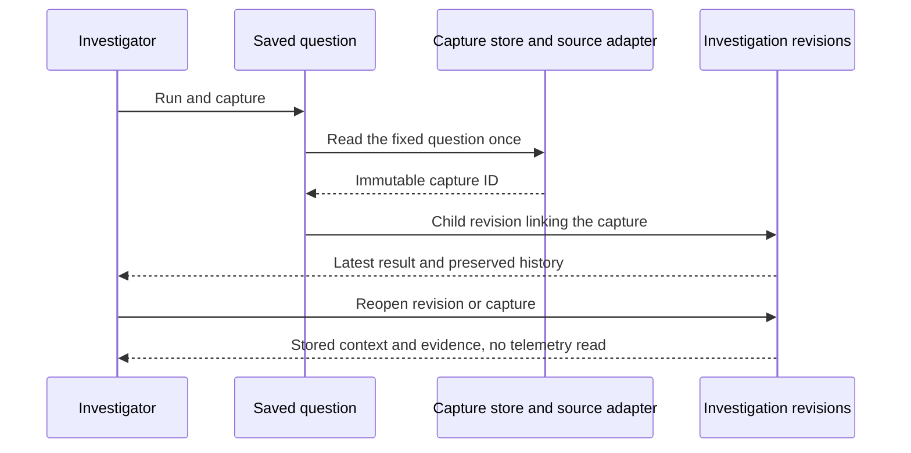
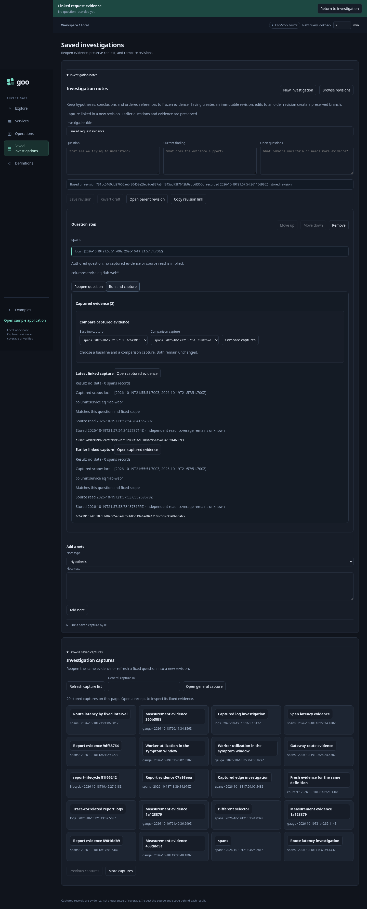
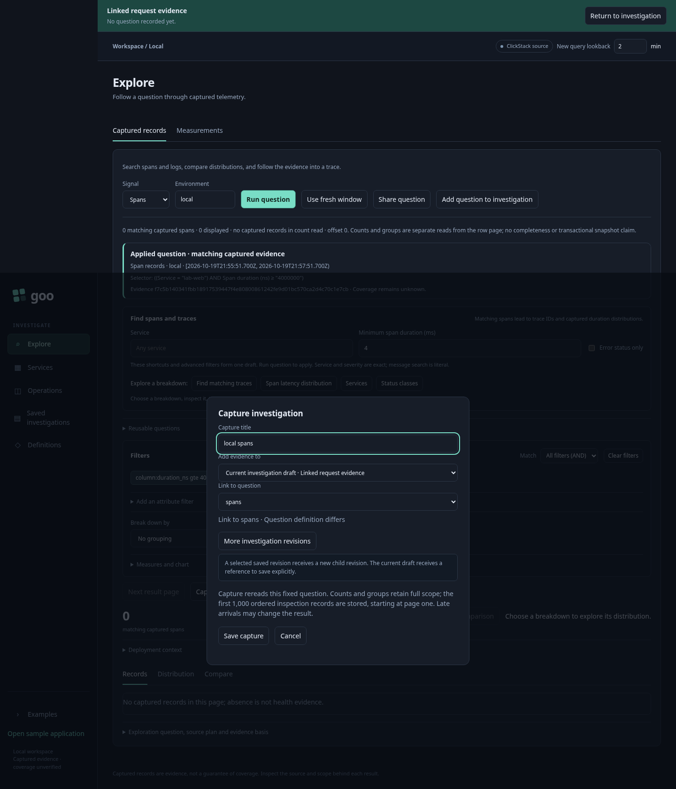
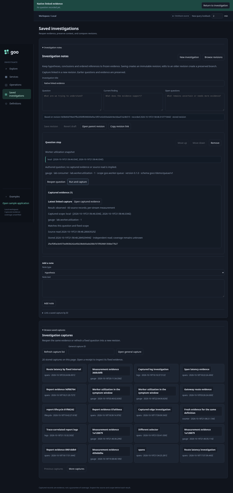

# Capture evidence for a question

A saved question card now has **Run and capture**. It rereads that fixed typed
question once, stores an immutable capture and saves a child investigation revision
with the capture linked to that card. Save pending edits first; this action does
not silently publish unrelated draft changes.

Each question has an opaque stable key and an ordered history of up to 16 capture
IDs. The most recently linked capture appears first, with its stored result state,
exact source-record count/grain, original source-read time, custody time and captured
scope. Native values and plots remain available through **Open captured evidence**;
source-record counts are not substituted for metric values. Earlier captures stay
accessible, as do earlier document revisions. “Latest linked” describes link order,
not a claim that its event window or read time is newest.

**Reopen question** still stages intent without a telemetry read. If you change
filters, bounds or a definition, **Capture evidence** offers the originating
question as its destination and shows the difference before capturing. The saved
capture keeps the actual question that ran; it does not overwrite the original
question card. Differences distinguish family, environment, fixed window and typed
definition. Matching bounds never imply equal populations or one transactional
snapshot. Record paging is presentation state and does not change population matching.

Capturing and saving the document are separate operations. If the capture succeeds
but document publication fails, the UI retains the current evidence history and
reports the saved capture ID. Attach that ID to the question through the existing
capture-link form, then save; retrying this attachment performs no new telemetry
read. If the investigation changes during a live capture, attachment fails rather
than link evidence into a different context. A saved capture remains available.

The Go store validates question keys, rejects duplicate keys/references, enforces
the 16-link bound and resolves every capture ID before publishing. Old documents
and IDs retain compatibility through omitted optional fields. Existing metadata
reads now expose stored read time and result summaries without evaluation. No
scheduler, automatic refresh, mutable latest head or statistical result comparison
is introduced. Question history is local immutable-document state, not a distributed
transaction with source storage.

Storyboard 51 (`journeys/linked-evidence.spec.js`) executes repeated capture,
reopening, changed-filter capture, a real capture plus simulated document-store
outage, attachment recovery without rereading, mobile layout, and native metric
capture. Hegel checks actual JavaScript scope comparison plus save/fork/link state
swarm histories. Quint validates observed read/link transitions with rejecting
mutations; Bombadil explores stored history without executing source reads.

Two or more linked captures now offer [stored evidence comparison](CAPTURE_COMPARISON.md),
with explicit compatibility checks and supported descriptive deltas.
