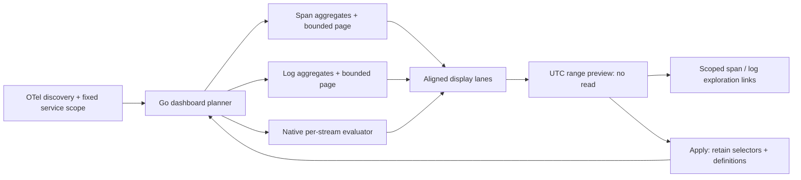
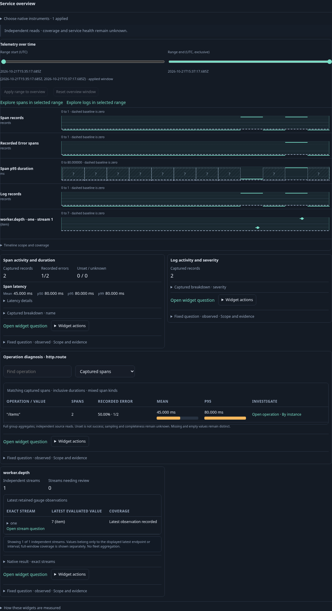
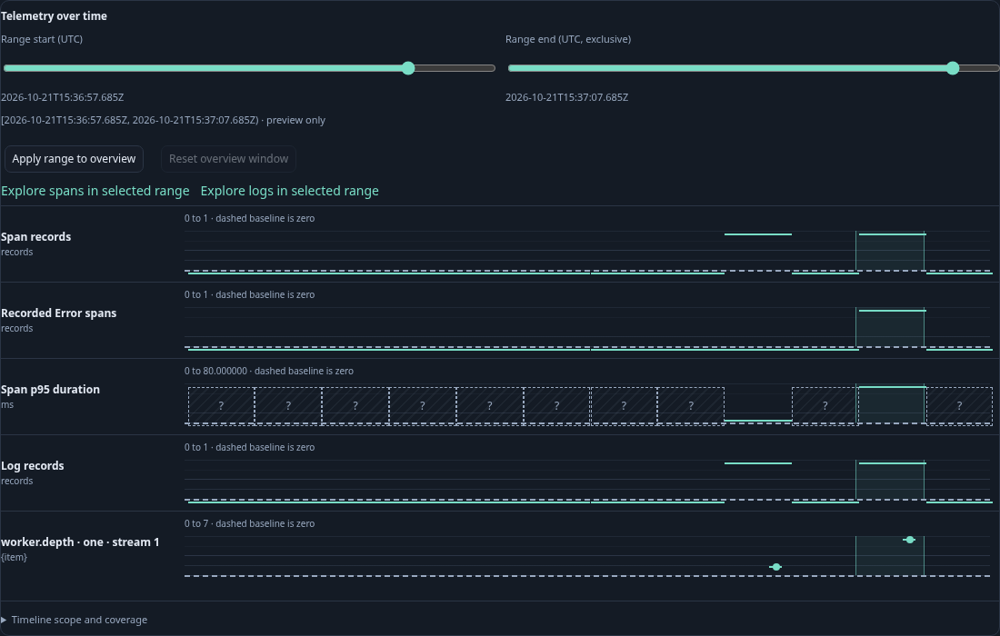
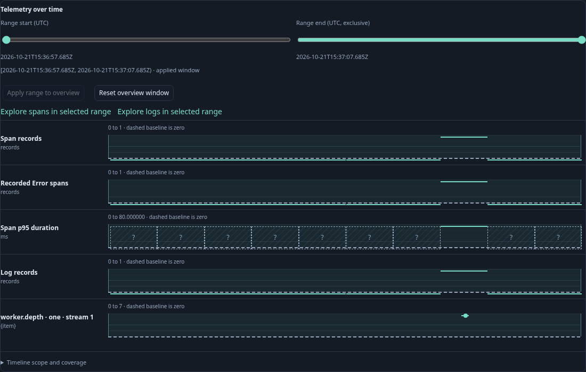
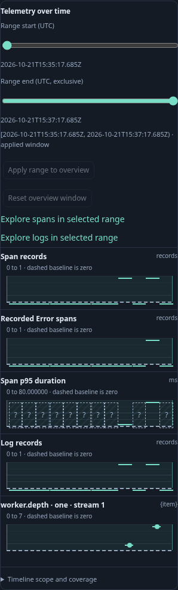

# Linked service telemetry timeline

The automatic service overview now aligns span activity, recorded Error counts,
per-bucket p95 duration, log activity and selected native streams on one UTC time
viewport. These are existing Go query/measurement results, not a new evaluator.
Each lane has its own labelled value scale; only the time axis is shared. Span
counts include mixed span kinds and retries, and do not establish request rate.

Click a retained chart interval or adjust the two UTC range handles to preview a
half-open selection. Preview updates every lane's highlight and the span/log
exploration links without reading telemetry. **Apply range to overview** reruns
all supported overview widgets—including operation diagnosis and selected native
instruments—in that window. Environment, service/namespace predicates, native
instrument definitions, unit and temporality stay unchanged. The Go planner may
choose finer record buckets for the narrower window. Reset rereads the original
service window. Native instrument selection survives range changes and reset.
The supporting discovery inventory below the overview keeps its original window.

The range control is the passive framework-neutral `goo-time-range` element:
HTML `data` JSON or detached SPA `.data` contain `{fromMs,toMs,selection}`. Native
keyboard/pointer sliders emit `goo-range-select` with `{fromMs,toMs}`; they do not
fetch, navigate or publish. `service-timeline.js` owns the preview and the existing
service adapter owns cancellation, plan validation and reading. It reuses
`goo-value-timeline` for the display lanes rather than introducing another chart
implementation. The per-widget duplicate activity charts are omitted in this
composition; widget summaries and detailed evidence remain available below it.

Native lanes retain exact stream observations/intervals, units and diagnostics.
At most four streams per selected instrument and the latest 200 points per stream
are shown. Exports crossing a viewport boundary are omitted rather than clipped
into invented measurements. Points are not interpolated, resampled or merged.
Go evaluates duration percentiles per bucket; the UI only formats nanoseconds as
milliseconds. Missing latency is unknown, rather than zero. Incoherent record
reads withhold their lanes. Failed widget reads remain unavailable while other
lanes can be inspected. Temporal alignment alone is not correlation by identity
or a causal claim. The [population workspace](POPULATION_WORKSPACE.md) now supports cross-service
span/log timelines and saved exploration views. Arbitrary native-stream composition
and saved multi-widget dashboards remain subsequent work.

[Journey 88](../journeys/linked-timeline.spec.js) emits generic HTTP spans, logs
and a native gauge through OTLP. It verifies aligned domains, source-free preview,
all-widget scope preservation, filtered span/log counts, reset, mobile layout and
an observed Quint/quint-go ledger with rejecting controls. Journey 89 checks
server HTML, detached component updates, keyboard selection and absence of source
reads. The companion Bombadil actor exercises discovery, range preview and Apply.
Hegel generates range-preservation cases; existing linked-history state/swarm
checks continue to cover saved question custody.

