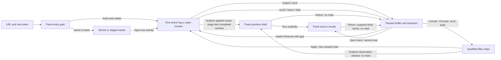

# Live Activity entry

The S1 entry composition uses the existing bounded log/span tail. A fresh `/` or
`#explore` visit automatically connects one log monitor for the lab's explicit
`local` environment. The environment input and Apply scope start another exact
scope; Logs/Spans selects one active signal. Missing scope asks for an environment.
This does not discover or query every environment in a deployment.

The normal entry has one compact scope/action bar: environment, signal and Pause.
Apply appears only while editing scope; a draft shows the currently applied scope.
Coverage state and local counts share a compact metadata row. Repeated scope pills,
workspace/source banners and the visible table caption are removed from this mode
(the caption remains available to assistive technology). Mobile navigation is
collapsed behind an accessible Menu toggle; other product areas remain reachable.
Opening or closing that menu performs no source read.

Rows and local buffer counts appear before the advanced fixed-question workspace.
UTC time is compact, with the full UTC timestamp and exact nanoseconds in the
row tooltip. Logs show body/severity; spans show name/duration/reported status.
Inspect uses the held record and attributes without a source request. Open trace
is a separately named source continuation using that row's original read window.
No ancestry is inferred from arrival order or a shared trace ID. The shared detail
view follows only supplied, exact reported parent links with explicit limits. See
[record presentation](RECORD_PRESENTATION.md).

## Intent and ownership

`GooStreamEntry` owns the fresh-entry intent, applied environment/signal, mode,
local inspector and lifecycle. `EntryGate` permits one automatic claim for a fresh,
visible, active records entry. Saved/fixed links, saved exploration views and the
explicit `#questions` builder never claim a monitor. Repeated route events,
returning from Services and returning from Measurements do not restart a paused
connection. Open live activity is an explicit mode change.

The monitor uses `GooTail` with a compact composition. It does not run the
population planner, a preliminary query or an aggregate before opening the SSE
stream. Display elements remain passive. Scope edits stay drafts until Apply;
applied scope remains visible while a replacement is pending. New scope and
signal generations abort the preceding reader and cannot accept its late batches.

## Pause, resume and failures

Scrolling away from the live edge pauses transport, not merely auto-scroll.
Focusing or inspecting a record, leaving Explore, selecting Measurements or a
hidden-document event also pauses. Resume explicitly starts a new recent window
and exposes a continuity gap. The inspector is cleared on explicit resume so a
cached connection-local observation key cannot masquerade as the new read.

Reconnects retain last-good rows until a successful replacement batch arrives.
HTTP/source failures remain stale/unavailable with a gap; retry does not present
an empty healthy view. Compact mode offers Pause reconnecting as well as explicit
resume. Scope replacement intentionally clears the old scope rather than mixing
its rows under new labels.

This is a bounded recent-event-time monitor: 60-second lookback, 2-second polls,
100-row/2 MiB display buffer, 1,000-row/512 KiB source-poll cap and four global
prototype stream slots. Counts are local observed/retained/evicted observations,
not population totals, request rates or evidence of telemetry completeness.
There is no ingestion replay guarantee. Last-good rows can refer to an earlier
completed poll while the next connection is unavailable.

## Deliberate limits and migration seam

The first S2 interaction cut adds Include/Exclude through the shared typed
attribute viewer, removable filter chips and explicit Apply. Predicates are exact
recorded strings, qualified by column/resource/attribute namespace, AND-combined
and bounded to 16. Empty string is a recorded value; absence is not coerced to it.
Exclude uses the existing `ne` predicate: the field must exist and differ.

Staging or removing filters pauses transport and retains the held rows/inspector.
Draft chips are marked; the previous applied environment/signal is shown and its
selector is available in the tooltip. Apply replaces the buffer with a new scoped
read. Resume refuses an unapplied scope; changing signals clears signal-specific
filters. Opening a fixed investigation from the inspector stages the drafted
predicate in the selected row's original 60-second read window. It does not fetch;
the existing Run action explicitly rereads that fixed question. It is not a
capture or an assertion of complete source coverage.

Live and fixed results now share record summaries and detail composition, with
bounded parent context from supplied span relationships. Live, fixed/frozen pages
and held service observations now share the record-table builder; aggregate/native
service layouts remain separate work. Saved record pages now have a dedicated
owner without a hidden editor; Live/fixed and Saved share record/context rendering. The paused parent return described below is implemented.
The legacy advanced editor is a temporary compatibility consumer; the
[whole-product reviews](STREAM_FIRST_WHOLE_PRODUCT_DESIGN.md) and
[active queue](IMPLEMENTATION_PLAN.md) name its replacement/removal gates.

The monitor does not publish captures or annotations. Exact retention of selected
tail observations requires server-owned membership/read-window capabilities.
Current tail handles are not native `resultToken` values. Existing fixed-page and
saved-capture retention remains available through its existing explicit paths.

Journeys 102/103 exercise real OTLP logs/spans, startup request counts, inert fixed
and saved links, scope/mode changes, local inspection, scroll anchoring, capacity
failure and explicit gap-bearing resume. The hidden-document lifecycle input is
injected in 103; it is not a claim of a native OS backgrounding campaign. Hegel
checks the actual JavaScript entry gate across state/swarm transitions. Quint
validates observed entry traces and rejecting controls. See [validation](../VALIDATION.md)
for actual completed runs and final image identity.

The HTTP proxy watches downstream disconnects and closes the upstream SSE socket
promptly, releasing its existing admission slot. `python3 scripts/check_tail_disconnect.py`
checks eight rapid aborts and the unchanged four-reader limit (fifth reader: HTTP 429).
Run this local-lab check without another active monitor.

Journey 104 follows four real generic OTel logs (west, east, empty and missing
attribute) through Include, Exclude, chip removal, explicit Resume and a staged
empty-string fixed query. It checks exact typed selectors and request counts;
[frames and storyboards](journeys/README.md) show draft, mobile filtered stream and
fixed-question staging. Hegel state/swarm campaigns run the actual JavaScript
filter model; observed browser transitions use the entry Quint protocol. The
Bombadil filter actor scopes the lab, inspects a record and stages a predicate.

## Return to paused activity

Opening a fixed investigation or trace from Live Activity retains one parent in
this tab: applied/draft scope, held rows, selected inspector and local scroll
positions. The existing header action becomes **Return to paused activity**.
Returning suspends and detaches the fixed owner, aborting in-flight fixed queries and invalidating pending
context generations before restoring the parent. It does not fetch or resume. Focus returns to
the selected row button when available. Apply and Resume remain explicit new reads.

Choosing Investigate → Build fixed question from the parent restores the retained fixed editor without
rerunning it. A query cancelled by returning remains cancelled until Run. The
existing question trail keeps its own bounded views; this adds no durable evidence
store, replay cursor or browser Back history. Reload drops the parent. Starting a
new live scope or resuming invalidates the old return anchor. A trace context is a
named source read, not inferred ancestry.

[Journey 105](../journeys/paused-return.spec.js) holds a real source response at the
browser transport boundary, returns while it is pending, then releases it to verify
it cannot replace the paused parent. It also covers completed fixed results,
selection/draft/scroll retention and mobile return. Its Quint ledger counts both live and fixed reads, so Return must preserve the
combined count. The shared Bombadil filter actor
now stages a fixed child and returns to the same selection.

## Contextual lookback and consolidation gate

The top-level lookback is a default for a new explicit read, not the horizon of
held Activity or saved evidence. Navigation hides it on Saved; Services, Operations,
Definitions HTTP preview and Examples name the read it configures. The input value
is retained across routes. Fixed questions retain their own bounds.

The [S2/A3 acceptance audit](S2_A3_ACCEPTANCE.md) records the delivered mount gate:
fresh Activity contains no fixed query editor. The trail registers navigation without
constructing one; explicit authoring or a supported continuation creates it. Return
to Activity suspends/detaches it, and reopening restores the same draft. Old record
question/step/view links restore their own editor without execution. The initial
live environment remains the explicit local lab default and does not depend on a
hidden fixed input. B1 follows this bounded cut.

## Contextual fixed analysis

[Activity analysis](ACTIVITY_ANALYSIS.md) adds a compact scope/window continuation
using the last completed tail read, including an empty window. The inspector
continuation retains the selected observation’s original window and staged
filters. Both stage before Run, disclose editing separately and return to the
paused parent without resubscribing. Neither preserves held rows as evidence.

[Activity navigation](ACTIVITY_NAVIGATION.md) consolidates current-window analysis and fixed authoring under the folded Investigate menu. Rolling configuration discovery remains in Views; the duplicated below-stream question/saved entrance is hidden while Activity is active.
