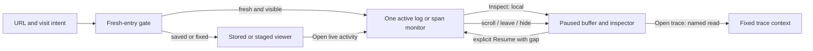

# Live Activity entry

The S1 entry composition uses the existing bounded log/span tail. A fresh `/` or
`#explore` visit automatically connects one log monitor for the lab's explicit
`local` environment. The environment input and Apply scope start another exact
scope; Logs/Spans selects one active signal. Missing scope asks for an environment.
This does not discover or query every environment in a deployment.

The normal entry has one compact scope/action bar: environment, signal and Pause.
Apply appears only while editing scope; a draft shows the currently applied scope.
Coverage state and local counts share a compact metadata row. Repeated scope pills,
workspace/source banners and the visible table caption are removed from this mode
(the caption remains available to assistive technology). Mobile navigation is
collapsed behind an accessible Menu toggle; other product areas remain reachable.
Opening or closing that menu performs no source read.

Rows and local buffer counts appear before the advanced fixed-question workspace.
UTC time is compact, with the full UTC timestamp and exact nanoseconds in the
row tooltip. Logs show body/severity; spans show name/duration/reported status.
Inspect uses the held record and attributes without a source request. Open trace
is a separately named source continuation using that row's original read window.
No ancestry is inferred from arrival order or a shared trace ID; richer reported-
parent presentation remains S2 work.

## Intent and ownership

`GooStreamEntry` owns the fresh-entry intent, applied environment/signal, mode,
local inspector and lifecycle. `EntryGate` permits one automatic claim for a fresh,
visible, active records entry. Saved/fixed links, saved exploration views and the
explicit `#questions` builder never claim a monitor. Repeated route events,
returning from Services and returning from Measurements do not restart a paused
connection. Open live activity is an explicit mode change.

The monitor uses `GooTail` with a compact composition. It does not run the
population planner, a preliminary query or an aggregate before opening the SSE
stream. Display elements remain passive. Scope edits stay drafts until Apply;
applied scope remains visible while a replacement is pending. New scope and
signal generations abort the preceding reader and cannot accept its late batches.

## Pause, resume and failures

Scrolling away from the live edge pauses transport, not merely auto-scroll.
Focusing or inspecting a record, leaving Explore, selecting Measurements or a
hidden-document event also pauses. Resume explicitly starts a new recent window
and exposes a continuity gap. The inspector is cleared on explicit resume so a
cached connection-local observation key cannot masquerade as the new read.

Reconnects retain last-good rows until a successful replacement batch arrives.
HTTP/source failures remain stale/unavailable with a gap; retry does not present
an empty healthy view. Compact mode offers Pause reconnecting as well as explicit
resume. Scope replacement intentionally clears the old scope rather than mixing
its rows under new labels.

This is a bounded recent-event-time monitor: 60-second lookback, 2-second polls,
100-row/2 MiB display buffer, 1,000-row/512 KiB source-poll cap and four global
prototype stream slots. Counts are local observed/retained/evicted observations,
not population totals, request rates or evidence of telemetry completeness.
There is no ingestion replay guarantee. Last-good rows can refer to an earlier
completed poll while the next connection is unavailable.

## Deliberate limits and migration seam

S1 offers environment/signal selection and local inspection. Facet Include/Exclude,
chosen field pills, supplied-row ancestry, fixed-window child staging and shared
record presentation are the next S2/A3 consolidation, not implemented here.
The legacy advanced editor is a temporary compatibility consumer; the
[whole-product reviews](STREAM_FIRST_WHOLE_PRODUCT_DESIGN.md) and
[active queue](IMPLEMENTATION_PLAN.md) name its replacement/removal gates.

The monitor does not publish captures or annotations. Exact retention of selected
tail observations requires server-owned membership/read-window capabilities.
Current tail handles are not native `resultToken` values. Existing fixed-page and
saved-capture retention remains available through its existing explicit paths.

Journeys 102/103 exercise real OTLP logs/spans, startup request counts, inert fixed
and saved links, scope/mode changes, local inspection, scroll anchoring, capacity
failure and explicit gap-bearing resume. The hidden-document lifecycle input is
injected in 103; it is not a claim of a native OS backgrounding campaign. Hegel
checks the actual JavaScript entry gate across state/swarm transitions. Quint
validates observed entry traces and rejecting controls. See [validation](../VALIDATION.md)
for actual completed runs and final image identity.

The HTTP proxy watches downstream disconnects and closes the upstream SSE socket
promptly, releasing its existing admission slot. `python3 scripts/check_tail_disconnect.py`
checks eight rapid aborts and the unchanged four-reader limit (fifth reader: HTTP 429).
Run this local-lab check without another active monitor.
