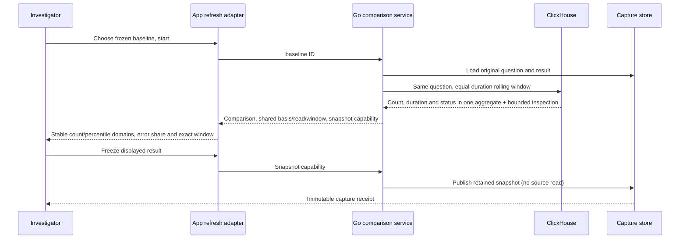

# Frozen baselines and live comparisons

Implemented for saved **record questions** (spans or logs) linked to an
investigation question. Open **Compare with a fresh window**, choose a compatible
prior evidence baseline, then explicitly **Start live comparison**. Opening the
preview and choosing evidence read only stored metadata. Native counters also support the exact-stream pilot below; gauges and histograms
retain the fixed-window capture flow.

The rolling window has the baseline's exact duration (at most two hours), ending
at the server's evaluation time. Environment, predicate, reported edge and all
other question settings come from the stored baseline, never a client-supplied
replacement question. The baseline is never reread or edited. Current counts
come from full-population ClickHouse aggregates; inspection rows are bounded at
1,000 and never define counts. This is unrelated to the local live-log buffer.

A successful read displays both exact windows and source-read time. Coverage
remains unknown, separate source reads are not transactional, and differences
are descriptive. No rates, unique requests, statistical significance or causal
attribution are inferred. Existing evidence compatibility checks withhold numeric
comparisons for unavailable/no-data or incompatible results. Saved span questions requesting `summary: span-duration` and/or `spanStatus: true`
also display full-population span latency and recorded error share. Existing count-only
captures retain their definition; capture a question requesting those measures to
compare them. Logs remain record counts. Native counter rates use the separate export-window policy below.

The app refreshes ten seconds after a completed read, with one outstanding read
per panel. Pause, hidden browser, route change, preview close, baseline change or
removal aborts/stops refresh. Old generations cannot publish into a replacement
panel. Failed reads retain the previous snapshot with a stale label and its
original window. A failed first read is unavailable; no prior result is invented.
Baseline window and source-read provenance live in a native disclosure; the
current window remains visible in the chart frame. Pausing never advances the window. Refresh is polling JSON,
not SSE; reusable display components own no subscriptions.

The first comparable result establishes a common zero-based count axis. Requested
latency uses one common supplied nanosecond domain across both compact p50/p95/p99
rails, with mean and exact-value disclosures. Recorded error share uses a permanent
0–100% axis with exact Error/total fractions and a percentage-point change. Unset
and Unknown statuses remain in the denominator and are not success.

Each count and latency domain is retained until explicit rescale. A latency overflow
withholds percentile rails while other in-domain measures can still be shown.

The first comparable result establishes the common zero-based axis. Later
values retain it. A result exceeding that domain withholds bars until the user
chooses **Rescale comparison**; it never clips a value or silently changes scale.
The same axis applies to both sides, including after counts fall.

**Freeze displayed result** pauses refresh and publishes the exact server-owned
snapshot. It does not query telemetry again, even if late telemetry has arrived.
The immutable capture separates its source-read time from custody time and is
available through the capture library. **Add frozen result to investigation**
links it to the current question draft; saving a revision is explicit. The
original investigation revision remains unchanged. This
is distinct from **Capture and compare**, which executes its previewed question.

`POST /api/captures/live` accepts exactly one `baseline` capture ID or `freeze`
capability. Refresh may supply `replace` for the previous capability. Snapshots
are process-local, expire after two minutes, and are bounded to 16 entries,
4 MiB serialized content each, 16 MiB total serialized content. Refresh replaces its previous draft. Repeated freeze
before expiry returns the same capture receipt. Expiry/restart returns 410;
published captures remain durable. Capabilities travel in POST bodies, not URLs.
This local lab has no production authentication/session isolation; these limits
are execution controls, not authorization. Existing query concurrency budget and
55-second source timeout apply.



Journey 69 ingests real OTel spans, compares 2 baseline/4 current records, grows
the current population to 7, exercises explicit rescale and a failed read, then
adds an eighth source record before freezing the displayed seven. It reopens
stored evidence and proves the baseline is unchanged. Its observed ledger is
replayed through Quint with six rejecting mutations. The optional Bombadil
actor explicitly opens, selects, starts, freezes and links the feature. Hegel generates
shifted equal-duration windows and incompatible environment comparisons. Go
source/HTTP tests verify bounded inspection, full totals, custody and idempotent
source-free freeze. See VALIDATION.md for actual execution results.

## One window and one evidence basis

Count, duration and recorded status come from the same aggregate SQL statement,
not separate metric refreshes. All displayed measures are replaced together from
one response under its question window, source-read timestamp and evidence basis.
Rows and field discovery remain separate bounded reads; this is not a transactional
snapshot of every inspection artifact. Refresh returns `basis` and `baselineBasis`
without changing historical comparison receipt formats. Freeze preserves the whole
result, including duration/status and its original basis, without another source read.

Journey 71 ingests real OTel spans: baseline latency 1 ms and recorded errors 1/2;
current latency 10 ms and errors 1/4. Three 100 ms errors raise the population to 7,
p95/p99 to 100 ms, and recorded error share to 4/7. Both scales require explicit
rescale. A failed refresh preserves all measures, basis and window together. A
1,000 ms error arrives before freeze; the stored capture still retains the displayed
seven spans, 340 ms duration sum and four recorded errors. The observed ledger has
ten rejecting Quint controls. Bombadil checks each measure's own common domain,
exact percentile marker positions, snapshot basis and required live interactions.

An empty current window is explicit: the comparison identifies no matching current
records and withholds percentile and error-share geometry. Freezing retains the
`no_data` duration/count result without promoting it to observed latency or a
zero-percent error claim. A separate real-source browser check covers this path.


## Exact-stream counter rates

A saved native counter question can use a frozen baseline containing exactly one
complete, validated OTel stream. Start explicitly from the fresh-comparison panel.
The baseline is never reread. The current window has the same exact nanosecond
width, ending at the newest observed export endpoint, including an endpoint with
bad coverage or a reset. The evaluator refuses gaps, missing boundaries, resets,
temporality changes and changed stream membership. It never selects an older
healthy interval to produce a number, interpolates coverage, or sums unrelated
instances. This pilot has no new stream selector: if the unchanged definition
matches additional streams, the comparison is withheld.

Each refresh first discovers endpoints in a bounded search (window width plus
twice maxGapMs, capped at two hours), then reads the selected exact window.
The source adapter also includes its existing pre-window boundary context. These
two reads are not transactional. Source limits fail closed. The response exposes
the search question, read timestamp, basis, chosen endpoint, evaluation time and
endpoint age under policy `latest-observed-endpoint/v1`. No endpoint means age is
unknown, not zero. An endpoint older than maxGapMs withholds the live rate even
when its historical window has complete coverage.

Both bars share a stable zero-based rate domain. Rational rates retain exact
integer/fraction values for geometry; labels round to three decimal places.
Exceeding the domain requires explicit rescale. Stream identity, temporality,
coverage reasons, exact bounds, increments and rates are available in disclosures.
Source failures retain the previous display with stale state. Freeze publishes
the displayed server-owned typed result without another source read. Freshness
is a transient live policy: a frozen complete fixed window remains historical
evidence with its original bounds, source read time and basis; reopening it does
not claim it is still live. Polling, cancellation and draft expiry follow the
same custody contract as record comparisons. Gauges, histograms, fleet rates and
interactive exact-stream selection remain future work.

```mermaid
sequenceDiagram
 actor User
 participant UI as App adapter
 participant Goo as Go source adapter
 participant CH as ClickHouse OTel metrics
 participant Store as Capture store
 User->>UI: Choose frozen single-stream baseline; Start
 UI->>Goo: Refresh baseline capability
 Goo->>CH: Bounded endpoint discovery
 CH-->>Goo: Newest observed endpoint + search receipt
 Goo->>CH: Exact equal-duration nanosecond window
 CH-->>Goo: Typed counter evidence
 Goo-->>UI: Coverage comparison + freshness + snapshot capability
 UI-->>User: Shared rate axis or explicit unavailable reasons
 User->>UI: Freeze displayed result
 UI->>Store: Publish retained snapshot capability
 Store-->>User: Immutable historical evidence (no telemetry reread)
```

Journey 72 exercises real OTLP delta counters: baseline 3/s, current 5/s,
latest-window missing coverage, late coverage repair to 15/s, explicit rescale,
failed refresh and exact displayed-window freeze after a newer export arrives.
The observed ledger is replayed through Quint with seven rejecting mutations.
Hegel generates exact-width counter windows and boundary-crossing refusals.
The native Bombadil actor exercises preview, selection, start, freeze and link,
and checks rational geometry and exact-window ordering.
