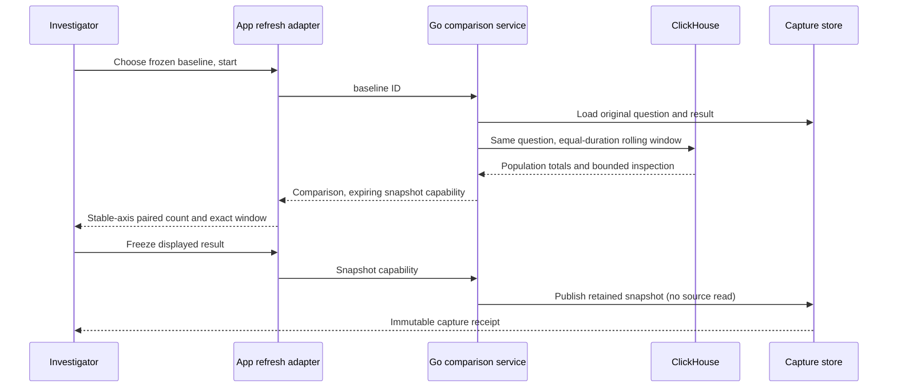

# Frozen baseline and rolling record count

Implemented for saved **record questions** (spans or logs) linked to an
investigation question. Open **Compare with a fresh window**, choose a compatible
prior evidence baseline, then explicitly **Start live comparison**. Opening the
preview and choosing evidence read only stored metadata. Native measurement
comparisons retain the existing fixed-window capture flow.

The rolling window has the baseline's exact duration (at most two hours), ending
at the server's evaluation time. Environment, predicate, reported edge and all
other question settings come from the stored baseline, never a client-supplied
replacement question. The baseline is never reread or edited. Current counts
come from full-population ClickHouse aggregates; inspection rows are bounded at
1,000 and never define counts. This is unrelated to the local live-log buffer.

A successful read displays both exact windows and source-read time. Coverage
remains unknown, separate source reads are not transactional, and differences
are descriptive. No rates, unique requests, statistical significance or causal
attribution are inferred. Existing evidence compatibility checks withhold numeric
comparisons for unavailable/no-data or incompatible results. The initial view
shows record count only; live duration/status/native-metric charts are future work.

The app refreshes ten seconds after a completed read, with one outstanding read
per panel. Pause, hidden browser, route change, preview close, baseline change or
removal aborts/stops refresh. Old generations cannot publish into a replacement
panel. Failed reads retain the previous snapshot with a stale label and its
original window. A failed first read is unavailable; no prior result is invented.
Baseline window and source-read provenance live in a native disclosure; the
current window remains visible in the chart frame. Pausing never advances the window. Refresh is polling JSON,
not SSE; reusable display components own no subscriptions.

The first comparable result establishes the common zero-based axis. Later
values retain it. A result exceeding that domain withholds bars until the user
chooses **Rescale comparison**; it never clips a value or silently changes scale.
The same axis applies to both sides, including after counts fall.

**Freeze displayed result** pauses refresh and publishes the exact server-owned
snapshot. It does not query telemetry again, even if late telemetry has arrived.
The immutable capture separates its source-read time from custody time and is
available through the capture library. **Add frozen result to investigation**
links it to the current question draft; saving a revision is explicit. The
original investigation revision remains unchanged. This
is distinct from **Capture and compare**, which executes its previewed question.

`POST /api/captures/live` accepts exactly one `baseline` capture ID or `freeze`
capability. Refresh may supply `replace` for the previous capability. Snapshots
are process-local, expire after two minutes, and are bounded to 16 entries,
4 MiB serialized content each, 16 MiB total serialized content. Refresh replaces its previous draft. Repeated freeze
before expiry returns the same capture receipt. Expiry/restart returns 410;
published captures remain durable. Capabilities travel in POST bodies, not URLs.
This local lab has no production authentication/session isolation; these limits
are execution controls, not authorization. Existing query concurrency budget and
55-second source timeout apply.

Journey 69 ingests real OTel spans, compares 2 baseline/4 current records, grows
the current population to 7, exercises explicit rescale and a failed read, then
adds an eighth source record before freezing the displayed seven. It reopens
stored evidence and proves the baseline is unchanged. Its observed ledger is
replayed through Quint with six rejecting mutations. The optional Bombadil
actor explicitly opens, selects, starts, freezes and links the feature. Hegel generates
shifted equal-duration windows and incompatible environment comparisons. Go
source/HTTP tests verify bounded inspection, full totals, custody and idempotent
source-free freeze. See VALIDATION.md for actual execution results.
