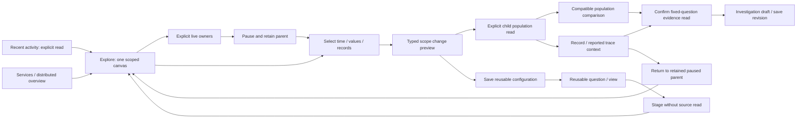

# Explore what is happening now

Whole-product design pass, 2026-10-21. **Proposed experience, not implemented UI.**
This is an expert source/design review, not customer usability research. It reviews
the current Explore/population/tail adapters, shared components, existing product
reviews, and the actual journey 92 desktop screenshot. No new runtime campaign
or screenshots were produced for this documentation change. Implemented contracts
remain in [Population workspace](POPULATION_WORKSPACE.md) and
[UI components](UI_COMPONENTS.md).

Implementation follow-through: the first [recent-entry canvas slice](RECENT_ACTIVITY.md)
provides the direct planner entry and compact fixed-result composition. This
document retains the wider proposed experience. [Time brushing and bounded retained
children](RANGE_DRILLDOWNS.md) now implement the first selection/navigation slice;
rectangle selection, record trays and persistent branches remain subsequent work.

## Product decision

Make **Explore one workspace for recent activity, narrowing, comparison and
investigation**. The usual first question is “What is happening in the part of the
system I care about?” The next is “What distinguishes these records from the
rest?” Grammar authoring, dashboards and evidence custody should support that
path without being prerequisites.

The current entry sequence requires a fixed question, then a linked population,
then a separately started tail, then a separately prepared comparison. The journey
92 screenshot shows several nested headings and control bars before records,
with comparisons below the tail. These are useful mechanisms presented as separate
destinations. Consolidate their orchestration and visual hierarchy; retain their
distinct execution and evidence semantics.

Explore becomes the default working canvas. Services opens the same canvas with
qualified service scope and its operational overview. A distributed view provides
another scope/relationship lens. Investigations holds durable explanations;
Library eventually holds reusable definitions and views. Measurements and
application contracts remain specialized lenses with appropriate evaluators,
not mandatory modes for finding ordinary spans or logs. Preserve existing routes
until equivalent workflows and links exist.

## First arrival and compact layout

On first arrival show source/environment, a recent-window choice, and **Show
recent activity**. That action authorizes a bounded initial plan: observed signal
availability and primary span/log activity, with a disclosed request budget.
Never guess a production environment. Restore an existing workspace configuration
without reading telemetry; offer **Run** or **Start live**. For a new workspace,
use a five-minute fixed overview proposal; until broader tail windows exist,
label the tail's independent last-60-seconds window explicitly. Initial activity
is an explicit read, not an automatically started subscription.

After entry, prioritize the following compact arrangement:

```text
Explore    source / environment / service       Last 5m   Refresh | Start live
Filters: [service.namespace = shop] [region = west ×]     + Filter   Undo
Activity ─────────────── selected UTC interval ─────────────── compare overlay
Duration heatmap / distribution                 Split by: service ▾
Fields / facets       Matching records                  Selection / inspector
route                 UTC · service · operation · duration · status
release               compact rows; columns ▾           Inspect | Compare
region                page/retention state              Capture | Save reusable
```

This is a layout sketch, not a screenshot. Use one scope bar and one action row;
remove nested “single question / population workspace / watch population” shells.
Show activity before detailed controls. A compact count, error-status share and
duration strip replaces tall summary cards. Exact source clocks, selector trees
and receipts belong in disclosures; scope, stale/partial/gap state and signal grain
remain visible. On narrow screens, facets and details become drawers; plots and
records retain priority. Keep comparisons adjacent or overlaid on common axes,
not separated by a long record viewport.

## One canvas, explicit time modes

| Mode | Meaning | User controls and boundaries |
| --- | --- | --- |
| Recent fixed | A resolved half-open UTC interval, independently read per signal | Refresh resolves new bounds; old results retain their original basis until replacement succeeds. |
| Live | Explicit scheduled full-population chart reads plus an optional bounded record subscription | Start/Stop live owns the declared read plan. Display chart and tail windows separately if unequal; no implication of a synchronized snapshot. |
| Paused / selected | Retained observations and fixed read bases | Starting a brush or selecting a row pauses moving owners before hit-testing. Nothing moves under selection. Resume explicitly clears or retains selection by a visible choice. |
| Frozen evidence | Immutable saved result with receipt | Reopen is source-free. Rerun creates a new result; it never updates the old capture. |

A single future Start live action can coordinate supported owners, but must say
what starts and at which cadence. It must not imply today's tail and comparison
windows already match. Unsupported signals remain useful in fixed mode. Navigation
or hiding stops subscriptions; returning restores the paused workspace. No widget
may start a source read from connection, expansion or property assignment.

## Natural gestures and their execution contracts

| Gesture | Immediate response | Explicit continuation |
| --- | --- | --- |
| Drag horizontally across a time chart | Pause motion; preview a UTC interval on all aligned plots | **Apply range** reads that fixed interval; **Cancel** restores the previous view without a read. Numeric UTC handles provide keyboard/touch alternatives. |
| Drag a rectangle over a duration heatmap | Preview time × duration bounds and matching typed predicates | **Inspect population** runs the bounded query; bucket-edge inclusion and exact units must match Go semantics. Never estimate its population from pixels. |
| Click a series, facet value or attribute | Show selection with Include / Exclude / Compare actions | Include or Exclude is an explicit read action with its predicate visible. Same-field multiselect proposes OR; across fields AND; preserve advanced existing trees. |
| Toggle errors or a signal | Preview the precise supported selector or signal plan | Apply explicitly; unset/unknown statuses remain distinct. “Errors” cannot silently combine span status and log severity. |
| Adjust a duration/value slider | Preview bounds, units and resulting predicate | Apply on confirmation, not every pointer movement. Pair with exact text inputs. Log-scale position is not a measurement transform. |
| Click / check / Shift-select records | Pause tail, retain nodes, show a selection tray | Inspect one; bookmark several; open reported trace context; prepare a population from chosen attributes. Row range means visible rows only. |
| Customize columns, order, widths, pinned fields | Local presentation only, preserving focus | Save as part of a view; fetching missing fields requires a separately labelled read. Discovered fields are not exhaustive. |
| Pin baseline, choose previous window or another population | Show both scopes and compatibility before reading | Compare explicitly; use shared axes, counts and denominators, with unequal durations/grains clearly stated. |
| Broaden from an inspector | Preview exactly which service, time or attribute restriction is removed | Open a child scope; retain a breadcrumb and parent state. Never silently drop unsupported predicates. |

Avoid magic modifier keys as the only affordance. Every gesture has visible
controls, focusable targets, cancellation and an equivalent form action. Touch
scrolling remains scrolling until selection mode is deliberately engaged.

## Isolate populations before promising anomaly detection

Start with tools for seeing differences: aligned activity bars, a duration heatmap,
ranked facets, shared-scale comparisons and a readable record table. Default
facets can suggest supported OTel service/namespace, operation or templated route,
span kind/status, release and region fields. Keep resource and record namespaces
distinct, expose generic custom fields, and avoid raw URLs or identifiers as
default groupings. A log-only service must not land on an empty span dashboard.

The useful comparison shortcut is **Selection versus rest of this population**,
followed by **Previous window** and **Choose baseline**. “Rest” needs an exact Go
predicate complement within the original parent, not all system data or a second
independently filtered sample. Missing values and overlapping selections need
explicit semantics. This shortcut is proposed; existing value-to-value and
previous-window comparisons should be reused first.

A later **What differs?** panel should rank candidate dimensions using Go-computed
population counts, shares, coverage and minimum support. Display absolute counts
alongside percentage-point changes; show small samples, missing fields and bounded
top-N/other coverage. It suggests dimensions worth inspecting, not root causes.
Statistical anomaly detection needs a separately specified baseline, seasonality,
sampling assumptions, multiple-testing policy and testable scoring contract. A
bright outlier or large relative change is not automatically an anomaly.

Basic transforms should initially mean typed operations already understandable
in the query: filter, group, choose an aggregate, sort, select time, and rename or
format a display column. Add rates, deltas, unit conversions and derived values
only through typed Go capabilities, with units, grain, counter resets and invalid
inputs handled there. No JavaScript expression evaluator; no percentile averaging.

## Select, inspect, capture and expand

The selection tray should distinguish **observations** from a **population**.
An observation carries its supplied fields, original read window, selector,
source/connection provenance and gap state. A population carries a typed query,
fixed bounds, signal grain and optional parent/baseline references. Neither is
automatically evidence. A local tail handle is not a stable physical event ID.

Open details locally from supplied data. Trace/context expansion is a separate
labelled source read using reported identities and the original observation
window. Offer time expansion and service-filter removal as previewed scope
changes. Keep the parent paused, retain its rows, scroll, selections, columns and
baseline, and provide **Back to live workspace** without an automatic restart.
Late child responses cannot overwrite the parent.

Use **Capture evidence** consistently. The initial supported path resolves the
selection into a fixed typed question and explains that confirmation rereads it.
An immutable capture receipt records that new evidence basis; a missing original
anchor is visible and never represented as successfully captured. Exact saving
of retained tail bytes or arbitrary multi-record sets requires a separate custody
schema and validation; do not imply today's population capture does that.
For multiple selected items, stage a bounded list of capture intents and show
success/failure per intent. Add successful captures to an investigation draft
only through explicit actions; Save revision publishes that draft.

## Reusable pieces and composition

| Piece users can reuse | Meaning | Composition rule |
| --- | --- | --- |
| Population | Signal, qualified scope and predicate expression | Combine only through checked Go operations; intersect by default, never overwrite a selector silently. |
| Time policy | Fixed interval or relative lookback | Resolve relative time once for a run and disclose bounds. Frozen evidence always retains fixed bounds. |
| Measure | Count, duration or supported typed native/attribute evaluation | Retain unit, grain, eligibility, source binding and missing-data semantics. |
| View | Columns, grouping, chart type and layout over questions | Presentation and query configuration only; opening is source-free. |
| Comparison | Two questions or frozen capture references plus compatible measures | Keep both scopes and independent read bases; no implicit baseline refresh. |
| Evidence / investigation | Immutable result receipts; authored explanation citing them | References stay immutable; reuse a definition through a new run, not mutation of evidence. |

These are conceptual pieces, not a proposal for six new persistence APIs. First
compose the existing typed queries, saved exploration views, packages, captures
and investigation revisions. A later named reusable selector or parameterized
question needs explicit versioned references, cycle detection, bounded expansion,
capability validation and migration rules. Never persist copied UI state as a
second semantic language. Export useful definitions to existing package authoring
where representable; annotations are optional enrichment, not entry requirements.

## Widget and adapter work

| Need | Existing basis | Missing bounded work |
| --- | --- | --- |
| One scope/mode bar | Question scope, evidence summary and workspace history | Consolidated owner state; compact draft/applied/live/paused indication. |
| Linked time and value selection | Time range, time bars, value timeline, bucket heatmap | Shared brush preview/commit/cancel contract, rectangle selection and accessible equivalents. |
| Compact facets and filters | Facet list, attributes, typed query AST | Include/exclude multiselect, visible AST grouping, apply batch and undo. |
| Record selection and field chooser | Native table, typed field values, bounded tail | Stable owner selection, local selection tray, arbitrary supported columns and compact reorder UI. |
| Inspector and scope continuation | Existing inspector shell, trace waterfall and workspace history | Parent/child state retention and explicit widening proposals. |
| Comparable populations | Shared comparison display, distributions and live comparison | Adjacent scope headers and optional compatible overlays; exact complement and difference ranking need Go support. |
| Reuse and evidence | Saved views, packages, capture and documents adapters | One action vocabulary and staged multi-intent capture with partial results. |

Keep display Web Components passive and framework-neutral. Standardize selection
events around supplied opaque keys and exact bounds, with preview/commit/cancel
phases; the application validates bounds and maps them to typed queries. Components
must not infer predicates from field names, fetch, subscribe, navigate or capture.
Use existing components in two real compositions before adding a new public element.



## Delivery order and acceptance storyboards

1. **Make the canvas the entry point.** Remove nested shells; recent fixed activity,
   compact scope, facets, plots and rows in one layout. Reuse the existing bounded
   population planner. Manifest-free multi-service, log-only and no-data fixtures
   must all have useful entry states. Opening a saved view remains source-free.
2. **Unify selection and parent retention.** Brush time, select a facet or record,
   pause motion, preview a child question, run and return. A generic slow-route
   storyboard must preserve the original parent rows, window, baseline and scroll;
   keyboard/mobile alternatives must perform the same query transformation.
3. **Compare populations visually.** Use current baseline mechanisms in the same
   viewport. Implement exact selection-versus-rest and dimension differences only
   after Go contracts and fixtures exist. Show unequal durations, missing fields,
   zero baselines and partial reads without misleading normalized changes.
4. **Preserve and compose.** Capture selected fixed questions with partial-failure
   handling, add evidence to an investigation, save reusable view configuration,
   reopen both in a fresh browser, and explicitly run a fresh interval. Keep old
   evidence immutable and subscriptions stopped until requested.

This ordering supersedes adding another isolated “tail to investigation” panel.
That workflow belongs in steps 2 and 4 after the primary entry canvas is coherent.
It does not require automatic anomaly detection, a new dashboard editor or a new
query engine.

For each implemented slice, regenerate actual desktop/mobile journey frames and
update architecture/component docs. Playwright uses real generic OTLP data and
checks query bounds/predicates, request budgets, source-free previews/reopening,
partial failures and late responses. Bombadil actions cover brush/cancel/apply,
include/exclude/undo, select/inspect/return and explicit live start/stop; invariants
cover stable selection, bounded retention, no hidden subscriptions and overflow.
Hegel properties/state-swarmed sequences check typed transforms, exact complement
partitioning when added, missing/empty distinctions and immutable configurations.
Quint/quint-go replays observed owner/read transitions with rejecting controls for
hidden reads, widened selectors, changed parent state and overwritten captures.
These are acceptance plans, not new passing test claims.
