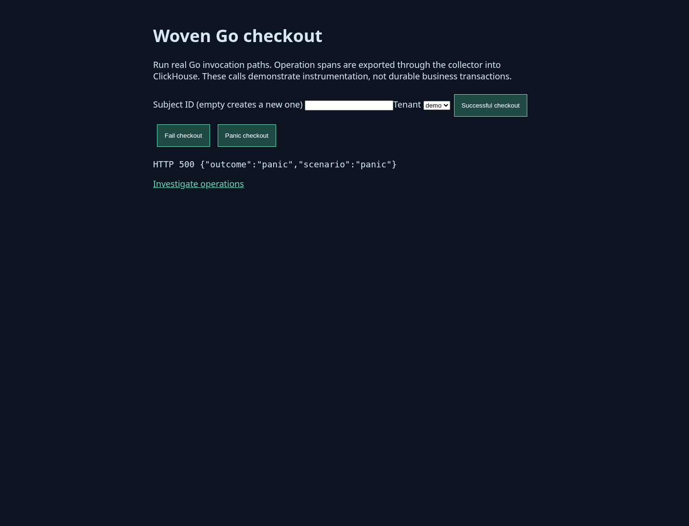
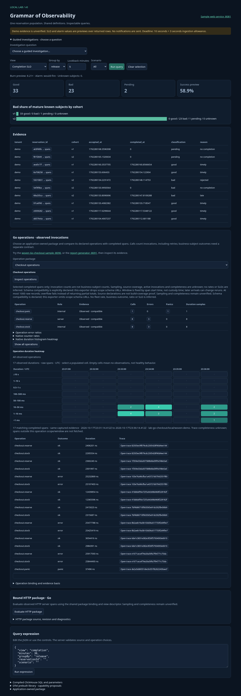
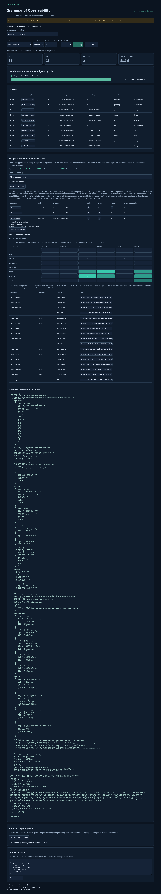

# Live woven operation investigation

The separate Go checkout sample emits actual woven operation spans through the
standard OTLP/HTTP exporter → existing collector → ClickHouse `otel_traces`.
The Go package service checks those spans against the sample's source manifest.
The investigation UI presents declared operations with compatible observed
invocations, or `Unobserved · unknown` when evidence is absent.

## Executable storyboard

The eighth Playwright journey in `journeys/investigation.spec.js` executes this
sequence against running services, without mocked telemetry:

1. Open the woven checkout sample on loopback port 8090. Run successful checkout,
   failing checkout and panic checkout. Real Go functions return HTTP 200, 503
   and 500 respectively. Panic recovery in the HTTP handler preserves the process;
   the woven function records its panic and rethrows it to that handler.
2. Wait for exported spans to reach ClickHouse. Two reserve invocations include
   one error; a separate panic invocation is recorded. Existing observations in
   the selected window can make totals larger.
3. Open the investigation UI on loopback port 8088. Set lookback to five minutes
   and select **Inspect operations**. The panel shows operation, role, evidence
   status, completed calls, errors, panics and duration sample count.
4. Open **Operation binding and evidence basis** to inspect the source contract
   revision, content-derived evidence label, resource binding, fixed bounds, SQL,
   typed parameters and duplicate count.

Captured frames:

Run `npm run test:journeys`. The existing wrapper drains only owned demo traffic
and restores it without resetting volumes or deleting stale pending entries.

## Build and startup

Default Compose includes `operation-app`, the existing Go `packages` service and
Python `query` proxy. The app has an isolated module under examples/operation-app;
Orchestrion and OTel SDK/exporter dependencies stay outside the root runtime
module. `scripts/build_operation_app.sh /absolute/output/path` validates the source
contract before building a static woven binary. Plain `go build` ignores the
annotations and is not the supported sample build.

The dedicated Dockerfile also validates the contract before weaving. On managed
hosts its build can receive a combined CA bundle as a `proxy_ca` BuildKit secret;
TLS verification stays enabled. This environment validated a host-built static
binary in the existing offline-wheel image, not the networked multistage Dockerfile.
Use `docker compose config --quiet`, then `docker compose up --build -d` on a host
with normal build networking. Ports bind to loopback. No Databricks instance is
required. Source contracts and resources are now selected by
[YAML operation packages](OPERATION_PACKAGES.md) using repeatable
`-operation-package` flags.

## Source and interpretation contracts

The explicit local binding selects service `lab-go-checkout`, environment `local`,
instance `woven-demo`, and instrumentation scope/version from the source manifest.
The demo instance identity is deliberately fixed for this one sample container;
replicated deployments require distinct instance IDs and an explicit aggregation
contract. A half-open span-start window is frozen per request, at most 120 minutes.
All selected completed raw spans are inspected up to a 1,000-record guard; record
1,001 fails the report rather than producing partial totals. HTTP response payloads
are bounded at 8 MiB and queries at ten seconds. Values use typed parameters.
Returned timestamps, resources, scope/version, span kind/role, IDs, durations,
outcomes and duplicates are independently validated. Conflicting copies fail.
Exact raw copies are deduplicated before the common conformance evaluator.

This exporter drops scope schema URLs. The source adapter labels the schema as
explicitly declared compatibility, not observed proof. The UI retains that caveat.
It uses DOM text nodes for source values. Unobserved rows display unknown counts.
Durations remain exact uint64 samples in the Go API, with decimal-string evidence
for browser selections. The browser does not reconstruct percentiles. Calls count function
invocations, not unique requests or business subjects. Errors and panics are
separate categories; the sample currently exports traces, not native metrics.

A manifest describes the selected source package, not linked-build coverage.
Sampling, missing telemetry and ingestion completeness remain unknown. The basis
hash captures source revision, resource binding, window and returned rows, not an
immutable custody snapshot; late arrivals can change a rerun. No native counter
rate, reset-aware metric operator, histogram merge, SLO, business-outcome aggregate
or Databricks execution is claimed. See OPERATION_CONFORMANCE.md for the pure API.

The panel now also supports [operation duration heatmaps and trace drilldown](OPERATION_DRILLDOWN.md)
over a single captured response. The sample includes a nested stock-check
operation with explicitly simulated bounded dependency work.
