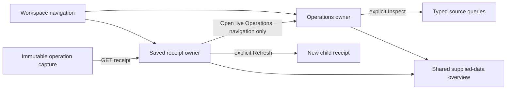

# Live and saved operation ownership

Implemented in the first consolidation round. Operations keeps its live package,
lookback, returned evidence and local selection. Navigation never moves that editor
into Saved investigations. Saved operation captures use a separate supplied-data
presenter with distinct DOM IDs; opening, selecting a heatmap cell, restoring a
ratio explanation or following a retained trace does not read telemetry.

`GooOperations.overview` supplies the same operation table and evidence explorer
to both owners. Rates, ratios, fleet coverage and histograms retain their typed
renderers. Saved rendering uses only the stored receipt and does not assign the
live `activeOperation`, package selector or selection controllers.

**Open live Operations** changes destination only. It preserves whatever live
package, lookback and selection were already there; it does not copy the saved
package or run a query. **Refresh saved evidence** remains the explicit fixed-
question reread that publishes a child receipt. Expanding a trace across services
is still an explicitly named independent context read.

Old `#investigation=<id>` links and immutable IDs remain valid. The browser journey
19 reloads an actual receipt while source APIs are blocked, verifies restored
selection, unsaved investigation notes and independent live ownership, and refreshes a late-arriving span into
a successor while preserving the original. The workspace Bombadil invariant
checks that the editor always belongs to Operations and never appears in Saved.
