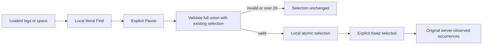

# Select loaded matches

Activity offers **Select N loaded matches** beside a valid nonempty Find. Pause
explicitly first. This selects occurrences already loaded in the browser; it does
not search the source or establish a population total.

The action adds every matching occurrence to the existing selection, including
selected items hidden by Find or evicted from the loaded buffer. The full union
must fit the 20-occurrence limit. Every old and new occurrence must retain its
original unexpired membership, key, connection, checked selector and observation
window. Conflicting copies of one key refuse the operation. Identical copies are
idempotent. Refusal leaves the entire original selection unchanged; nothing is
truncated, replaced or silently refreshed.

Zero matches, already selected matches, streaming and pending preservation expose
an explicit disabled reason. Clear Find hides the batch action without clearing
selection. Successful keyboard activation moves focus to **Keep selected**, without
activating it. Other updates do not steal focus. Retired controls cannot select a
newer Find, layout, buffer, scope or connection, even after returning to the same
visible values.

The app-owned selection planner returns detached data; committing replans the
original inputs rather than trusting an earlier plan. Existing selected objects
and their original references survive successful additions. Display availability
is advisory; the click rechecks freshness and current references. Selection makes
no requests or writes. Existing Keep alone stores the exact original references;
there is no new endpoint, query operator or persistence format.

See the [executable journey](journeys/325-select-loaded-matches.md),
[architecture review](reviews/LOADED_MATCH_SELECTION_ARCHITECTURE_325.md),
[design review](reviews/LOADED_MATCH_SELECTION_DESIGN_325.md) and
[validation](../VALIDATION.md).

326 consolidates repeated layout reads: each matching/projection pass takes one
detached chosen-column snapshot. The batch control no longer retains an unused
detached record plan. Full readiness and click-time validation remain unchanged;
there is no readiness cache. See the [bounded browser measurement](reviews/LOADED_MATCH_SELECTION_BENCHMARK_326.md).
