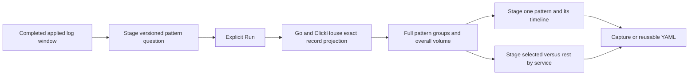

# Log-pattern exploration

Source is implemented and independently reviewed; live acceptance is in progress.

From logs in Activity, choose **Investigate → Log patterns**. This pauses the
stream and stages its completed applied window with the original filters.
**Run analysis** measures the full matching population. The table shows inferred
text shapes, exact record counts and shares; local most/least-frequent sorting
helps find common and rare shapes. It does not read more telemetry.

The timeline shows overall log volume. **Open pattern logs** stages that exact
shape's records and its own timeline. **Compare services with rest** stages a
disjoint selected/rest pair over the whole parent, grouped by service. Run reads
both independently. These descriptive comparisons do not infer issues or causes.
Existing capture, saved scope and reusable YAML owners retain the same questions.

## Immutable profile v1

`column:body_pattern_v1` is a log-only derived field. Every log contributes once.
The normalizer leaves the stored Body unchanged and replaces every maximal ASCII
digit run `[0-9]+` in its inferred shape. Signs, punctuation, whitespace, letter
case and non-ASCII digits stay literal. It does not parse numbers, UUIDs or IPs.
For example, `order 123 failed` and `order 456 failed` share
`order ⟪digits⟫ failed`; `v2` and `v3` also share a shape. Different event types
can therefore share an inferred shape.

Classification checks the original **UTF-8 byte length**, not character count:

| Identity | Meaning |
| --- | --- |
| `lp1:p:…` | Nonempty valid UTF-8 body of at most 256 bytes; inferred digit-run shape |
| `lp1:e` | Empty body, unclassified |
| `lp1:o` | Body over 256 bytes, unclassified; this takes precedence over UTF-8 validity |
| `lp1:u` | Invalid UTF-8 body within the byte bound, unclassified |

Unclassified buckets preserve their full counts and shares. Their members do
not claim a common message shape. Nothing is truncated into an apparent pattern.
Ordinary OTLP JSON strings are valid Unicode; invalid-byte parity is covered by
raw Go/ClickHouse tests, not fabricated browser telemetry. The profile does not
promise lossless invalid-byte transport through existing JSON record viewers.

## Exact identities and scope

Each literal byte chunk is encoded as lowercase hex; digit runs become the
separator `n`, which cannot appear in hex. The normal identity is
`lp1:p:` followed by those chunks joined by `n`, with a maximum of 518 bytes.
Literal placeholder text cannot collide with a normalization token. Predicates
use the canonical identity, never the readable label. Decoder validation rebuilds
a representative body and checks canonical re-normalization. Exact equality and
inequality are supported; encoded-substring matching is refused.

Human labels visibly escape literal backslashes, the opening token delimiter,
controls, format characters and line separators. Raw messages remain available
through existing record inspection. A later normalization policy needs a new
version/field; existing predicates and captured definitions retain v1 meaning.

The main question groups only by pattern and requests overall time buckets.
Opening one shape filters by exact identity and requests its total timeline.
It does not pretend that an eight-series grouped chart covers an arbitrary
number of patterns. The existing 1,000-group limit fails the whole request when
exceeded; the UI does not present top-K results as full-population counts.

No new query endpoint, ingestion processor or pattern storage is introduced.
Unrequested source SQL and older capture payloads retain their prior behavior.
Business-event windows, source-read time and immutable capture custody remain
separate; matching aggregates do not establish transactional isolation or
complete telemetry.
