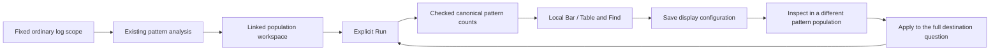

# Reusable log-pattern count displays

Implemented and accepted in milestone 391; runtime acceptance is recorded in
[validation](../VALIDATION.md).

The existing population workspace can keep a Bar or Table view of inferred log
shapes and apply its presentation to another fixed log population. Ordinary OTel
logs are sufficient. Start with log-pattern analysis, then use the existing
linked-population workflow and its display settings, save and reuse controls.
From the Records tab, open Population context and choose Explore linked
population. View settings enables the reusable log display; Chart settings
contains kind, scale, ordering and local Find. Preserve saves the configuration.
The specialized pattern analysis and time-comparison workflows remain available.

## One finite profile

The existing `goo.view/1` record-query declaration uses
`display.profile: "log-pattern-count-v1"`. It requires logs grouped solely by
`column:body_pattern_v1`, a count measure and the existing Bar/Table kinds.
Numeric measures, duration summaries, grouped time series, reported edges and
template expansion are outside this profile. The profile is required for this
grouping; it cannot be attached to an ordinary string-category query.

The supplied `goo.dataset/1` ranked dataset has one non-null string category,
marked `format: "log-pattern-v1"`, and a captured-record count. Category values
retain the canonical `lp1` identities. The existing pinned decoder derives
readable labels for charts, tables, Find, label ordering and selection summaries.
Literal placeholder characters, controls and HTML remain escaped text. Labels
are presentation, never filter keys, row identity, incidents or causes.

Empty, oversized and invalid UTF-8 bodies retain explicit unclassified groups.
Their recorded counts are known; unclassified does not mean an unavailable
numeric value. Pattern normalization and raw bodies are unchanged. See
[log-pattern semantics](LOG_PATTERNS.md).

## Scope and certainty

Count and population-share presentation use the same checked group dataset.
Local Find, ordering and kind changes do not change the denominator, source
question or immutable evidence. Exhaustive group accounting is bounded and
refuses excessive groups; there is no top-K partition masquerading as complete.
Group completeness never establishes complete upstream ingestion or sampling.

Changed-between-read or count/group disagreement retains reported counts, but
cannot attest a complete partition, authorize shares or grant drill authority.
A display declaration cannot repair inconsistent evidence. Empty populations
have no meaningful share and imply no health conclusion.

Returning from a pattern drill keeps the accepted result. Its unchanged applied
question, basis and consistent groups can stage another comparison from a visible
control without a source read. This does not renew acquisition or publication
leases: the new comparison still requires explicit Run. Dirty, hidden, replaced
or inconsistent results cannot use that held-data staging capability.

Saved configuration contains presentation intent, not source data, receipts or
execution authority. Inspect and Apply preserve the destination's complete
question: filters, environment policy, fixed time bounds and paging. Apply stages
the declaration, clears old result/selection and waits for explicit Run. Existing
capture custody and source-read clocks remain separate.

Go and JavaScript validate the same finite profile. OpenAPI describes its wire
shape; runtime additionally validates parent-query relationships, canonical
identities, full count accounting and current-owner capabilities. Optional empty
or null input profile values retain existing ordinary-default semantics; they
do not satisfy the required pattern profile.

See the [active roadmap](ROADMAP_2026_11_09_CHECKPOINT_390.md) for the next depth
and consolidation items. This cut adds no classifier, normalization version,
query engine, renderer registry or new view store.
