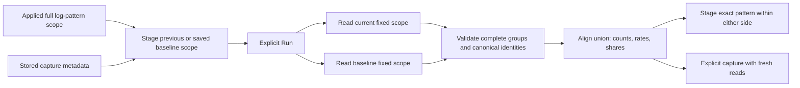

# Log patterns across time

Implemented with reviewed source and real OTel/browser/native acceptance. This extends [log-pattern exploration](LOG_PATTERNS.md)
using existing fixed questions, population comparison and capture owners.

From an applied log-pattern result, stage a comparison against the previous
adjacent window or an explicitly loaded saved capture's scope. Staging does not
read telemetry. **Run** reads both fixed questions independently; a saved capture
supplies its selector and window, not frozen baseline counts. Both sides retain
their own source-read clocks. The original saved evidence stays unchanged.

## Comparison contract

Both questions use the same `column:body_pattern_v1` profile and environment.
Each side retains its own complete selector and half-open UTC window. Different
selectors are descriptive population comparisons, not evidence of change caused
by time. Group identities are canonical and collision-safe; readable labels never
become predicates. Empty, oversized and invalid-UTF-8 bodies remain explicit
unclassified groups in the totals.

Align the union of the two complete group sets. For each identity, show:

- Exact counts in each side, with zero for a group absent from a successful,
  consistent side read.
- Records per second, calculated as `count × 1000 / windowMilliseconds`.
- Share of all matching records on that side, and current-minus-baseline changes.

Arithmetic and ordering use integer ratios, with rounded text only for display.
Shared visual scales make the two sides directly comparable. Unequal-duration
windows can have equal rates despite different counts. A zero-record population
has a known zero record rate but no defined share. A failed or inconsistent read
does not supply a zero, a difference or an absence conclusion.

“Not observed in baseline read” and “Not observed in current read” describe only
the completed reads. They do not establish first occurrence, resolution,
statistical anomaly, causality or telemetry completeness. Unclassified groups do
not claim a common message shape. The existing 1,000-group per-side bound refuses
excessive cardinality; no top-K result stands in for the full population.
The aligned union can contain 2,000 distinct identities. Initial display is 20
rows with an explicit show-more action; ranking, totals and visual scales still
use the full union. This display limit does not change either population.

## Interaction and evidence

Keep baseline controls contextual and compact. Sorting and changing a display
measure operate locally. Opening one side stages an exact profile-identity
predicate within that side's original scope. Returning to the parent remains
source-free. Dirty scope, hidden or superseded owners cannot launch reads or
navigate through stale results.

Existing comparison capture operations may perform fresh source reads. Their
labels must say so; they must not claim to freeze a previously displayed pair.
Reopening stored evidence reads storage only. Saving a reusable view retains
questions, not observed totals. Existing capture identities, body bytes, custody
clocks and normalization version remain unchanged.

No new ingestion processor, query endpoint, store or normalization version is
required. Independent reads are not a transactional snapshot. Acceptance covers
ordinary OTel logs, unequal windows, saved-scope late arrivals, unchanged
capture custody, empty/unavailable states, stale ownership, actual desktop/mobile
frames, Bombadil, generated properties and finite trace validation with rejecting
controls. Finite replay validates observed schedules, not every interleaving or
complete telemetry. See [journey 183](../journeys/183-log-pattern-time-comparisons-storyboard.md).

Reviewed source: `6482198` validates canonical comparison groups, `d5def6e`
provides the exact pure arithmetic model, and `cc81fbf` integrates staged baseline
choice, shared presentation, fresh-read capture labels and storage-only reopen.
`a29fbd2` corrects unavailable-share ranking copy. All 72 Node files, three real
browser cases, the 55-second actor and all 93 native rejecting controls pass.
Generated checks cover 150 examples, 240 metric projections and 640 rejected
response mutations; a separate boundary case retains the full 2,000-group union.
The saved baseline advances from 400 to 412 records on reread while original
stored bytes remain unchanged. Final desktop/mobile/empty frames and durable
replay modes are in the storyboard; [VALIDATION.md](../VALIDATION.md) records
actual receipts, observer corrections and evidence limits.
