# Discover metrics without known labels

Goo can find observed metric service scopes without a manifest or a guessed
environment/service name. In Activity, open **Find data**, read available signals,
then choose **Find metric scopes**. This opens Measurements without querying again
and carries the exact discovery window forward.

You can also open **Find metric scopes** directly in Measurements. Generic startup
leaves environment and service blank; the lab's optional default does not replace
a scope you have selected or edited.

1. **Read metric scopes** explicitly reads the chosen window across compatible
   metric sources.
2. Choose a service, environment and namespace. Selection is local and focuses
   **Discover instruments**.
3. Discover instruments explicitly in that exact scope and window.
4. Build a measurement package to preview its definition without reading values.
5. Run explicitly when you want evaluated source observations.

## Scope meaning

Choices combine effective environment, service and namespace across the available
metric families. Current environment-key **presence** wins over the legacy key,
including an empty current label. Missing and present-empty environments remain
distinct. Missing and present-empty namespaces also remain distinct; same-named
services in different namespaces do not collapse.

The chooser displays **exported points**, not metric values, unique streams,
histogram observations, health or complete ingestion. Its counts cover the whole
matching identity group, not displayed instrument rows. Canonical scope groups
merge equivalent current/legacy combinations before the group limit is applied.

Selecting a scope preserves its checked effective environment selector, exact
namespace and fixed window. Typing an environment replaces that selection with a
current-key-only name; changing identity fields retires instrument results and
visibly resets the discovery bounds/namespace. Package measurement windows and
applied observations retain their existing separate owners.

## Bounds and source states

`POST /metric-scopes` takes only a half-open window of at most 120 minutes. It
reuses the four metric-family readiness checks introduced in
[source capabilities](SOURCE_CAPABILITIES.md). Missing, incompatible and unreadable
families remain explicit. No usable family refuses the operation; a subsequent
source read failure does not publish a partial catalog.

The response contains at most **128 complete canonical groups**. More groups,
malformed rows or an oversized response refuse the catalog; the UI does not
present an arbitrary first page as exhaustive. The existing lookback control lets
you narrow a read. Empty results mean no observed scopes in that successful read.

Raw identities beyond selector limits remain visible but cannot be chosen. They
never become a synthesized environment, service or namespace. Point counts use
exact decimal UInt128 strings. The bounded aggregate, not a sample, supplies them.

## Discovery and evaluation are different

Discovering an instrument and previewing a package do not establish that its
points meet the existing kernel's requirements. In particular, Goo's current
**service-instance evaluation** path requires reported `service.instance.id`.
This is stricter than universal OTLP stream identity, and is not a requirement to
browse metric scopes. No instance identifier is invented for missing data.

The metrics-only journey reports actual instance IDs for its successful Run.
Clearer preflight for absent instance identity, and a separate design decision on
generic reported-stream evaluation, are tracked in the
[roadmap](ROADMAP_2026_11_14_CHECKPOINT_430.md). This feature does not expand kernel
eligibility or claim that every discovered instrument is executable.

```mermaid
flowchart LR
  Available[Observed metric family] -->|local exact-window handoff| Picker[Find metric scopes]
  Picker -->|explicit read| Choices[Qualified observed identities]
  Choices -->|local selection| Intent[Environment + namespace + service + window]
  Intent -->|Discover instruments| Instruments[Existing supported/unsupported catalog]
  Instruments -->|Build: pure preview| Package[Checked measurement definition]
  Package -->|Run: source read| Result[Existing kernel evaluation]
```

[Executable storyboard](journeys/metric-scopes.md) · [API](API.md).
