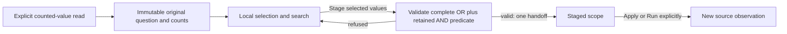

# Select several counted values

Load counted values in Filters, then select one or more values and choose
**Stage selected values**. Selection, search and **Clear selected values** are
local. Search keeps choices outside the visible results and reports how many
selected values are hidden. **Apply scope** or the owning view's explicit Run
acquires the new population.

Values selected within one qualified field use OR. The selected alternatives
are combined with the retained applied predicate using AND. Choosing two
countries means `(country = US OR country = DE) AND original scope`; it does not
replace existing constraints, including constraints on that same field. Resource
and attribute fields with the same name remain different fields.

Missing keys, present empty strings and literal values such as `"Missing key"`
remain distinct. Each checkbox keeps the original captured count visible and
available to assistive technology. Selection reports the number of chosen
values, never an inferred new population total. Counts and read facts continue
to describe the original applied window, not the new draft.

The shared renderer copies supplied facts and owns only its local selected
indexes. The source owner supplies a separate live lease. Checkbox changes,
Clear and Stage check that lease; Stage also requires the editor's current
signal and predicate to match the counted question. Changing the source scope,
editor draft, field or result retires selection authority. Identical later scope
text cannot revive a retired source generation.

The pure predicate helper validates the full combined expression before the
editor replaces its tree or emits a change. Node/depth, field and UTF-8 value
bounds apply to retained predicates and selected alternatives together. A choice
that exceeds those bounds is refused without losing the prior valid selection.
Unsupported values stay visible with counts but cannot be selected.

This replaces immediate single-value staging in the shared filter editor.
Existing contextual **Facet by…**, explicit Load, count conservation and native
return behavior are retained. There is no new endpoint, SQL engine, persisted
selection format or claim of upstream sampling completeness.

[Storyboard](journeys/multi-value-facets.md),
[independent review](reviews/MULTI_VALUE_FACETS_REVIEW_422.md), and
[validation](../VALIDATION.md) record executed checks and their limits.
