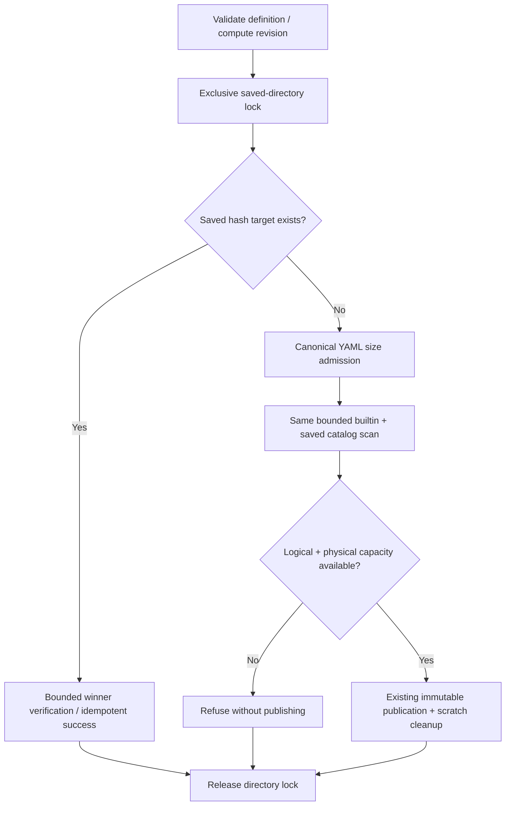

# Native package publication and catalog capacity — 246

A successful new publication must remain discoverable by the same catalog reader.
`internal/nativecatalog` now owns one policy for native discovery, immutable
publication and exact lookup. The HTTP adapter retains the existing YAML/response
shape, 201 publication response and 400 validation/capacity refusals.

The complete catalog admits at most **256 distinct revisions** across builtin and
saved definitions. Each root separately admits at most **256 physical entries**
with a 257-entry overflow read. Aliases are deduplicated by checked revision for
the logical limit, but every physical entry—including junk and directories—uses
scan capacity. YAML entries must be regular files of at most 32 KiB; bounded actual
reads enforce the same limit. A hash-shaped filename must match its contents.
Builtin ownership remains visible when a saved alias has the same revision.
Worst-case input is bounded by both roots, not by an unbounded directory walk.

New canonical YAML must fit the reader's file limit **before publication**. The
writer verifies its immutable target first. A valid duplicate succeeds even at or
above capacity; a corrupt, wrong-revision, oversized or nonregular winner fails
without replacement. Duplicate success establishes that revision's integrity,
not the health of unrelated files. New revisions fail when either capacity is
exhausted or the current catalog is invalid. Saving an existing builtin revision
still preserves an immutable saved copy when physical space remains.

## Atomic admission

On supported Unix platforms, cooperating Goo processes use advisory locks on the
saved directory itself: shared for reads, exclusive across writer admission,
temporary publication and cleanup. No persistent lock file or GET-time directory
creation is needed. Waiting respects request cancellation. A read that observes a
missing saved root uses an empty saved snapshot for that invocation; it must not
reopen the path unlocked if the first writer creates it concurrently.



This is a stable local-filesystem contract. The configured saved directory must
remain in place; external editors, root replacement, noncooperating writers and
network filesystems without equivalent locking are outside the guarantee. Unix
implementations cover Linux, macOS and supported BSDs; other platforms fail closed
instead of pretending concurrent quota admission is safe. No new dependency or
user-facing synchronization machinery is required. Existing file-sync-only YAML
durability semantics are unchanged.

## Existing over-limit stores and exact recovery

No existing definition is deleted, truncated or rewritten to meet a quota.
Full catalog reads refuse an over-limit or corrupt store explicitly. New saves
are refused; verified duplicate retries still succeed. Known saved revisions use:

```text
GET /api/measurement-packages/revisions/{revision}
```

This performs one bounded hash-file read and identity check without enumerating
the saved catalog. A corrupt saved winner is refused before builtin fallback;
only an absent saved target permits a bounded builtin scan. Invalid IDs/query
parameters are 400, absent revisions 404. Arbitrary legacy alias filenames cannot
be resolved by hash without enumeration; ordinary Goo publications are hash-named.
The endpoint does not claim that the overall catalog is healthy.

The measurement workbench's existing **Package definition** disclosure now accepts
an exact revision and **Open revision**. It checks that response's generation,
opens the definition and previews a source plan. It does not run a measurement,
read telemetry or publish anything. Retained catalogs/details survive a failed
refresh. Saved investigation links already carry their complete checked question;
they do not need a catalog scan to restore it.

[The executable journey](../journeys/246-native-catalog-capacity-storyboard.md)
checks admission, browsing and over-limit recovery. Root tests cover independent
stores and subprocesses contending for the last slot, builtin union/aliases,
canonical size, duplicate/corrupt winners and cancellation. Hegel state/swarm and
a small observed Quint boundary trace complement those tests; the Quint binding
checks a bounded safety prefix, not campaign completion or arbitrary disk edits.
