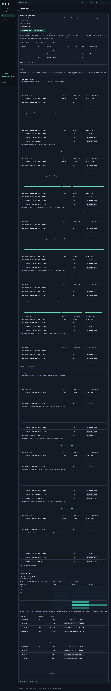
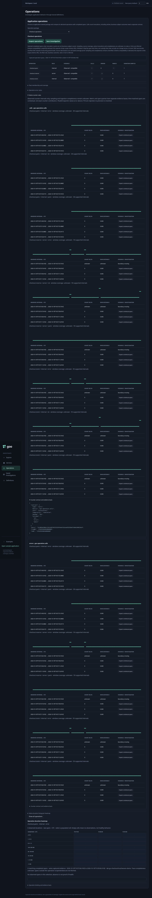

# Native counter interval rates

Goo now evaluates monotonic counter observations independently of storage, and
uses that evaluator for an opt-in live operation-rate view. The checkout Go app
exports actual native metrics through the standard OTel HTTP metric exporter every
two seconds, alongside its trace exporter. The report app remains trace-only.

This implements per-resource/instance/attribute-stream interval rates. It does not
sum fleet rates. [Error ratios](OPERATION_ERROR_RATIOS.md) and
[histogram operators](NATIVE_HISTOGRAMS.md) now build on separate bounded kernels. A call is a completed
function invocation; it is not a unique request or durable business outcome.

## Declarative package contract

The checkout YAML enables `counter-rates` and declares two views of its counter:

```yaml
rates:
  - name: calls
    metric: goo.operation.calls
    unit: '{invocation}'
    temporality: cumulative
    maxGap: 10s
    outcomes: [ok, error, panic]
  - name: errors
    metric: goo.operation.calls
    unit: '{invocation}'
    temporality: cumulative
    maxGap: 10s
    outcomes: [error, panic]
```

Each outcome remains a separate stream. Missing outcomes are not synthesized as
zero. `maxGap` must be 1 second through 1 minute in the current live adapter;
only the declared goo operation calls counter/unit and known outcomes are supported.
The contract is included in the package revision and counter evidence basis.
This is independent of the sampling/completeness assumptions, which stay unverified.

## Evaluation rules

Stream identity includes the complete resource map (with required service/instance),
instrumentation scope/version/schema, metric name/unit and complete attribute map.
Streams with different identities are never subtracted or combined.

- **Cumulative:** consecutive points in one epoch produce the exact uint64 count
  difference over their actual observation interval. The first point is a baseline,
  not a count from zero. A start-time change makes the boundary interval unknown;
  subsequent same-epoch pairs can be evaluated. A decrease with unchanged start
  time taints that epoch until a declared epoch change. Regressing epoch starts
  reject rather than guess how a process restarted.
- **Delta:** each point's start/end bounds define its count interval. Overlapping
  intervals reject. Gaps are retained as missing coverage.
- **Gaps and flags:** intervals exceeding maxGap or touching no-recorded-value
  cumulative points remain unknown. Flagged delta intervals remain unknown.
- **Window edges:** crossing intervals are clipped for display and marked unknown;
  no count is allocated proportionally and no rate is extrapolated to a boundary.
- **Duplicates:** identical stream/timestamp copies count once. Conflicting copies
  and mixed temporality within a stream reject. Input order does not change results.
- **Late points:** sorting a new input can repair interval coverage and produces a
  new content basis. Previous result objects remain unchanged. There is no durable
  historical correction store or custody timestamp in the exporter adapter.

An interval can be `ok` with an exact zero delta when two valid points support it.
An unknown interval has no rate field. A stream is `ok` for the whole request only
when supported intervals cover the entire requested window without gaps; otherwise
it is `unknown`, or `no_data` when no usable intervals exist. This state describes
observation coverage, not instrumentation or ingestion completeness. In ordinary
rolling windows the last not-yet-observed interval often leaves window coverage
unknown even while supported interior rates are useful.

Counts and timestamps cross the JSON boundary as exact decimal strings. Rates
are rationally computed then projected to Float64 for display. The generic kernel
supports uint64 counts without floating subtraction, bounded to 10,000 input points.

Run a storage-independent example:

```sh
go run ./cmd/goo evaluate-counters -input examples/metrics/counters.json
```

Expected supported deltas are 3 and 4, with rates 0.3/s and 0.4/s respectively.

## Live source and investigation

`GET /api/counter-rates?package=checkout&fromMs=...&toMs=...` uses the operation
snapshot's fixed window. The source reads `otel_metrics_sum` with typed parameters,
read-only queries, a ten-second query limit, 1,000-point overflow guard and 8 MiB
payload limit per declared rate. It also reads at most maxGap before the window
for cumulative baselines. Overflow fails instead of evaluating a partial scope.

The adapter independently validates resource/instrumentation/unit, exact operation
and outcome dimensions, start/end bounds, temporality, monotonicity and flags.
Unlike trace rows, these exporter metric rows retain scope schema URLs; the adapter
checks that value. Missing OTLP start time rejects. The exporter stores counter
values as Float64: only finite nonnegative integers **below 2^53** are accepted,
even though the generic kernel supports larger uint64 inputs. Precision is never
reconstructed from an already rounded exporter value. Delta is fixture-tested;
the running sample uses cumulative export.

In the operation panel, expand **Native counter rates**. Charts show supported
interval segments; unknown intervals remain gaps/reasons and never become healthy
zero values. Tables are scrollable presentation only; evaluation uses all bounded
points. Each stream reports whole-window coverage and its supported interval count.
Inspect the contract and separate counter basis under its explanation.

**Inspect contextual spans** uses operation/role/outcome and the metric interval
as a span-start-time filter on the already captured operation evidence. These are
contextual matches, not exemplars or exact contributing invocations: counters are
recorded at function completion, while spans are selected by start time. A span can
start outside the metric interval or original span query. Counter and span queries
have separate bases, even though their bounds/package match. A package revision
mismatch rejects the rate display and asks for a refreshed operation capture.

## Executable storyboard

Journey 13 makes real calls, waits for collected counter baselines, makes another
call, and verifies supported positive rates in ClickHouse-backed results. It then
expands the chart, checks unknown intervals lack rates, inspects a counter basis,
and opens contextual spans. No metric data is mocked or derived from span counts.




Verification includes exact uint64 fixtures, resets, decreases, zero increments,
missing values, delta overlaps, duplicates, mixed temporality, scope separation,
window boundaries, late repair and frozen prior results. Source fixtures reject
precision loss, wrong schema/unit/temporality/flags and unknown OTLP start times.
Hegel runs 100 state/swarm sequences of up to 30 actions. Quint validates a five-step
observed evaluator trace (increase → restart → increase → gap → late repair), and
rejects a deliberately invented rate across the restart boundary. Artifacts live
under artifacts/verification/counter-*.

```sh
go test -race ./...
cd verification
go test -run 'TestHegelCounterStateSwarm|TestQuintObservedCounterEpochs' -v .
```

For context, see the [architecture diagrams](ARCHITECTURE_DIAGRAMS.md). Fleet alignment, exemplars, alerts and
Databricks native-metric lowering remain separate future work.

Operation error ratios are now a supported consumer of one evaluated rate basis;
see [policy and zero baselines](OPERATION_ERROR_RATIOS.md). The live counter
source cap is now 3,000 raw points per contract to accommodate explicit outcome
zero initialization; the 8 MiB/precision guards remain. Older 1,000-point notes
describe the earlier slice. Histogram caps are unchanged.
