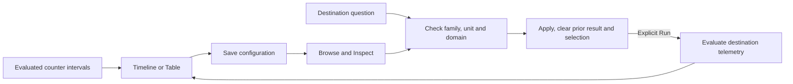

# Reuse counter interval displays

Implemented in milestone 389. See [validation](../VALIDATION.md) and the
[executable storyboard](../journeys/389-native-counter-view-storyboard.md).

Save a counter Timeline or Table as display configuration, inspect it beside a
different compatible measurement question, and Apply it before explicitly running
that question. The view stores no values, source clock, evidence basis, selected
interval or custody receipt. It uses the existing NativeView store and API.

## Applicability

The counter arm is finite:

| Property | Meaning |
| --- | --- |
| Family and grain | Counter, per-stream service measurement |
| Unit | Exact literal base unit; no conversion |
| Domain | Existing integer evaluator (omitted/empty question `counterDomain`) or explicit `nonnegative-decimal` |
| Selection | `evaluated-intervals` |
| Kind | `timeline` or `table`, version 1 |
| Display | `category: time`, `value: counter-rate`, `requiresComplete: false` |

Reuse requires the same family, unit and domain. Catalog metadata carries a
counter-only `counterDomain` discriminator, `nonnegative-integer` or
`nonnegative-decimal`. These summary names do not expand the authored question
vocabulary: `nonnegative-integer` is not a valid question policy. Inspect checks
the loaded definition against the selected metadata before allowing Apply.

The destination retains its entire question: resource identity, environment,
source filters, fixed bounds, maximum gap and counter domain. The donor supplies
only title and display declaration. There is no donor freshness, reset policy,
rate calculation or selected-interval transfer. Resource-bound counters, other
grains, stocks and unsupported policies are outside this arm.

## Evaluated data stays authoritative

The evaluator already interprets monotonic cumulative or delta exports, epoch
changes, decreases, missing values and excessive gaps. The display consumes those
evaluated intervals. It does not derive rates from table totals, merge streams,
repair resets, interpolate gaps or turn unavailable values into zero. Unknown
intervals remain outside the numeric rate scale. Recorded zero remains numeric.
Exact delta and optional exact-rate information remain available without
inventing precision that the integer evaluator does not report.

Table cells say **Unavailable** when the interval calculation is not admitted;
the source exports may still be recorded. An otherwise known interval says
**Not supplied** when its evaluator does not provide the optional exact rate.
Neither case is a recorded zero.

Browse, Inspect and Apply read configuration only. Apply clears old observations
and selection and waits for Run; it does not execute telemetry. Timeline/Table
switching uses the same supplied result locally. Source reads, navigation,
publication and fixed-window ownership remain with the application.

See [gauge/histogram display reuse](NATIVE_GAUGE_VIEW_REUSE.md),
[counter evaluation](NATIVE_COUNTERS.md), the
[review](reviews/COUNTER_VIEW_REVIEW_389.md), and [validation](../VALIDATION.md).
