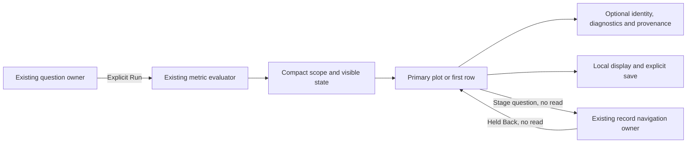

# Data-first native measurements

Implemented in milestone 390. Actual entry/browser, held-return, independent
source/geometry admission, required model and final image checks pass. See
[validation](../VALIDATION.md) for their distinct evidence boundaries.

The task is to see the observation first, identify its scope and uncertainty,
then inspect full provenance or change configuration when needed. This pass
consolidates existing presentation across ordinary Measurements, expanded service
measurements and saved native evidence. It introduces no new source executor,
metric evaluator, store, API or navigation manager.

## Presentation contract

- Keep a compact title, exact unit, fixed window and visible state beside the
  primary data. Recorded zero, stale samples, unavailable calculations, absent
  optional values and source failures retain distinct meanings.
- After a successful ordinary measurement read, collapse question-authoring
  controls. Run, cancellation, active status and source refusal stay reachable
  and visible. Reading or refusing data must not silently discard the question.
- Put the visual or first data item before full stream attributes, diagnostic
  explanations, source plans and custody metadata. Disclosures preserve access
  to those details; they do not grant execution or capture authority.
- Group the local display choice with a compact Save disclosure. Defaults must
  not name a previous display kind after switching; preserve authored titles.
- Reuse passive return-bar presentation where it fits. Each existing owner keeps
  its own current-request, visibility, held-evidence and focus checks.

The ordinary gauge's held-question staging capability remains separate from
native acquisition/publication. Counter and histogram interval semantics remain
distinct from gauge observations. Save/reuse continues to preserve the whole
destination question and waits for explicit Run.

## Component boundaries

Application adapters own source reads, scope, navigation, cancellation and
publication. Reusable display components receive supplied data. Layout styles
must target their own children rather than applying card padding to nested plots
or selected-interval sections. Verify standalone/server-rendered and nested SPA
composition, including the shared numeric/unavailable time axis and keyboard
focus. Remove duplicated mechanics only where their authority policies match.
`goo-chart-frame[density="compact"]` owns compact chart chrome; application
styles retain only placement and the plot's public height variable.

## Acceptance

Measure the actual scroll container and viewport at ordinary read completion,
service-native entry and saved-capture entry. Desktop and 390-pixel screenshots
must show the primary data at the natural entry position. A forced test scroll
is inspection, not entry proof. Record application-driven navigation/focus and
any resulting scroll separately.

Use actual OTel source banks for integration, including zero, unknown, empty and
refused states. Compare requested scope, clocks, source/custody counts and held
selection before and after local disclosure/display/return interactions. Browser
rectangles prove geometry; independent source checks and measured model replay
prove different bounded properties. Neither substitutes for the others.

### Actual entry result

The final browser journey passes all 14 natural-entry checks across seven surfaces
and two viewport widths. Ordinary counter first data moves from about 1,775 to
649 pixels on desktop and 2,609 to 581 pixels on narrow screens; saved counter
narrow moves from 2,205 to 614 pixels. Source, custody and return owners retain
their existing roles. Four existing Saved/service/gauge/counter journeys also
pass with the final binary.

Fresh Playwright frames establish the application pixel evidence. The latest
Bombadil run confirms DOM/source completion across 719 snapshots and five phases.
Its four distinct camera images do not establish a completed-actor pixel verdict;
actor evidence remains DOM/source-only. An earlier all-identical 662-snapshot
camera run is excluded from visual evidence. Standalone compact-frame fixtures
establish component behavior, not telemetry acquisition.

Independent baseline admission passes in 0.03 seconds. Final source/geometry
admission and required Quint replay pass in 5.31 seconds, with zero skips, covering
14 entries and 27 measured facts; six semantic mutants and an unintended local-read
control are rejected. Final Docker, health and seven embedded UI/CSS byte checks
pass, with persistent stores preserved. See validation for exact scope and results.

See [the active roadmap](ROADMAP_2026_11_09_CHECKPOINT_390.md),
[source review](reviews/NATIVE_CONSOLIDATION_REVIEW_390.md), the
[executable storyboard](../journeys/390-native-entry-storyboard.md), and
[validation](../VALIDATION.md).
