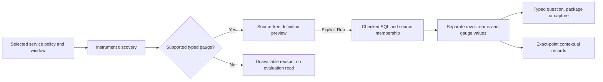

# Native gauge values under a checked environment policy

319 adds a bounded native path: service-bound, per-stream gauges can use the
existing versioned environment selector. The selected policy survives instrument
discovery, definition validation, SQL, source-row membership, evaluation, widget
questions, packages and captures. It never becomes a same-looking legacy name.

## What can be evaluated

| Definition | Supported path |
| --- | --- |
| Legacy named environment | Existing native families retain their current-key-only behavior. |
| Typed selector + service-bound per-stream gauge | Current-only named, effective named, effective empty and unreported. |
| Typed selector + counter, histogram, stock, state or lifecycle | Refused before source access. |
| Typed selector + host/pod/container resource binding | Refused before source access. |

Services retains the checked equivalent-name bridge for current-only scopes.
Other scopes advertise a `gauge-only` native capability. Discovery can report
unsupported instrument metadata with an explicit reason; it provides no executable
prototype for an unsupported family. These entries are not zero-valued gauges.

Environment membership follows [the shared precedence contract](SERVICE_ENVIRONMENT_POLICIES.md):
current-key presence wins, including present empty values; only an absent current
key permits legacy fallback. Unreported means neither key exists.

## Preserve the streams, not only their values

A current-key resource and a legacy-key resource remain different native streams,
even with the same service, instance ID, scope, metric, unit and attributes. Their
full raw resource maps and schema identity are retained. Selecting effective
`prod` can therefore return two gauge observations, such as 123 and 456 items. It
does not produce a sum, an average, a fleet value or a count of two items.

The existing native interface shows values with unit, endpoint, fixed question
window, read clock and quality. Raw environment keys distinguish otherwise similar
stream labels; structured details retain the complete identity. Unknown values,
missing observations and stale samples retain their existing meanings.

## Explicit reads and reusable questions

Use the existing service/instrument workflow. Planning or previewing a definition
is source-free; explicit Read/Run acquires values in the retained fixed window.
Existing overview and picker actions retain their documented acquisition ownership;
this adds no automatic read on opening a staged service or following a question.

Share and authored widget steps retain the selector in both scope and definition.
They must describe the same checked population. Native package YAML, revision
identity and capture scope/catalog metadata retain the typed gauge selection.
Returned questions detach caller selectors before source I/O and when retained.

The native-record-context planner and pure protocol preserve a gauge sample as
a single half-open nanosecond point,
`[atNS, atNS + 1)`, inside an enclosing millisecond query. It carries the policy,
reported service, namespace and instance; it does not infer lookaround, causality
or complete telemetry. The existing inspector still offers record navigation for
interval measurements, not a new gauge-point navigation button. Counter/histogram
typed context remains unsupported.

Deployment entities, entity-bound service annotations and service-bound view
libraries remain separate current-only named capabilities. This native read path
does not invent environment entities for empty or unreported populations.
