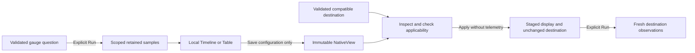

# Reuse native gauge displays

Implemented in milestone 386. See [validation](../VALIDATION.md) and the
[executable storyboard](../journeys/386-native-gauge-view-storyboard.md).

A saved native display is configuration, separate from measurement calculation
and captured observations. Gauge, histogram and counter displays share one immutable
`NativeView` API and one browser owner. They have different selection contracts:

| Measurement | Selection | Display kinds | Data meaning |
| --- | --- | --- | --- |
| Histogram | `export-interval` | Histogram, Table | Complete bins of one evaluated export distribution; not proof of complete upstream collection |
| Gauge | `retained-observations` | Timeline, Table | Recorded instantaneous samples, with observed, stale and unknown states; not continuous coverage |
| Counter | `evaluated-intervals` | Timeline, Table | Evaluated rates with gaps and reset boundaries; exact unit and domain applicability |

The [counter arm](NATIVE_COUNTER_VIEW_REUSE.md) adds explicit domain compatibility.

For a gauge, choose Timeline or Table, then save its display configuration. On a
compatible current gauge question, browse saved displays, inspect a candidate,
and apply it. Applying clears the displayed result and stages the configuration;
**Run measurement** explicitly reads the unchanged destination question.

## Destination authority

Reuse requires the same measurement family, exact instrument unit and supported
per-stream service grain. Current native measurement bindings require a nonempty
unit; missing/empty units are refused before save or apply. The entire destination
question wins: service,
namespace, environment policy, source identity and exact-stream selector,
attributes, fixed bounds, lookback and freshness policy. Donor resource identity,
values, selected observations, read clock, evidence basis and custody never
transfer. Gauge reuse refuses cross-family donors, resource bindings, stocks and
states. Counter-to-counter reuse uses its separate domain check in the same owner.

Switching Timeline/Table changes only the supplied-data projection. Gauge
freshness stays evaluated at the fixed question window end; reopening a stored
result does not age it against the wall clock. Missing/unknown is not zero, stale
is not healthy, and no line interpolates values between observations. The latest
200 retained samples are a display bound, not a source-completeness statement.
Unknown observations belong in a labelled rail outside the numeric domain,
retaining timestamp position without implying zero or the maximum value.
Gauge observations have timestamps rather than export intervals; histogram
interval and exemplar navigation do not acquire gauge authority.

## One configuration boundary

`POST /native-views` saves configuration, `GET /native-views` browses bounded
verified metadata, `GET /native-views/{id}` loads one immutable configuration, and
`POST /native-views/reuse` checks it against a complete destination question.
These routes do not read telemetry. Listing metadata cannot substitute for loading
and checking the artifact; table/unit alone cannot distinguish gauge and histogram
applicability. Summaries explicitly name measurement family and selection kind.

The closed `goo.view/1` declaration matches the validated question family. A gauge
uses `selection.kind: retained-observations`, `kind.name: timeline|table`, and
`display: {category: time, value: recorded-value, requiresComplete: false}`.
The explicit false is required; missing/null does not silently acquire that value.

The backing directory retains its existing private `native-histogram-views` name
so already saved artifacts keep their bytes and hashes. Public code, routes and
UI use the shared native-view contract; no legacy route aliases or parallel gauge
store are introduced. Specialized histogram projection/evaluation remains separate.
