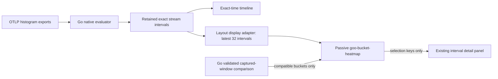

# Native histogram bucket heatmaps

Packages may additionally opt into [Go-evaluated fixed time buckets](HISTOGRAM_TIME_BUCKETS.md). The retained export-interval view described below remains available without aggregation.

Open an exact native histogram stream in Measurements, then expand **Bucket heatmap · compatible layouts**. The timeline retains exact time positions; the grid uses the latest 32 retained intervals as columns. Gaps do not become zero-count columns. Choose a supplied layout to inspect its native buckets, then select a cell to inspect that interval using the existing retained evidence panel.

The count scale is shared across all displayed evaluated intervals, including other layouts, so switching layouts cannot quietly rescale colors. Recorded zero is `0`, an unknown interval is `?`, and a known interval with another layout is a disabled `—`. Unknown intervals have no assigned layout. Layout identity includes unit and every explicit boundary; equal bucket counts alone never imply compatibility. Native bucket labels preserve open lower bounds and the unbounded tail. Colors show populations, not rates, interpolated percentiles, or normalized distribution shapes.

Captured-window comparisons retain the distribution-share chart as their main visual. A separate **Exact bucket populations · shared count scale** disclosure shows raw counts only when the Go comparison returned compatible buckets. Different layouts retain separate exact tables. Compare window duration and coverage before interpreting raw-count differences.

`goo-bucket-heatmap` is a framework-neutral display component. Supply `.data` or a JSON `data` attribute containing `title`, exact unsigned-string `ceiling`, `rows: [{key,label}]`, and `columns: [{key,label,cells}]`. Each cell has `state: observed | unknown | outside`; only observed cells carry an exact unsigned-string `value`. Up to 64 rows and 32 columns are accepted. Invalid input fails closed. Exact counts remain strings; only color geometry uses a bounded numeric ratio. No source reads, metric aggregation, layout inference, custody changes or question mutation occur in the component.

Selection is controlled through `.selectedCell = {columnKey,rowKey}` (or the corresponding `selected-column` / `selected-row` attributes). Native buttons emit bubbling `goo-heatmap-select` events with those keys. Unknown cells may be inspected; outside-layout cells are disabled. Updating selection preserves the focused button. The table has scoped row/column headers, a caption and an internally scrollable region capped at 360px. SSR attributes, detached properties and the standalone gallery use the same renderer.

Layouts exceeding 64 buckets are not truncated or merged: use the exact retained tables. Selecting an older timeline interval outside the latest 32 columns clears grid selection. No hidden historical fetch occurs. This is a retained-evidence view, not live streaming or an elapsed-time heatmap.

Validation: pure model/adapter cases in `tests/bucket-heatmap.test.js`; standalone browser contracts in journeys 79/80; real OTLP layout/zero/unknown/selection/mobile checks and saved-capture Bombadil action in journey 77; compatible/incompatible capture comparison checks in journey 54. Existing observed Quint traces continue to validate source-read and custody boundaries for those journeys.

## Executable storyboard

1. Run a native histogram measurement for one exact OTel stream. Expand the bucket heatmap and choose a supplied layout. Journey 77 injects real OTLP exports containing two different layouts, a recorded-empty interval, an unknown interval and a gap.
2. Select a zero-count cell: the interval inspector reports no observations and supplies no invented percentile. Select an unknown cell: the previous native bucket table disappears. Select the newer interval on the timeline: the layout picker follows its native boundaries without rereading the source.
3. On a narrow screen, scroll the bucket grid internally while the timeline and selected interval remain in the same frame. The exact table remains available below.
4. Compare two complete captured histogram windows. Journey 54 shows normalized distribution shares and a separate shared-count grid for compatible buckets. Its changed-layout case retains individual stored tables and offers no common grid.

[Desktop retained intervals](journeys/screenshots/77c-histogram-interval-bounds.png) · [Mobile retained intervals](journeys/screenshots/77d-mobile-native-timeline.png) · [Captured-window comparison](journeys/screenshots/54b-whole-window-histogram-buckets.png) · [Synthetic standalone component contract](journeys/screenshots/79-bucket-component-contract.png)
