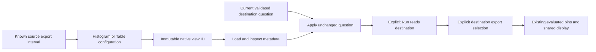

# Reusable native histogram displays — 371

Native histogram display configuration is separate from a measurement definition
and from captured evidence. In Measurements, select a known export interval,
open **Selected native bucket counts**, choose Histogram or Table, and **Save
interval display** with a title. Keep its **Native histogram view ID**.

For another validated measurement question, open the existing Save/share area,
load that exact ID and inspect its configuration. **Apply interval display**
preserves the entire current question and clears its previous result. **Run
measurement** explicitly reads the destination. Select an actual destination
export interval to display; applying never selects a donor or latest interval.

## Bounded contract

The supported question is a service-bound, per-stream explicit histogram in
exactly `s` or `ms`, without time buckets or resource-native bindings. Reuse
requires the same exact unit; it does not convert units. The complete destination
question survives, including environment policy, namespace, source attributes,
exact stream and nanosecond bounds. The declaration stores neither observations
nor selected interval, bin layout, counts, result basis or read clock.

The display requires complete bins for **one known evaluated distribution**.
That guarantee does not establish complete collection, fleet coverage or an
atomic source snapshot. Existing evaluation owns delta/cumulative temporality,
resets and layout changes. An unknown export says **Distribution unavailable**;
it cannot become an empty chart, zero observations or another interval.

Display changes leave the measurement calculation, SQL, parameters and package
revision unchanged. A native view ID names configuration, not a measurement
package revision or immutable telemetry receipt. Ordinary record templates still
refuse native measurement payloads. Saved/imported snapshots retain their
existing conservative authority; configuration supplies no completeness witness.

## API and ownership

The existing Go workbench store publishes a separate content-addressed family.
External routes are `POST /api/native-histogram-views`,
`GET /api/native-histogram-views/{id}` and
`POST /api/native-histogram-views/reuse` with `{id, question}`. Creation omits
`id`; reuse reloads the source by ID and returns an unsaved configuration without
an ID. All three routes operate on metadata, with no telemetry acquisition.
See the generated [OpenAPI specification](../api/openapi.json).

Current question, generation, visibility and action leases govern metadata
adoption. Editing the ID, replacing the plan, navigation or cancellation retires
pending actions. A late successful response cannot replace the current owner.
There is no catalog, mutable latest pointer, general editor or new evaluator.

Validation and actual storyboard frames are recorded in
[VALIDATION](../VALIDATION.md) and the
[journey](../journeys/371-native-histogram-reuse-storyboard.md).
