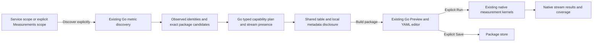

# Observed native instruments and HTTP duration hints

Implemented E1 discovery and typed-plan continuation in the existing Measurements surface,
including the existing service-to-discovery handoff. No manifest, goo annotations
or Go-specific instrumentation is required. The Go discovery adapter still owns
bounded source reads, supported bindings and exact package generation. It now also
supplies a versioned metadata capability plan and observed per-stream presence.
The browser presents that plan; it does not classify conventions independently.
This is metadata planning, not verification of metric values or time coverage.

## User flow

From a service, choose its metric-discovery continuation; environment, service,
optional namespace and fixed incident window are staged. Alternatively open
Measurements → Discover metrics from an application and choose a service and
environment for a fresh two-minute inventory. Press Discover explicitly.

The compact table shows instrument name, observed kind/unit/count and whether a
package can be previewed. Up to 25 identities appear per local page. More/Previous
appear only when needed; paging and Metadata and support disclosures read no
sources and publish nothing. The shared `goo-table` contains horizontal overflow
on narrow screens. Unknown or unsupported instruments remain visible.

Build measurement package sends the existing exact definition to the existing Go
preview validator. It does not execute or save a measurement. Preview canonicalizes
the editor to YAML. Run measurement performs a separate, explicit source read;
Save package revision and Capture evidence remain separate actions. A fixed service
handoff retains its window; a manually fresh discovery keeps the existing separate
package-lookback/preview-window behavior.

## Pinned HTTP hint

The rule set is [OpenTelemetry semantic conventions v1.30.0 HTTP metrics](https://github.com/open-telemetry/semantic-conventions/blob/v1.30.0/model/http/metrics.yaml):
`http.server.request.duration`, histogram, unit `s`. A matching name is an HTTP
**candidate**, not a conformance verdict. A wrong kind/unit is explained while
retaining any valid generic package binding; no conversion or schema migration
occurs. A matching schema URL is evidence of metadata only. Missing or other schema
URLs remain unverified rather than being silently upgraded.

The hints distinguish:

| Supplied information | Meaning |
| --- | --- |
| Name/kind/unit/schema and observed dimension keys | Bounded observed metadata; not declarations or complete coverage. |
| Go `supported` plus a supplied definition | Eligible for package preview under the existing kernels. |
| HTTP method/status key observed | A key appeared somewhere in this inventory, not on every record or export. |
| Successful Preview | Definition and source plan validated without telemetry execution. |
| Explicit Run | Existing kernels evaluate actual samples, exact streams, boundaries, reset/temporality and histogram coverage. Metadata hints remain labelled not evaluated; they do not acquire a verified badge. |

Missing status dimensions withhold an HTTP error-rate suggestion. Even when a status
key is observed, no error policy, denominator or error-rate view is invented.
Latency remains native histogram bucket ranges per compatible exact stream; request
rates and fleet percentiles are not inferred. An absent HTTP duration name is
reported as not observed in this bounded window, not as missing instrumentation.
Declared manifests continue to have their existing separate service inventory role.

## Ownership

`ui/instrument-capabilities.js` is a pure presenter for the Go capability plan.
It performs no reads, publication, convention classification, binding rewrites or
verification; unsupported/missing plan versions require another discovery. `ui/metric-discovery.js` owns only catalog presentation
and local paging, with Build passed back to the existing measurement owner.
Discovery cancellation, generation invalidation and namespace/scope handling remain
in `ui/measurements.js`. No component lifecycle starts a request.

## Executable storyboard

Journey 130 emits language-neutral OTLP for a manifest-free application: an HTTP
histogram in seconds, the same name in milliseconds, a custom job counter and a
non-monotonic sum. It stages service scope without reading, discovers all four,
explores metadata/refusals, previews the exact seconds binding without execution,
then runs once in the original fixed window. It checks no writes, no page overflow,
actual Go results through the existing Quint discovery replay and rejecting controls,
and disclosure-only Bombadil exploration. A supplied-catalog browser case checks
local paging, exact Build intent and zero API requests. Hegel exercises the actual
Go planner across kinds/units and exact-stream permutations without mutating supplied metadata.

## Remaining E1 scope

This does not complete E1. Typed metadata capability plans and observed per-stream
HTTP key presence are delivered. Temporal/value-validity coverage, verified
error/denominator policies, a database-pool or
messaging case and any supporting typed relations remain follow-up work. Existing
metric support limits (including unsupported non-monotonic sums and exponential
histograms) are not widened by presentation hints. No automatic dashboard or
persistent convention declaration is created by this cut.

## Typed server plan and observed stream presence

`POST /metric-discovery` now adds `capabilityPlan` to each instrument. Its version is
`goo/instrument-capability-plan/v1alpha1`; it retains `verification: not-run`.
The Go planner owns the pinned HTTP profile, generic fallback, shape/eligibility
and diagnostic text. The browser accepts this version without recomputing rules.
Old clients may ignore the additive field; new clients disable Build when no
supported plan is supplied. Request semantics and generated definition IDs remain
unchanged. [OpenAPI](API.md) contains the reflected response types.

The same bounded source query now retains resource/attribute identity and resource
schema URL. Exact streams remain separate across resource, attributes, scope,
version, schema, name and unit; their IDs are scoped to their parent instrument
kind/temporality. Missing and empty instance IDs remain distinct diagnostics.
The HTTP profile watches method/status keys and reports present-nonempty, empty
and missing stream counts. Generic instruments retain stream identity inspection
without inheriting HTTP assumptions. A union of keys no longer hides a missing key
on another stream. Duplicate observations increase record counts, not stream counts.

Only the first 25 sorted streams per instrument are displayed, with an explicit
omitted count; presence totals use all streams in the bounded read. Legacy source
fixtures without resource/attribute metadata report unavailable presence rather
than fabricated counts. The original 10,000-row/8 MiB source budgets and overflow
refusal remain. No extra source query is made. Presence is not interval continuity,
valid attribute values, error classification, conformance or fleet comparability.

Journey 131 ingests three HTTP streams with differing present/empty/missing keys
and one missing instance ID. It checks all three states, exact identity, duplicate
observation counts, disclosure-only browsing and mobile containment. Its observed
Quint trace compares the actual server plan against independent ClickHouse identity
rows and rejects seven mutations (counts, identities, eligibility, effects and extra
reads). Go unit tests and Hegel cover permutation stability, exact bindings, aliasing,
missing/empty identity and the 25-stream display cap without changing totals.

