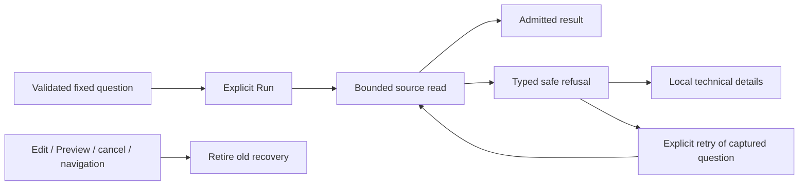
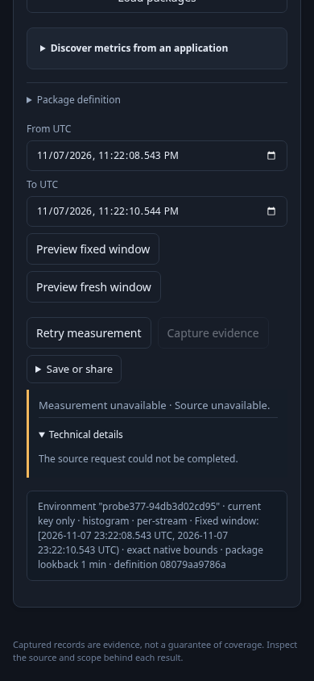
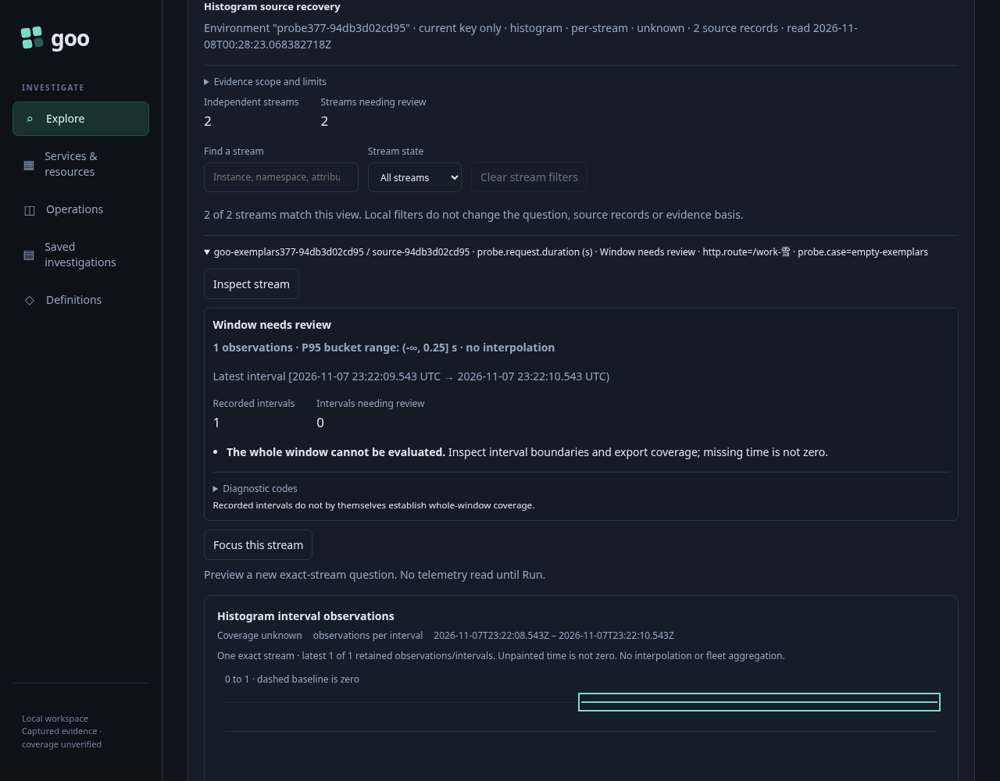

# Native measurement refusal and recovery

Status: delivered (378), with Go/UI/API, native browser/actor and recorded-model
checks passing. See [validation](../VALIDATION.md).

Measurements uses the same structured source refusals as other source owners.
Timeout, cancellation, bounded-read failure, malformed source data and source
unavailability remain distinct. The concise reason is visible; safe technical
details are disclosed locally without reading telemetry. Raw upstream error text,
SQL, source addresses and credentials are not displayed.

## One explicit recovery action

After a retryable source failure, **Retry measurement** replaces Run as the primary
action. It reads the exact failed question again: definition, typed environment,
namespace, fixed millisecond/nanosecond bounds and selected native display intent.
It does not recompute a lookback, widen the scope or promise the next read succeeds.
Users can edit and Preview a different question explicitly instead. A successful
read may still return unknown or no-data measurement coverage; it does not declare
the application healthy.

Retry is retired by edits, Preview, display replacement, cancellation or navigation.
Old, hidden, detached, disabled and inert controls cannot read. Returning to the
surface does not renew a retired callback. During a retry, Run is disabled and
Cancel remains available; a new failure gets a new retry control. Cancellation
has no Retry action. Capture remains disabled until a successful result is admitted.

Keyboard focus follows recovery when the user has not moved elsewhere: Run failure
to Retry, repeated failure to the replacement Retry, successful Retry to the new
result heading. Late package-list failures cannot overwrite a newer source read,
refusal or result. Catalog-owned status remains separate.

## Backend boundaries

The bounded native reader classifies local 8 MiB/10,000-row limits as budget
refusals. Non-200 upstream status is unavailable before reading its body. Transport
and body failures retain their causes, including cancellation and timeout identity.
JSONEachRow requires complete JSON objects; invalid source records and non-lifecycle
post-acquisition evaluation failures are malformed. No partial result is published.

Question validation and compilation remain outside source-protocol classification.
Lifecycle custody/storage failures retain their existing separate meaning; a
filesystem error is not mislabeled as malformed telemetry. Optional exemplar
metadata retains its independent unavailable state and does not corrupt otherwise
valid numeric histogram evaluation.

The reader uses `bytes.Lines` over the already bounded response instead of a second
Scanner buffer. Numeric semantics, source settings, scopes, limits and public wire
shapes remain unchanged. The implementation reuses existing failure and display
helpers without adding dependencies or another retry manager.

The [executable storyboard](../journeys/378-native-recovery-storyboard.md) reuses
retained real OTLP data and plants only source failures. Successful recovery and
late-success tests use actual Go/ClickHouse responses, with no invented telemetry.
See [validation](../VALIDATION.md) for completed checks and remaining acceptance.

