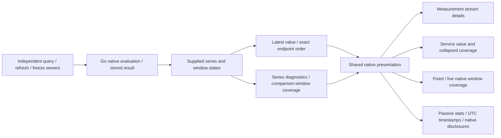

# Native values and coverage

`GooNativePresentation` presents supplied native results across measurement details,
service native summaries and fixed/live native-window comparisons. It has no source
client, query lifecycle, capture ownership or evidence clock. The Go evaluators still
own native temporality, reset/gap handling, freshness and whole-window validity.

The pure presenter retains two distinct views:

- `latest(series, kind)` selects the latest supplied endpoint/interval by exact
  nanosecond order. A newer invalid interval never falls back to an older valid
  value. Observed zero remains zero; a recorded latest interval may coexist with a
  whole window needing review. Gauges retain fixed-evaluation freshness. Histogram
  values retain bucket-bound P95 ranges and the original unit, without interpolation.
- `streamDiagnostics` describes the supplied series state, recorded/review counts
  and diagnostic codes. `windowCoverage` describes one validated comparison window,
  including missing exact streams. An unknown window with no reasons does not become
  validated coverage. Export coverage is not ingestion completeness or service health.

The existing exact rational-rate formatter and diagnostic explanations also live
here. Public `GooMeasurements` diagnostic functions, `GooServiceDashboard.nativeSummary`
and `GooLiveComparison.rateText` delegate for compatibility. Service summaries keep
their four-stream display limit; measurement paging and evaluator inputs are unchanged.

## Shared display

Full measurement stream details show the latest supplied value and UTC endpoint or
interval alongside the same coverage counts and explanations used by service rows.
Services keep coverage details collapsed in the existing Coverage column; opening
them does not read telemetry. Narrow service tables use the existing labelled-row pattern so values and expanded coverage remain together without horizontal scrolling. Fixed/live window comparisons share UTC bounds with
exact nanoseconds in timestamp tooltips and the same diagnostic explanations.

`native-presentation.css` owns these display styles, separate from product page and
table layout. The presenter composes existing framework-neutral stats, timestamp and
native disclosure primitives; it is an application presenter, not a new custom element.
Source reads, baselines, refresh/freeze, native identity, links and custody remain in
their existing owners. No component lifecycle or coverage disclosure reads telemetry.

## Validation boundaries

Journey 59 inspects service coverage locally on desktop/mobile. Journey 54 checks
comparison bounds and exact timestamp tooltips. Native navigation/timeline, service
instrument selection and live-counter journeys protect the surrounding source and
custody protocols. Updated service/native-window Bombadil invariants exercise the
shared coverage without new read actions.

Unit checks distinguish latest values from whole-window validity. A generated Hegel
campaign varies interval states/order at nanosecond precision, checks zero versus
unavailable and non-mutation, and rejects invented coverage. Existing counter and
histogram state/swarm and native-window properties protect evaluator contracts;
existing Quint/quint-go ledgers check observed accounting/state, not an exhaustive
model of all native UI composition. See [actual results](../VALIDATION.md).

Other native aggregate layouts, arbitrary composition, fleet discovery and durable
catalog/navigation work remain separate. This cut does not add new native math,
interpolate bucket bounds or combine scalar percentiles.
