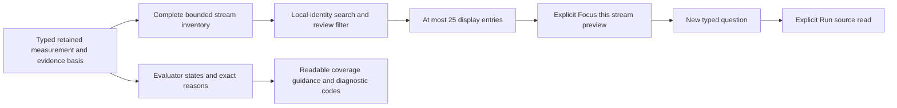

# Browse native streams and understand coverage

Native measurement results and saved evidence now have **Find a stream** and
**Stream state → Needs review** controls. They search the complete bounded
retained inventory, including resource and point keys/values, schema URLs,
namespace, scope and instance. Stream pages remain capped at 25. Searching or
changing state resets the page; Clear returns to all retained streams. An empty
search result is explicitly different from a measurement with no captured data.

These are local display controls. They perform no source reads, do not revise
the question or change its source record count, and do not define fleet totals.
The original window, read time and evidence basis remain visible and unchanged.
Top-level stream and review counts describe the full retained inventory. The
feedback separately reports how many streams match the local view. Cached outer
stream disclosures retain their open state across filtering and pagination.
Local filters and cached disclosure state last for the current rendered result;
they are not part of shared questions or saved evidence. Nested value components
keep their existing update/lifecycle behavior.

**Focus this stream** remains the explicit boundary into a new typed source
binding: it previews a new question without reading telemetry, and Run is a
separate action. See [exact stream selection](EXACT_STREAM_SELECTION.md).

## Coverage explanations

Display labels and guidance come from existing typed evaluator states and reason
codes. No coverage or rates are recalculated by the browser. Counter/histogram
`ok` labels are **Window covered**; gauges label the latest observation rather
than claiming continuous window coverage. **Needs review** includes streams with
unknown/stale/no-data state or observations flagged by the evaluator, including
older flagged gauge samples even when the latest sample is recorded.

Per-stream diagnostic stats count retained interval/sample states, not requests
or fleet rates. A recorded zero remains observed. An unknown state without a
specific interval reason receives a conservative incomplete-window explanation;
it does not invent the location or cause of missing exports. Source reason codes
remain in **Diagnostic codes**, alongside readable guidance for boundaries,
incomplete coverage, resets, epoch changes, stale exports, absent values and
histogram layout changes. Unrecognized codes remain exact and use neutral advice.

The same reason presenter explains why a live counter comparison is unavailable.
It does not hide gaps, change the fixed window, choose an older healthy export,
or turn missing values into zero. Native measurements and comparisons retain all
existing semantic and custody rules. A covered historical window is not proof of
application health or ingestion completeness.

Journey74 ingests 28 real OTel streams, including a partial window and a crossing
boundary beyond the first page. It verifies local page/review/search/empty/clear
flows, cached disclosure state, mobile bounds, no telemetry reads, unchanged
question/basis, focus preview and immutable reopen. The observed Quint projection
has nine rejecting mutations. Bombadil drives review, empty search, identity
search, reset and next page with bounds, predicate and retained-basis invariants.
Existing journey72 checks human-readable live gap explanations; journey73 retains
exact source isolation and freeze/reopen coverage. The Hegel exact-stream state
property continues to exercise the unchanged source binding contract.
