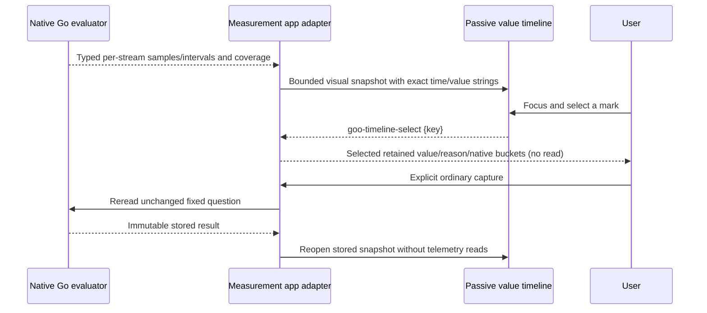

# Native measurement timelines

Implemented in ordinary measurement results and stored measurement captures. The
same renderer is reused by expanded native service results and investigation
evidence. No manifest, new evaluator or telemetry read is required to inspect
retained points. Each chart belongs to one complete OTel stream identity.

## What the marks mean

- Gauges are independent samples. Signed values and recorded zero remain visible;
  dots are never joined. Muted marks retain evaluator-classified stale samples as
  historical observations. A newer unknown sample is initially selected and
  unavailable; the view does not substitute an older valid value.
- Counter segments show the Go kernel's evaluated `perSecond` for that interval.
  Reset, epoch, excessive-gap and other unknown intervals have hatched question
  bands with no numeric value. The browser never subtracts counters, computes a
  rate or repairs an epoch. The existing floating interval-rate representation is
  unchanged; exact rational whole-window comparison remains a separate workflow.
- Histogram segments show **observations per interval**, not a percentile or rate.
  Select an interval to inspect its own native bucket counts and P95 bucket range.
  Open-ended bounds remain open, zero observations have no percentile, and bucket
  layouts from different intervals are never combined or aligned by position.
  Selecting an unknown interval removes prior bucket details instead of reusing them.

Time coordinates use exact nanosecond bounds. Primary labels show UTC; the
selection's **Exact timestamp bounds** disclosure retains full nanoseconds.
Interval lengths remain visible on the fixed time axis. Unpainted time is not
filled with zero, joined or evaluated by the browser; whole-window coverage still
comes from the native kernel and the existing stream diagnostics.

Numeric geometry includes zero and preserves exact decimal/integer strings,
including scientific notation and counts above JavaScript's safe integer limit.
Only bounded visual ratios become `Number`. The dashed baseline is zero; an
all-unknown snapshot has no numeric scale. Domains are local to each stream's
retained visual snapshot and are labelled explicitly; these charts do not claim
an aligned cross-stream comparison or a fleet aggregate.

The timeline and exact table show at most the latest 200 retained observations or
intervals. The chart reports the retained total and visible count. This limit does
not revise evaluation, source counts, capture input, question or evidence basis.
Native stream search/review/paging retains the existing local navigation contract.
Charts are built when their outer stream disclosure first opens, so unopened
streams do not eagerly create hundreds of controls.

## Interaction and custody

Mouse or keyboard selection updates an application-owned detail panel over the
same retained result. It performs no source request, changes no question bounds,
and creates no capture or new evidence basis. Unknown intervals show the existing
human-readable diagnostic guidance with exact codes available in disclosure.
Native observation and bucket tables reuse the passive shared table shell.

**Focus this stream**, Run, sharing, ordinary capture and immutable reopen keep
their existing explicit boundaries. Selecting a mark is not a request to trim or
rerun a measurement: cumulative intervals may need a predecessor, and uncovered
windows must not be silently manufactured as complete questions. Live polling,
SSE and live gauge/histogram evaluation remain outside this milestone.



## Framework-neutral component

`goo-value-timeline` is display-only, with styles in `ui/value-timeline.css`. A
server may supply a JSON `data` attribute; an SPA may assign `.data` before or
after registration/connection. Getters and setters detach values. The component
accepts at most 256 supplied points and fails closed for invalid time bounds,
duplicate keys, unsupported states or ambiguous missing numeric values.

```html
<goo-value-timeline aria-label="Supplied observations"
  data='{"fromNS":"0","toNS":"100","points":[{"key":"zero","fromNS":"50","toNS":"50","state":"observed","value":"0","label":"Recorded zero"}]}'></goo-value-timeline>
```

Each point supplies `key`, `fromNS`, `toNS`, `label`, and `state` (observed, stale,
unknown or no_data). Observed/stale points require a decimal string `value`;
unknown/no_data points carry no scalar value. Equal bounds denote an independent
sample. `.selectedKey` / `selected-key` is caller-controlled; activating a native
button emits a bubbling `goo-timeline-select` event with `{key}`. Updating selection
preserves the focused mark and does not replace its DOM. Updating the complete
snapshot rerenders marks. The component owns no subscriptions, telemetry fetches,
question navigation, bucket evaluation or evidence storage. Compose it inside
`goo-chart-frame` for title, units, fixed-window state and notes.

The labelled synthetic example in `/ui-components` is separate from the real OTLP
application storyboard. Journey78 verifies server HTML, detached upgrade,
reactive empty results, getter detachment, mobile bounds and keyboard control.
Journey77 verifies actual gauge/counter/histogram evidence, local selection,
changed histogram bounds, reset/unknown preservation, capture and source-free
reopen. Its observed Quint ledger has nine rejecting controls; Bombadil exercises
unknown, observed-empty and native-bucket inspection over the saved capture.
